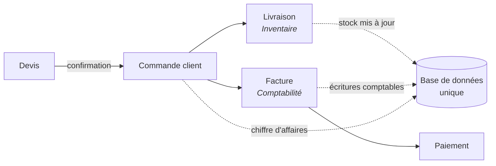
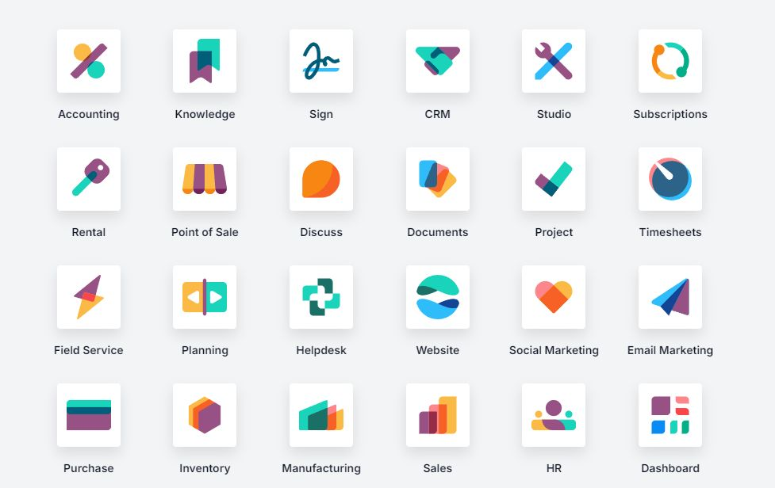
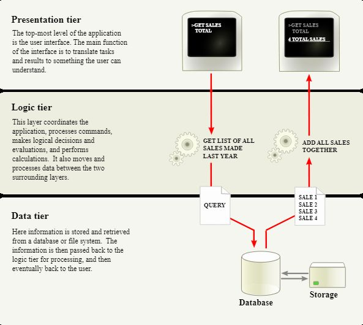

# Chapitre 1 — Introduction

[⬅ Sommaire](../README.md) · [Chapitre 2 ➡](02-installation.md)

## Objectifs

À la fin de ce chapitre, vous savez :
- expliquer ce qu'est un ERP et en quoi il diffère d'une application spécifique ;
- citer les grands modules d'un ERP et les flux qui les relient ;
- décrire l'architecture technique d'Odoo et ses modes d'hébergement ;
- naviguer dans Odoo et suivre un flux de vente complet.

---

## 1. Organisation du cours

Chaque séance se déroule en deux parties :

| Partie | Durée | Contenu |
|---|---|---|
| **Projet ERP** | 1h | Fausse rencontre client, état d'avancement, vérification GitHub et storyboard |
| **Approche théorique et pratique** | 3h | Concepts Odoo, exercices techniques et fonctionnels |

### Ce que vous devez apprendre

| Aspect fonctionnel | Aspect technique |
|---|---|
| Comprendre le rôle des logiciels métiers (CRM, comptabilité, stock…) | Utiliser une plateforme ou un framework existant |
| Identifier les besoins métiers réels, pas seulement techniques | **Adapter des solutions existantes plutôt que coder from scratch** |
| Analyser les processus et les flux d'information entre départements | Déployer, configurer et intégrer des modules |
| Comprendre les contraintes et objectifs des utilisateurs finaux | Comprendre comment la technique soutient le métier |

---

## 2. Qu'est-ce qu'un ERP ?

Un **ERP** (*Enterprise Resource Planning*), ou **PGI** (progiciel de gestion intégré) en français,
est un logiciel qui gère l'ensemble des processus d'une entreprise en intégrant toutes ses fonctions :

| Fonction | Exemples |
|---|---|
| Ventes et CRM | Prospects, devis, commandes clients |
| Achats et stock | Commandes fournisseurs, réceptions, inventaire |
| Comptabilité et finance | Factures, paiements, déclarations TVA |
| Production | Nomenclatures, ordres de fabrication |
| Ressources humaines | Employés, congés, notes de frais |
| Aide à la décision | Tableaux de bord, rapports, indicateurs |

Le mot important est **intégré** : toutes ces fonctions partagent **la même base de données**.
Quand un commercial confirme une commande, le magasinier voit la livraison à préparer
et le comptable voit la facture à émettre. Personne ne ressaisit rien.

*Le flux « de la commande à l'encaissement » (quote to cash) : un seul document de départ, quatre départements concernés.*

### ✍️ À vous — Exercice 1.1

**Suivre un flux de vente complet.**
Ouvrez la base de démonstration **[demo.odoo.com](https://demo.odoo.com)** (aucun compte requis).

1. Dans **Ventes**, créez un devis pour un client existant, avec deux produits stockables.
2. Confirmez le devis. Quel bouton apparaît en haut à droite du formulaire ?
3. Ouvrez la **livraison** liée et validez-la.
4. Revenez sur la commande, créez la **facture** et confirmez-la.
5. Enregistrez le **paiement** de la facture.

**Pour vérifier :**
- [ ] La commande affiche une livraison et une facture (boutons intelligents en haut à droite).
- [ ] La facture est au statut « Payé ».
- [ ] Vous savez dans quelle application se trouve chaque document.

💡 Indice : je ne trouve pas la livraison

Après confirmation, un bouton **Livraison** apparaît en haut à droite du formulaire de commande.
Il n'apparaît que si au moins un produit est suivi en inventaire (type « Marchandise » avec suivi du stock).

💡 Indice : je ne trouve pas le bouton pour facturer

Le bouton **Créer une facture** dépend de la politique de facturation du produit.
Si elle est sur « Quantités livrées », il faut d'abord valider la livraison.

👉 [Réponse commentée](../reponses/01-introduction.md#exercice-11)

---

## 3. ERP intégré ou application spécifique ?

| | ERP intégré | Application spécifique |
|---|---|---|
| **Définition** | Un seul logiciel pour tous les modules | Un logiciel pour un besoin précis (paie, flotte, marketing…) |
| **Avantages** | Données centralisées, pas de doublons · processus fluides entre départements · vision globale en temps réel | Spécialisation pointue · mise en place rapide · souvent plus simple |
| **Limites** | Plus complexe à déployer · moins flexible pour un besoin très spécifique | Données isolées, risque de duplication · intégration avec les autres systèmes parfois complexe |

**ERP du marché :** SAP · Oracle ERP Cloud · Microsoft Dynamics 365 · Sage X3 · **Odoo** · Infor · NetSuite · Workday · Epicor · IFS

### Réussir un projet ERP

| Étape | Points d'attention |
|---|---|
| **Sélection** | Adéquation fonctionnelle, hébergement (SaaS ou On-Premise), coût total de possession (TCO), pérennité de l'éditeur |
| **Anticipation** | Éviter les **développements spécifiques inutiles**, le sous-dimensionnement des ressources, les données non nettoyées |
| **Adoption** | Conduite du changement, formation continue, utilisateurs clés (*key users*) impliqués |
| **Synthèse** | Aligner le système d'information sur les objectifs métier |

> 💡 Le piège n°1 d'un projet ERP : **développer ce qui existe déjà en standard.**
> Chaque ligne de code spécifique devra être maintenue et migrée à chaque nouvelle version.

---

## 4. Odoo

Odoo est une suite d'applications open source qui couvre l'ensemble des besoins d'une entreprise.
Toutes les applications communiquent nativement entre elles.

### ✍️ À vous — Exercice 1.2

**Découvrir un module inconnu.**
Choisissez dans la base de démo une application que vous n'avez **jamais** ouverte
(Fabrication, Projet, Helpdesk, Location, Abonnements, Point de vente…). En 15 minutes, trouvez :

1. À quel besoin d'entreprise elle répond.
2. Les 2 ou 3 objets principaux qu'elle manipule (ex. pour Projet : projet, tâche, feuille de temps).
3. Un lien avec une autre application (ex. une tâche créée depuis une commande de vente).

Préparez une explication de 2 minutes pour le reste de la classe.

👉 [Exemple de réponse](../reponses/01-introduction.md#exercice-12)

---

## 5. Architecture technique

Odoo est construit en **trois couches** :

| Couche | Technologie | Rôle |
|---|---|---|
| Présentation | HTML / CSS / JavaScript | Interface web, rendu visuel |
| Logique | **Python** | Règles métier, calculs, traitements |
| Données | **PostgreSQL** | Stockage, requêtes |

Odoo est une **application web** : on l'utilise depuis un navigateur, sur ordinateur, tablette ou smartphone.
Aucune installation n'est nécessaire côté utilisateur, et la maintenance se fait sur le serveur.

### Modèle open core

| | Licence | Contenu |
|---|---|---|
| **Community Edition** | LGPLv3 (open source) | Le noyau et les fonctionnalités fondamentales |
| **Enterprise Edition** | Propriétaire | Applications avancées, hébergement, support |
| **Modules communautaires** | LGPLv3 ou AGPLv3 | Modules développés par la communauté (ex. [OCA](https://github.com/OCA)) |

### Modes d'hébergement

| | Odoo Online (SaaS) | On-Premise | Odoo.sh (PaaS) |
|---|---|---|---|
| Hébergement | Cloud Odoo | Votre serveur | Cloud Odoo, flexible |
| Installation | Prêt à l'emploi | Manuelle | Déploiement auto via Git |
| Mises à jour | Automatiques | Manuelles | Automatiques sur branche stable |
| Modules personnalisés | ❌ Non | ✅ Oui | ✅ Oui |
| Maintenance, sauvegardes | Incluses | À gérer soi-même | Incluses |
| Accès au code | ❌ | ✅ | ✅ (dépôt Git) |

### ✍️ À vous — Exercice 1.3

**Conseiller un client.** Pour chaque client, quel mode d'hébergement recommandez-vous, et pourquoi ?

1. Une boulangerie de 3 personnes qui veut gérer ses ventes et sa comptabilité, sans informaticien.
2. Une PME de 80 personnes qui a besoin de deux modules développés sur mesure, sans équipe serveur.
3. Une administration publique qui exige que les données restent sur ses propres serveurs.

👉 [Réponse commentée](../reponses/01-introduction.md#exercice-13)

---

## Questions de compréhension

1. Quelle est la différence principale entre un ERP et une application spécifique ?
2. Pourquoi dit-on que les développements spécifiques sont un piège dans un projet ERP ?
3. Quelles sont les trois couches techniques d'Odoo, et quelle technologie pour chacune ?
4. Un client veut développer ses propres modules. Quel(s) mode(s) d'hébergement pouvez-vous lui proposer ?
5. Dans le flux de l'exercice 1.1, quelles applications Odoo sont intervenues ?

---

[⬅ Sommaire](../README.md) · [Chapitre 2 ➡](02-installation.md)
