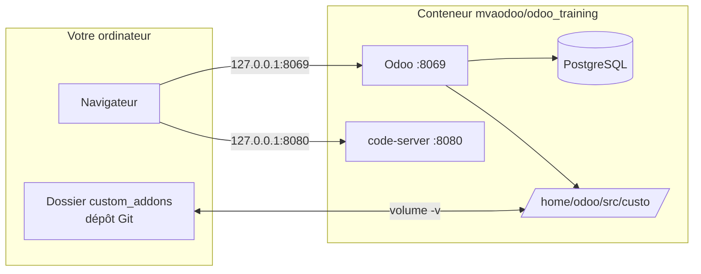
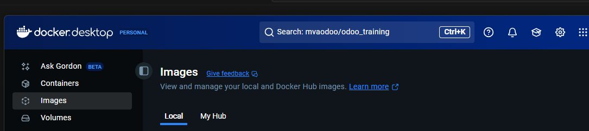
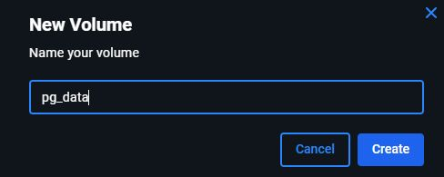
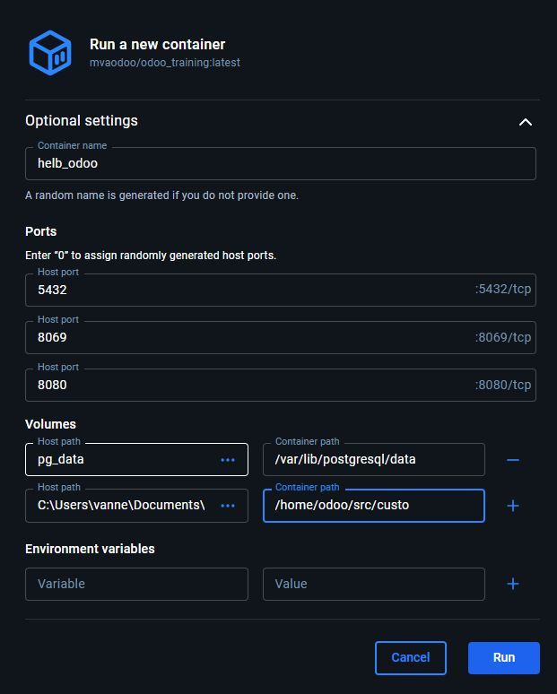
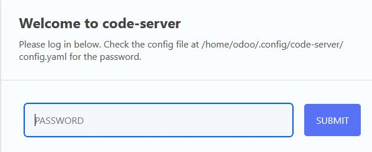
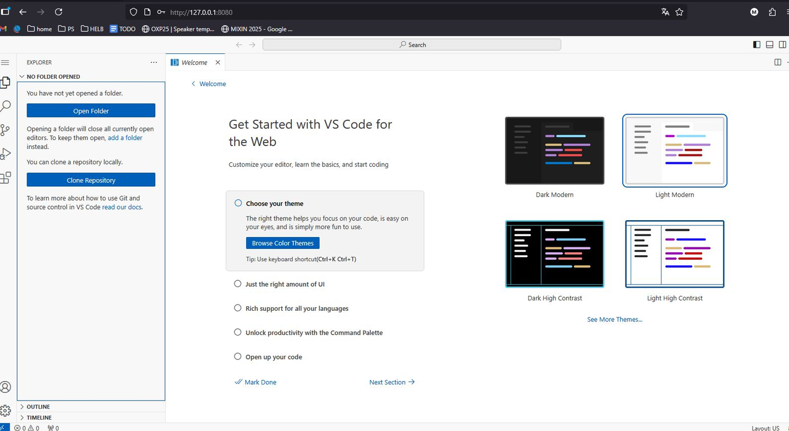
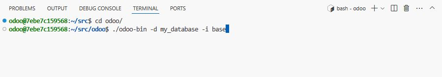
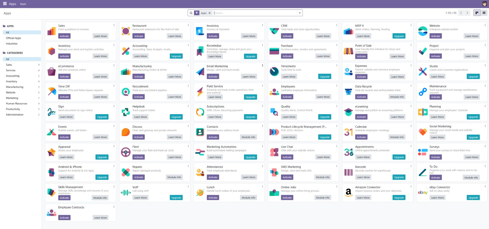
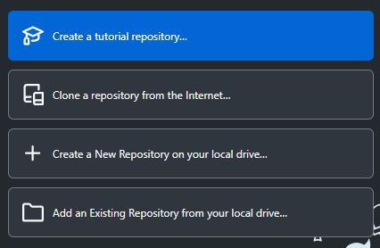
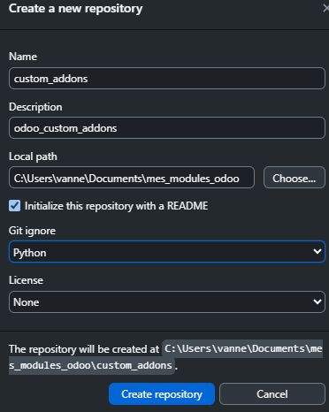

# Chapitre 2 — Installation

[⬅ Chapitre 1](01-introduction.md) · [Sommaire](../README.md) · [Chapitre 3 ➡](03-premier-module.md)

## Objectifs

À la fin de ce chapitre, vous savez :
- installer et lancer Odoo 18 (via Docker ou en local sous Linux) ;
- vous connecter à Odoo dans le navigateur ;
- créer le dépôt Git qui contiendra vos modules.

Choisissez **une** des deux méthodes : **Docker (recommandé)** ou **installation locale sous Linux**.

---

## Méthode A — Docker (recommandé, Windows / macOS / Linux)



*Vos modules vivent sur votre ordinateur et sont partagés avec le conteneur. Si le conteneur est supprimé, vos fichiers restent.*

### 1. Installer Docker Desktop

1. Téléchargez Docker Desktop : <https://www.docker.com/products/docker-desktop>
2. Lancez l'installateur et gardez les options par défaut.
3. Sous Windows, Docker a besoin de **WSL 2**. S'il n'est pas installé, Docker vous le proposera : suivez les instructions.
4. Redémarrez si demandé, puis lancez Docker Desktop. L'icône 🐳 apparaît dans la barre de notification.

### 2. Récupérer l'image du cours

Dans Docker Desktop, cherchez l'image **`mvaodoo/odoo_training`** et téléchargez-la (*Pull*).



### 3. Lancer le conteneur

**Avec l'interface de Docker Desktop :**

1. Créez un volume nommé `pg_data` (il conserve la base de données PostgreSQL).

   

2. Lancez l'image (*Run*) avec ces options :
   - nom du conteneur : `helb_odoo` ;
   - ports : `8069` (Odoo) et `8080` (éditeur de code) ;
   - volumes : `pg_data` → `/var/lib/postgresql/data`, et votre dossier `custom_addons` → `/home/odoo/src/custo`.

   

**Ou en ligne de commande** (équivalent) :

```bash
docker run -it -d \
  --name helb_odoo \
  -v <CHEMIN_VERS_custom_addons>:/home/odoo/src/custo \
  -p 8069:8069 -p 8080:8080 \
  mvaodoo/odoo_training
```

- `-v` relie un dossier de votre ordinateur au dossier `/home/odoo/src/custo` du conteneur.
  **Vos modules doivent être dans ce dossier.**
- `-p` ouvre les ports : `8069` pour Odoo, `8080` pour l'éditeur de code.

Pour ouvrir un terminal dans le conteneur : `docker exec -it helb_odoo /bin/bash`

### 4. Ouvrir l'éditeur de code

1. Allez sur <http://127.0.0.1:8080>. Mot de passe : `odoo`.

   

2. **Open Folder** → choisissez `/home/odoo/src` → cochez *« Yes, I trust the authors »*.

   

3. Ouvrez le terminal intégré avec `Ctrl + J`.

### 5. Lancer Odoo

```bash
cd odoo/
./odoo-bin -d my_database -i base
```



- `-d my_database` : le nom de la base de données (elle est créée si elle n'existe pas).
- `-i base` : installe le module de base lors du premier lancement.

Ouvrez <http://127.0.0.1:8069> et connectez-vous avec **admin / admin**.
Vous arrivez sur la liste des applications :



Pour arrêter le serveur : `Ctrl + C` dans le terminal.

---

## Méthode B — Installation locale (Linux Debian / Ubuntu)

Documentation officielle : [Installation depuis les sources](https://www.odoo.com/documentation/18.0/fr/administration/on_premise/source.html)

```bash
# 1. Récupérer les sources (seulement la version 18, sans l'historique)
git clone https://github.com/odoo/odoo.git --depth 1 --branch 18.0

# 2. Vérifier la version de Python (3.10 minimum)
python3 --version

# 3. Installer PostgreSQL et créer un utilisateur à votre nom
sudo apt install postgresql postgresql-client
sudo -u postgres createuser -d -R -S $USER

# 4. Installer les dépendances Python dans un environnement virtuel
sudo apt install python3-pip python3-venv libldap2-dev libpq-dev libsasl2-dev
cd odoo
python3 -m venv .venv && source .venv/bin/activate
pip install -r requirements.txt

# 5. Lancer Odoo
./odoo-bin -d ma_base -i base
```

Ouvrez <http://127.0.0.1:8069> et connectez-vous avec **admin / admin**.

---

## Créer votre dépôt Git

Vos modules vivent dans un dépôt Git à part, **jamais dans les sources d'Odoo**.

Avec [GitHub Desktop](https://desktop.github.com/download/) :

1. Connectez votre compte GitHub (créez-en un si nécessaire).
2. **Create a New Repository on your local drive** :

   

3. Remplissez :
   - Name : `custom_addons`
   - Local path : le dossier monté dans Docker
   - Cochez *Initialize this repository with a README*
   - Git ignore : **Python**

   

4. **Create repository**, puis **Publish repository**.
   ⚠️ Gardez la case **Keep this code private** cochée : votre dépôt doit être **privé**.
5. Sur GitHub, ouvrez votre dépôt → **Settings → Collaborators → Add people**
   et invitez votre professeur (son nom d'utilisateur GitHub vous sera donné au cours).

> Votre dépôt est privé pour que votre travail reste le vôtre. Le professeur y a accès pour suivre
> votre avancement : il regarde vos commits, pas seulement le résultat final.

En ligne de commande, c'est équivalent à :

```bash
mkdir custom_addons && cd custom_addons
git init
echo "__pycache__/" > .gitignore
git add . && git commit -m "Initial commit"
```

---

### ✍️ À vous — Exercice 2.1

**Environnement opérationnel.** Installez Odoo avec la méthode de votre choix et créez votre dépôt `custom_addons`.

**Pour vérifier :**
- [ ] <http://127.0.0.1:8069> affiche la page de connexion d'Odoo.
- [ ] Vous êtes connecté en tant qu'admin.
- [ ] Votre dépôt `custom_addons` existe sur GitHub, il est **privé**, et le professeur y est invité.
- [ ] Un fichier créé dans `custom_addons` sur votre machine apparaît dans le conteneur, dans `/home/odoo/src/custo`.

<details><summary>💡 Indice : « port is already allocated »</summary>

Un autre programme utilise déjà le port 8069 ou 8080 (souvent un ancien conteneur).
Listez les conteneurs avec `docker ps -a` et arrêtez l'ancien avec `docker stop <nom>`.
</details>

<details><summary>💡 Indice : « role does not exist » (installation locale)</summary>

L'utilisateur PostgreSQL à votre nom n'existe pas. Relancez `sudo -u postgres createuser -d -R -S $USER`.
</details>

👉 [Réponse commentée](../reponses/02-installation.md#exercice-21)

### ✍️ À vous — Exercice 2.2

**Installer une application.** Dans Odoo, allez dans **Apps** et installez **Ventes**.

1. Quelles autres applications sont apparues dans le menu principal ?
2. Pourquoi ?

👉 [Réponse commentée](../reponses/02-installation.md#exercice-22)

---

## Questions de compréhension

1. Que fait l'option `-d` de `odoo-bin` ? Et l'option `-i` ?
2. Pourquoi vos modules ne doivent-ils pas se trouver dans le dossier des sources d'Odoo ?
3. Avec Docker, que se passe-t-il pour vos fichiers si vous supprimez le conteneur sans avoir monté de volume ?

---

[⬅ Chapitre 1](01-introduction.md) · [Sommaire](../README.md) · [Chapitre 3 ➡](03-premier-module.md)
