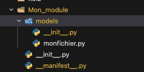
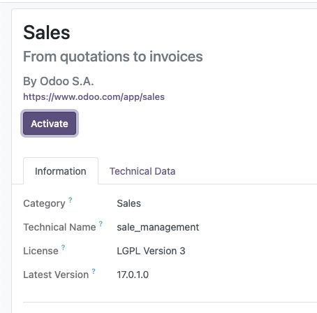
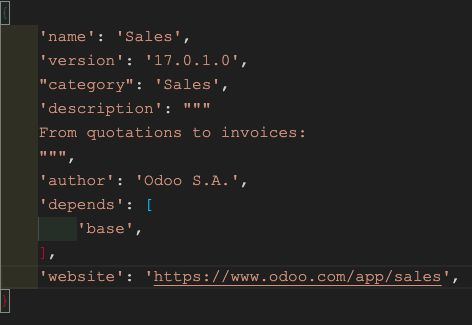
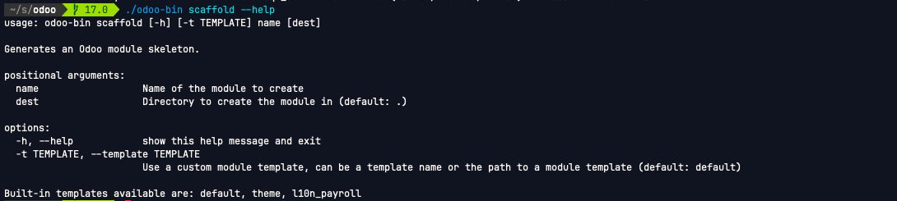
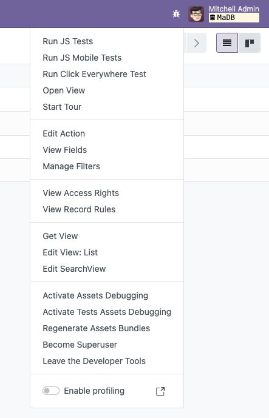
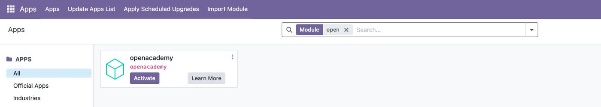
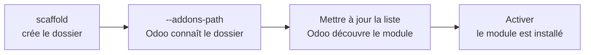

# Chapitre 3 — Mon premier module

[⬅ Chapitre 2](02-installation.md) · [Sommaire](../README.md) · [Chapitre 4 ➡](04-modeles.md)

## Objectifs

À la fin de ce chapitre, vous savez :
- décrire la structure minimale d'un module Odoo ;
- générer un module avec `odoo-bin scaffold` ;
- indiquer à Odoo où trouver vos modules (`--addons-path`) ;
- activer le mode développeur et installer votre module.

---

## 1. Structure d'un module

Un module Odoo est un **dossier** qui contient au minimum deux fichiers :



| Fichier | Rôle |
|---|---|
| `__init__.py` | Importe le code Python du module |
| `__manifest__.py` | Décrit le module : nom, version, dépendances, fichiers à charger |

Un module complet ressemble à ceci :

```
openacademy/
├── __init__.py
├── __manifest__.py
├── controllers/       ← routes web (chapitre 11)
├── data/              ← données chargées à l'installation
├── models/            ← modèles Python (chapitre 4)
├── report/            ← rapports PDF (chapitre 10)
├── security/          ← droits d'accès (chapitres 4 et 9)
├── views/             ← vues, actions, menus en XML (chapitre 5)
└── wizard/            ← assistants (chapitre 12)
```

### `__init__.py`

Un fichier Python classique qui importe les fichiers et sous-dossiers du module :

```python
# __init__.py (à la racine du module)
from . import models        # importe le dossier models/, qui a son propre __init__.py
```

```python
# models/__init__.py
from . import course        # importe models/course.py
from . import session
```

> ⚠️ Un fichier Python qui n'est pas importé dans un `__init__.py` **n'existe pas** pour Odoo.

### `__manifest__.py`

Un dictionnaire Python qui décrit le module. Ce que vous écrivez dans le manifest
est ce qu'Odoo affiche dans la fiche de l'application :

| Fiche dans Apps | Manifest |
|---|---|
|  |  |

```python
{
    'name': 'Open Academy',
    'version': '18.0.1.0.0',
    'summary': 'Gestion des cours et des sessions de formation',
    'author': 'Votre nom',
    'license': 'LGPL-3',
    'category': 'Education',
    'depends': ['base'],          # modules nécessaires au fonctionnement de celui-ci
    'data': [                     # fichiers XML / CSV chargés, dans cet ordre
        'security/ir.model.access.csv',
        'views/course_views.xml',
    ],
    'application': True,          # apparaît comme une application dans Apps
}
```

Le **nom technique** du module est le **nom du dossier** (`openacademy`), pas la clé `name`.

### ✍️ À vous — Exercice 3.1

**Lire un module standard.** Ouvrez le dossier `odoo/addons/sale_management/` dans votre éditeur.

1. Quelles sont ses dépendances (`depends`) ?
2. Quels fichiers sont chargés dans `data` ? Dans quel ordre apparaissent les fichiers de sécurité et les vues ?
3. Que contient son `__init__.py` ? Et `models/__init__.py` ?

👉 [Réponse commentée](../reponses/03-premier-module.md#exercice-31)

---

## 2. Générer un module avec `scaffold`

Plutôt que de créer les fichiers à la main, Odoo peut générer un squelette :

```bash
./odoo-bin scaffold openacademy /home/odoo/src/custo
#                    ↑ nom du module  ↑ dossier où le créer
```



La commande crée le dossier `openacademy/` avec `__init__.py`, `__manifest__.py`, `models/`, `views/`,
`controllers/`, `security/` et `demo/`, avec du code d'exemple commenté.

---

## 3. Indiquer à Odoo où sont vos modules : `--addons-path`

Par défaut, Odoo ne connaît que ses propres modules. Il faut lui donner le chemin vers les vôtres :

```bash
./odoo-bin -d my_database --addons-path=addons,/home/odoo/src/custo
```

`--addons-path` est une **liste de dossiers séparés par des virgules** (sans espace).
Chaque dossier **contient** des modules ; il n'est pas lui-même un module.

```
/home/odoo/src/custo/          ← c'est CE dossier qu'on met dans --addons-path
└── openacademy/               ← le module
    ├── __init__.py
    └── __manifest__.py
```

---

## 4. Mode développeur (debug)

Le mode développeur donne accès aux outils techniques : inspection des vues et des champs,
menu **Paramètres → Technique**, **Mettre à jour la liste des applications**…

- **Dans l'URL** : ajoutez `?debug=1` → `http://127.0.0.1:8069/odoo?debug=1`
- **Extension navigateur** : [Odoo Debug pour Chrome](https://chromewebstore.google.com/detail/odoo-debug/hmdmhilocobgohohpdpolmibjklfgkbi)

Une icône 🐞 apparaît dans la barre du haut :



---

## 5. Installer son module

La liste des modules est calculée à la création de la base. Un module ajouté ensuite
**n'apparaît pas automatiquement**.

1. Activez le mode développeur.
2. **Apps → Mettre à jour la liste des applications**.

   

3. Retirez le filtre « Applications » dans la recherche et cherchez `openacademy`.
4. Cliquez sur **Activer**.

Alternative en ligne de commande : `./odoo-bin -d my_database --addons-path=... -i openacademy`



### ✍️ À vous — Exercice 3.2

**Créer le module Open Academy.**
C'est le début du fil rouge : le module `openacademy` gère des **cours** et des **sessions de formation**.
Vous le compléterez à chaque chapitre.

1. Générez le module `openacademy` avec `odoo-bin scaffold` dans votre dépôt `custom_addons`.
2. Adaptez `name`, `summary`, `author` et `category` dans `__manifest__.py`.
3. Relancez Odoo en ajoutant votre dossier au `--addons-path`.
4. Activez le mode développeur, mettez à jour la liste des applications et installez `openacademy`.
5. Committez.

**Pour vérifier :**
- [ ] `openacademy` apparaît dans Apps avec le nom et la description que vous avez choisis.
- [ ] Le module est installé.
- [ ] Votre commit est visible sur GitHub.

<details><summary>💡 Indice : mon module n'apparaît pas dans Apps</summary>

Vérifiez dans cet ordre :
1. Le chemin dans `--addons-path` est le dossier **parent** du module, pas le module lui-même.
2. Vous avez bien cliqué sur **Mettre à jour la liste des applications** (mode développeur).
3. Vous avez retiré le filtre « Applications » dans la recherche.
4. Les logs du terminal n'affichent pas d'erreur sur votre `__manifest__.py`.
</details>

<details><summary>💡 Indice : erreur au démarrage dans le manifest</summary>

`__manifest__.py` est un **dictionnaire Python** : une virgule oubliée ou une accolade
mal fermée suffit à casser le chargement. Lisez la dernière ligne de l'erreur dans le terminal.
</details>

👉 [Réponse commentée](../reponses/03-premier-module.md#exercice-32)

---

## Questions de compréhension

1. Quels sont les deux fichiers obligatoires d'un module ? À quoi sert chacun ?
2. Quelle est la différence entre la clé `name` du manifest et le nom technique du module ?
3. Vous ajoutez un fichier `models/room.py` mais Odoo l'ignore. Quelle est la cause la plus probable ?
4. Que contient le dossier que l'on passe à `--addons-path` ?
5. Pourquoi faut-il « mettre à jour la liste des applications » après avoir créé un module ?

---

[⬅ Chapitre 2](02-installation.md) · [Sommaire](../README.md) · [Chapitre 4 ➡](04-modeles.md)
