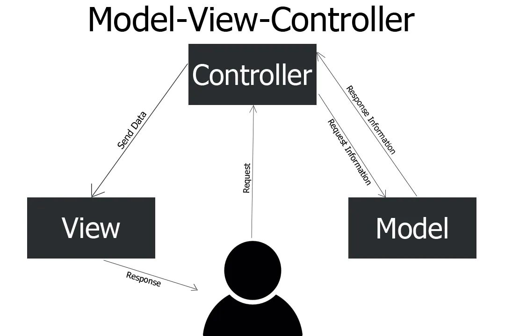
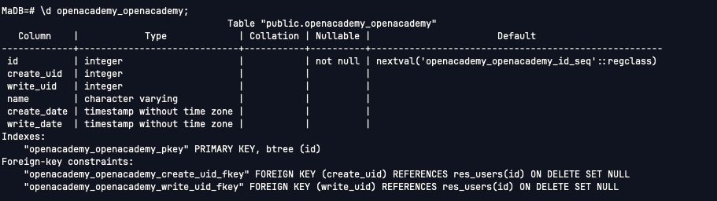
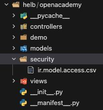
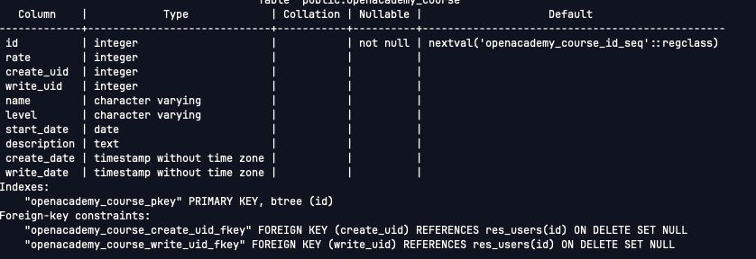
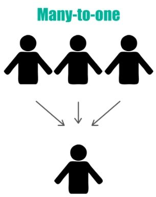
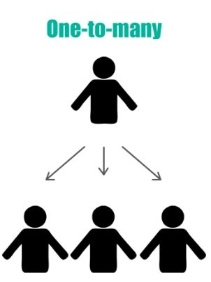
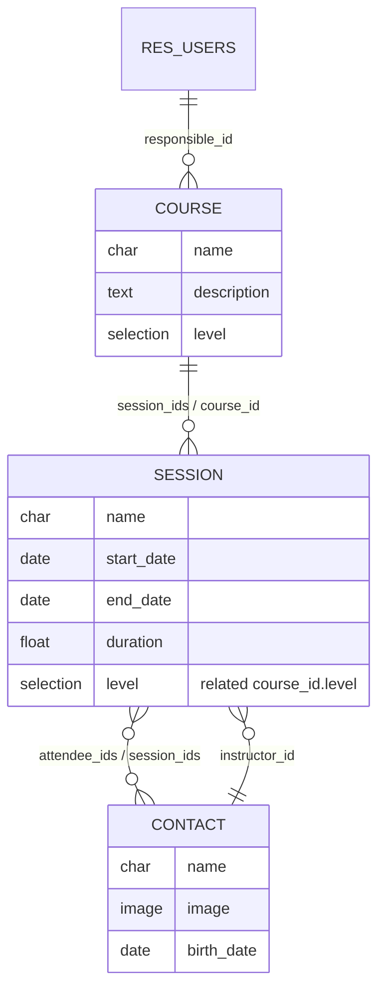

# Chapitre 4 — Modèles

[⬅ Chapitre 3](03-premier-module.md) · [Sommaire](../README.md) · [Chapitre 5 ➡](05-vues.md)

## Objectifs

À la fin de ce chapitre, vous savez :
- situer le modèle dans l'architecture MVC d'Odoo ;
- créer un modèle Python et retrouver sa table dans PostgreSQL ;
- donner les droits d'accès à un modèle (`ir.model.access.csv`) ;
- déclarer des champs simples et relationnels (`Many2one`, `One2many`, `Many2many`) ;
- mettre à jour un module après une modification.

> Les noms de champs à utiliser sont dans les [conventions de nommage](../ressources/conventions.md).
> Respectez-les : les chapitres suivants s'appuient dessus.

---

## 1. L'architecture MVC



| Couche | Rôle | Dans Odoo |
|---|---|---|
| **Modèle** | Gère les données, applique les règles métier | Classes Python (ORM) → tables PostgreSQL |
| **Vue** | Affiche les données | Fichiers XML (formulaire, liste…) — chapitre 5 |
| **Contrôleur** | Reçoit les requêtes, orchestre | Le framework web d'Odoo, et vos routes — chapitre 11 |

L'**ORM** (*Object-Relational Mapping*) traduit vos classes Python en tables SQL.
Vous écrivez du Python, Odoo crée et maintient les tables pour vous.

---

## 2. Créer un modèle

```
openacademy/
├── __init__.py              → from . import models
└── models/
    ├── __init__.py          → from . import course
    └── course.py
```

```python
# models/course.py
from odoo import fields, models


class Course(models.Model):
    _name = 'openacademy.course'          # nom technique du modèle
    _description = 'Cours'                 # libellé lisible (obligatoire, sinon warning)

    name = fields.Char(string='Titre', required=True)
```

Odoo crée une table dont le nom est `_name` avec les points remplacés par des `_` :
`openacademy.course` → **`openacademy_course`**.



Les champs `id`, `create_uid`, `create_date`, `write_uid` et `write_date` sont ajoutés **automatiquement** à chaque modèle.

---

## 3. Droits d'accès : `ir.model.access.csv`

**Sans droit d'accès, personne ne peut utiliser un modèle**, même pas l'administrateur.



```csv
id,name,model_id:id,group_id:id,perm_read,perm_write,perm_create,perm_unlink
access_openacademy_course,openacademy.course,model_openacademy_course,base.group_user,1,1,1,1
```

| Colonne | Signification |
|---|---|
| `id` | Identifiant unique de la règle |
| `name` | Libellé libre |
| `model_id:id` | Le modèle : `model_` + `_name` avec des `_` → `model_openacademy_course` |
| `group_id:id` | Le groupe concerné (`base.group_user` = tous les utilisateurs internes) |
| `perm_read`, `perm_write`, `perm_create`, `perm_unlink` | 1 = autorisé, 0 = refusé (lire, modifier, créer, supprimer) |

Le fichier doit être déclaré dans le manifest :

```python
'data': [
    'security/ir.model.access.csv',
],
```

---

## 4. Mettre à jour son module

| Vous avez modifié… | Il faut… |
|---|---|
| Du code **Python** (méthode, logique) | **Redémarrer** le serveur |
| La **structure** (nouveau champ, nouveau modèle) ou un fichier **XML / CSV** | Redémarrer **avec `-u`** |

```bash
./odoo-bin -d my_database --addons-path=addons,/home/odoo/src/custo -u openacademy
```

### Vérifier dans PostgreSQL

```bash
psql my_database
```

```sql
\dt openacademy*                -- lister les tables de votre module
\d openacademy_course           -- décrire une table (colonnes, types, clés étrangères)
SELECT id, name FROM openacademy_course;
\q                              -- quitter
```

### ✍️ À vous — Exercice 4.1

**Créer les trois modèles.** Dans `openacademy`, créez trois modèles, **chacun dans son propre fichier** :

| Modèle | Fichier | Description |
|---|---|---|
| `openacademy.course` | `models/course.py` | Un cours |
| `openacademy.session` | `models/session.py` | Une session (un cours donné à des dates précises) |
| `openacademy.contact` | `models/contact.py` | Un participant ou un professeur |

Chaque modèle a pour l'instant un seul champ, `name` (obligatoire). Ajoutez les **3 règles d'accès**.

**Pour vérifier :**
- [ ] Le module se met à jour sans erreur ni warning « no access rules ».
- [ ] `\dt openacademy*` dans `psql` affiche trois tables.
- [ ] En mode développeur, **Paramètres → Technique → Modèles** affiche vos trois modèles.

<details><summary>💡 Indice : la table n'est pas créée</summary>

- Le fichier est-il importé dans `models/__init__.py` ?
- Le dossier `models` est-il importé dans le `__init__.py` du module ?
- Avez-vous relancé avec `-u openacademy` ?
</details>

<details><summary>💡 Indice : « No matching record found for external id 'model_...' »</summary>

Le `model_id:id` du CSV ne correspond à aucun modèle. Pour `openacademy.course`,
il faut écrire `model_openacademy_course` (préfixe `model_`, les points remplacés par des `_`).
</details>

👉 [Réponse commentée](../reponses/04-modeles.md#exercice-41)

---

## 5. Les types de champs

Documentation : [Référence des champs](https://www.odoo.com/documentation/18.0/fr/developer/reference/backend/orm.html#fields)

| Champ Python | Type PostgreSQL | Exemple |
|---|---|---|
| `fields.Char()` | varchar | Nom, référence |
| `fields.Text()` | text | Description longue |
| `fields.Html()` | text | Texte mis en forme |
| `fields.Integer()` | integer | Nombre de places |
| `fields.Float()` | numeric / double | Prix, durée |
| `fields.Boolean()` | boolean | Actif / inactif |
| `fields.Date()` | date | Date de début |
| `fields.Datetime()` | timestamp | Date et heure |
| `fields.Selection([...])` | varchar | Niveau, état |
| `fields.Binary()` / `fields.Image()` | stocké en pièce jointe | Fichier, photo |

### Attributs communs

```python
name = fields.Char(
    string='Titre',       # libellé affiché
    required=True,        # obligatoire
    readonly=True,        # non modifiable dans l'interface
    default='Nouveau',    # valeur par défaut
    help='Texte d\'aide', # infobulle
    index=True,           # index SQL (recherche plus rapide)
    copy=False,           # non copié lors d'une duplication
)

level = fields.Selection(
    selection=[('basic', 'Basique'), ('medium', 'Moyen'), ('advanced', 'Avancé')],
    default='basic',
)
```

Dans une `Selection`, la première valeur du tuple est **stockée en base** (`'basic'`),
la seconde est **affichée** (`'Basique'`).

Voici une table avec ses champs, vue depuis `psql` :



### ✍️ À vous — Exercice 4.2

**Ajouter les champs simples.** Choisissez vous-même le type de chaque champ.

| `openacademy.course` | `openacademy.session` | `openacademy.contact` |
|---|---|---|
| `name` : titre du cours | `name` : nom de la session | `name` : nom |
| `description` : description détaillée | `start_date` : date de début | `image` : photo |
| `level` : niveau (basique, moyen, avancé) | `end_date` : date de fin | `birth_date` : date de naissance |
| | `duration` : durée en jours | |

**Pour vérifier :**
- [ ] `\d openacademy_session` affiche les colonnes `start_date`, `end_date`, `duration`.
- [ ] Vous savez justifier le type choisi pour chaque champ.

<details><summary>💡 Indice : la colonne <code>image</code> n'apparaît pas dans la table</summary>

C'est normal : les champs `Binary` et `Image` sont stockés par défaut comme **pièces jointes**
(table `ir_attachment`), pas comme une colonne.
</details>

👉 [Réponse commentée](../reponses/04-modeles.md#exercice-42)

---

## 6. Les champs relationnels

Documentation : [Champs relationnels](https://www.odoo.com/documentation/18.0/fr/developer/reference/backend/orm.html#relational-fields)

### Many2one (N → 1)

| | |
|---|---|
|  | **Plusieurs** factures pointent vers **un** client. <br/><br/> Le `Many2one` est une **vraie colonne** en base (clé étrangère). <br/><br/> `partner_id = fields.Many2one('res.partner')` <br/><br/> Convention : se termine par **`_id`**. |

### One2many (1 → N)

| | |
|---|---|
|  | **Un** client a **plusieurs** factures. <br/><br/> Le `One2many` est un **champ virtuel** : il n'existe pas en base, il lit le `Many2one` inverse. Il faut donc **toujours** un `Many2one` en face. <br/><br/> Convention : se termine par **`_ids`**. |

```python
invoice_ids = fields.One2many('account.move', 'partner_id', string='Factures')
#                               ↑ modèle cible  ↑ nom du Many2one dans le modèle cible
```

### Many2many (N ↔ N)

Un fournisseur vend **plusieurs** produits, un produit a **plusieurs** fournisseurs.
Odoo crée automatiquement une **table de jonction**.

```python
tag_ids = fields.Many2many('res.partner.category', string='Étiquettes')
```

Pour avoir le même `Many2many` **des deux côtés**, les deux champs doivent utiliser
**la même table de jonction**, nommée explicitement :

```python
# Dans openacademy.session
attendee_ids = fields.Many2many(
    'openacademy.contact',
    relation='openacademy_session_contact_rel',  # nom de la table de jonction
    column1='session_id',                        # colonne qui pointe vers "ce" modèle
    column2='contact_id',                        # colonne qui pointe vers "l'autre"
)

# Dans openacademy.contact (même table, colonnes inversées)
session_ids = fields.Many2many(
    'openacademy.session',
    relation='openacademy_session_contact_rel',
    column1='contact_id',
    column2='session_id',
)
```

### Champ lié (`related`)

Un champ `related` affiche la valeur d'un champ accessible via une relation, sans la dupliquer :

```python
partner_email = fields.Char(related='partner_id.email')
nickname = fields.Char(related='user_id.partner_id.name', store=True)
```

Détails au [chapitre 8](08-compute-related.md).

### Le modèle de données d'Open Academy



### ✍️ À vous — Exercice 4.3

**Relier les modèles.** Ajoutez les champs relationnels du schéma ci-dessus :

| Modèle | Champ | Description |
|---|---|---|
| `openacademy.course` | `responsible_id` | L'**utilisateur** Odoo responsable du cours |
| `openacademy.course` | `session_ids` | Les sessions de ce cours |
| `openacademy.session` | `course_id` | Le cours de la session |
| `openacademy.session` | `instructor_id` | Le professeur (un contact) |
| `openacademy.session` | `attendee_ids` | Les participants (plusieurs contacts) |
| `openacademy.session` | `level` | Le niveau du cours. ⚠️ Cette information est déjà dans le cours : ne la dupliquez pas ! |
| `openacademy.contact` | `session_ids` | Les sessions auxquelles le contact participe |

**Pour vérifier :**
- [ ] `\d openacademy_session` montre une colonne `course_id` avec une clé étrangère.
- [ ] `session_ids` sur le cours n'a **pas** de colonne dans `openacademy_course` (vous savez pourquoi).
- [ ] Une **seule** table de jonction existe pour les participants.

<details><summary>💡 Indice : quel type pour chaque champ ?</summary>

Posez-vous la question « un X a combien de Y ? » **dans les deux sens** :
- Une session a **un** cours, un cours a **plusieurs** sessions → `Many2one` côté session, `One2many` côté cours.
- Une session a **plusieurs** participants, un participant suit **plusieurs** sessions → `Many2many`.
</details>

<details><summary>💡 Indice : le niveau sur la session</summary>

Utilisez un champ `related` : `related='course_id.level'`.
</details>

👉 [Réponse commentée](../reponses/04-modeles.md#exercice-43)

---

## 7. D'où vient la magie ?

Tout ce que vous venez de voir est du code Python ordinaire, que vous pouvez lire :
- les champs : [`odoo/fields.py`](https://github.com/odoo/odoo/blob/18.0/odoo/fields.py)
- les modèles : [`odoo/models.py`](https://github.com/odoo/odoo/blob/18.0/odoo/models.py)

Quand vous ne comprenez pas un comportement, **allez lire le code source**.

---

## 🏁 Défi du chapitre — Exercice 4.4

**Agence immobilière.** Créez un **nouveau module** `estate` avec trois modèles :

**`estate.property`** (le bien)

| Champ | Type | Remarque |
|---|---|---|
| `name` | Char | Titre de l'annonce, obligatoire |
| `description` | Text | |
| `expected_price` | Float | Prix demandé, obligatoire |
| `selling_price` | Float | Prix de vente réel, en lecture seule, non copié |
| `living_area` | Integer | Surface habitable (m²) |
| `garden_area` | Integer | Surface du jardin (m²) |
| `active` | Boolean | Par défaut à `True` |
| `state` | Selection | `new`, `offer_received`, `offer_accepted`, `sold`, `canceled` · par défaut `new` |
| `tag_ids` | Many2many | Vers `estate.property.tag` |
| `lead_id` | Many2one | Vers `estate.lead` |

**`estate.property.tag`** : `name` (Char), `color` (Integer)

**`estate.lead`** (le prospect) : `name`, `phone`, `email` (Char), `property_ids` (One2many vers `estate.property`)

👉 [Réponse commentée](../reponses/04-modeles.md#exercice-44)

---

## Questions de compréhension

1. Quel est le nom de la table PostgreSQL du modèle `estate.property.tag` ?
2. Quels champs sont ajoutés automatiquement à chaque modèle ?
3. Pourquoi un `One2many` n'a-t-il pas de colonne en base de données ?
4. Vous avez ajouté un champ Python, redémarré le serveur, mais la colonne n'existe pas. Pourquoi ?
5. Dans un `Selection`, qu'est-ce qui est stocké en base : la clé ou le libellé ?
6. Pourquoi utiliser un champ `related` plutôt qu'un champ simple que l'on remplirait à la main ?
7. Que se passe-t-il si vous oubliez la ligne d'un modèle dans `ir.model.access.csv` ?

---

[⬅ Chapitre 3](03-premier-module.md) · [Sommaire](../README.md) · [Chapitre 5 ➡](05-vues.md)
