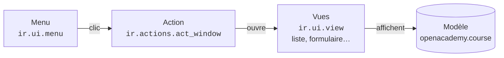
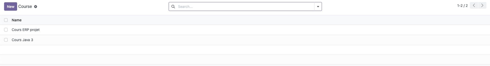
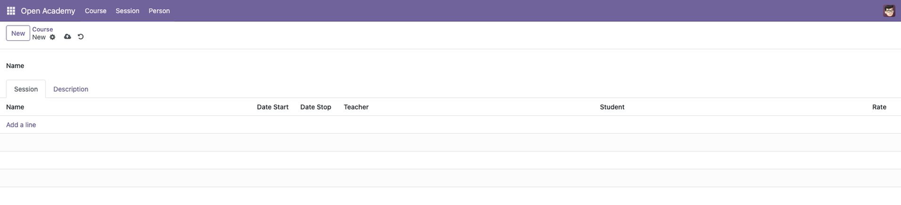
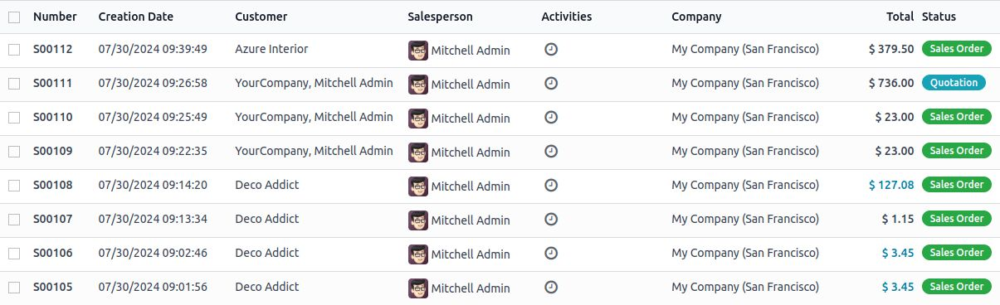
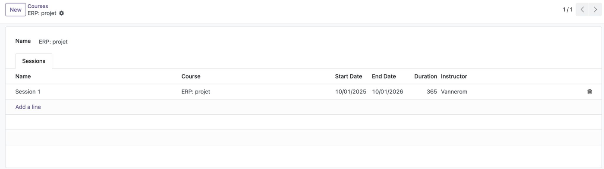
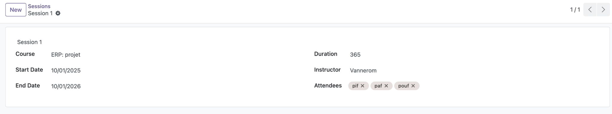
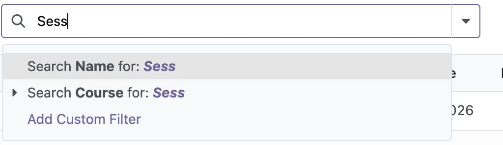
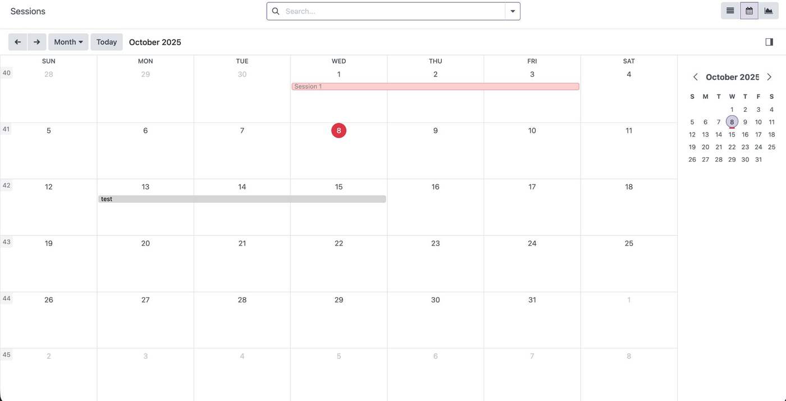
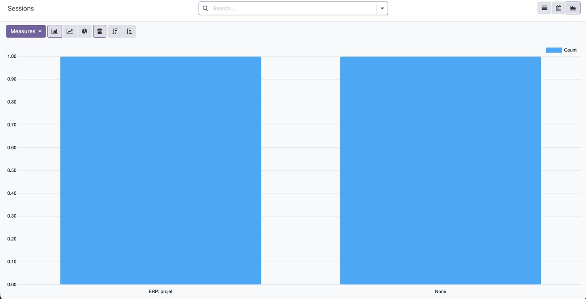

# Chapitre 5 — Vues, actions et menus

[⬅ Chapitre 4](04-modeles.md) · [Sommaire](../README.md) · [Chapitre 6 ➡](06-methodes-actions.md)

## Objectifs

À la fin de ce chapitre, vous savez :
- charger des données XML dans Odoo ;
- créer un menu qui ouvre une action ;
- créer les vues liste, formulaire, recherche, calendrier, graphique et kanban ;
- livrer des données par défaut et des données de démo avec un module ;
- filtrer et pré-remplir avec le domaine et le contexte d'une action.

---

## 1. Vues, actions et menus

Pour afficher un modèle, il faut trois éléments, qui sont eux-mêmes des **enregistrements** en base :



| Élément | Rôle |
|---|---|
| **Menu** | Une entrée dans la barre de navigation. Un clic déclenche une action. |
| **Action** | Dit quel modèle ouvrir, et avec quelles vues. |
| **Vue** | Décrit l'affichage : quels champs, dans quel ordre, comment. |

---

## 2. Charger des données en XML

Un fichier XML de données crée des enregistrements, comme on insérerait des lignes en base :

```xml
<odoo>
    <record id="course_python" model="openacademy.course">
        <!--   ↑ identifiant XML    ↑ modèle (= table)   -->
        <field name="name">Python pour débutants</field>
        <field name="level">basic</field>
        <!--         ↑ colonne      ↑ valeur        -->
    </record>
</odoo>
```

L'`id` est un **identifiant externe** (*XML ID*). Il permet de retrouver l'enregistrement
depuis un autre fichier, sous la forme `nom_du_module.id` (ex. `openacademy.course_python`).

Les fichiers sont déclarés dans le manifest et chargés **dans l'ordre** :

```python
'data': [
    'security/ir.model.access.csv',   # 1. la sécurité d'abord
    'views/course_views.xml',         # 2. puis les vues et actions
    'views/menus.xml',                # 3. les menus en dernier (ils pointent vers les actions)
],
```

On ne peut référencer un XML ID que s'il a **déjà été chargé**.

Documentation : [Fichiers de données](https://www.odoo.com/documentation/18.0/fr/developer/reference/backend/data.html)

---

## 3. Actions et menus

```xml
<odoo>
    <!-- 1. L'action : quel modèle ouvrir, avec quelles vues -->
    <record id="course_action" model="ir.actions.act_window">
        <field name="name">Cours</field>
        <field name="res_model">openacademy.course</field>
        <field name="view_mode">list,form</field>
    </record>

    <!-- 2. Les menus -->
    <menuitem id="menu_root" name="Open Academy"/>
    <menuitem id="menu_course" name="Cours" parent="menu_root" action="course_action"/>
</odoo>
```

- Le menu sans `parent` apparaît dans la liste des applications.
- L'attribut `action` du menu pointe vers l'`id` de l'action.
- Sans vue définie, Odoo génère des vues par défaut, très basiques :

| Liste par défaut | Formulaire par défaut |
|---|---|
|  |  |

> ⚠️ Un menu reste **invisible** si l'utilisateur n'a pas le droit de lecture sur le modèle de l'action.

### ✍️ À vous — Exercice 5.1

**Créer les menus.** Créez la structure suivante, dans un fichier `views/menus.xml` :

```
Open Academy
├── Cours
├── Sessions
└── Contacts
```

**Pour vérifier :**
- [ ] « Open Academy » apparaît dans la liste des applications.
- [ ] Chaque menu ouvre la bonne liste et vous pouvez créer un enregistrement.

<details><summary>💡 Indice : mon menu n'apparaît pas</summary>

1. Le fichier XML est-il dans le `data` du manifest ? **Après** le CSV de sécurité ?
2. Avez-vous mis à jour le module avec `-u` ?
3. Les droits d'accès du chapitre 4 sont-ils corrects pour les trois modèles ?
4. Rafraîchissez la page du navigateur.
</details>

👉 [Réponse commentée](../reponses/05-vues.md#exercice-51)

---

## 4. Les vues

Documentation : [Architectures des vues](https://www.odoo.com/documentation/18.0/fr/developer/reference/user_interface/view_architectures.html)

Une vue se déclare toujours de la même façon :

```xml
<record id="course_view_list" model="ir.ui.view">
    <field name="name">openacademy.course.list</field>
    <field name="model">openacademy.course</field>
    <field name="arch" type="xml">
        <!-- l'architecture de la vue -->
    </field>
</record>
```

### Vue liste (`list`)



```xml
<list>
    <field name="name" string="Mon libellé personnalisé"/>
    <field name="amount" sum="Total"/>         <!-- total en bas de colonne -->
    <field name="currency_id" column_invisible="1"/>
    <field name="tax_id" optional="show"/>     <!-- colonne masquable par l'utilisateur -->
</list>
```

> En Odoo 17 et avant, la balise s'appelait `<tree>`. Depuis Odoo 18, c'est `<list>`.

### ✍️ À vous — Exercice 5.2

**Liste des sessions.** Créez la vue liste des sessions avec les colonnes :
nom, cours, date de début, date de fin, durée, professeur.



👉 [Réponse commentée](../reponses/05-vues.md#exercice-52)

### Vue formulaire (`form`)

```xml
<form string="Cours">
    <sheet>
        <div class="oe_title">
            <h1><field name="name" placeholder="Titre du cours"/></h1>
        </div>
        <group>
            <group>                              <!-- colonne de gauche -->
                <field name="level"/>
            </group>
            <group>                              <!-- colonne de droite -->
                <field name="responsible_id"/>
            </group>
        </group>
        <notebook>                               <!-- onglets -->
            <page string="Description">
                <field name="description"/>
            </page>
            <page string="Sessions">
                <field name="session_ids"/>      <!-- One2many : affiché en sous-liste -->
            </page>
        </notebook>
    </sheet>
</form>
```

Widgets utiles :

```xml
<field name="attendee_ids" widget="many2many_tags"/>   <!-- étiquettes au lieu d'une liste -->
<field name="image" widget="image" class="oe_avatar"/>
<field name="level" widget="radio"/>
```

### ✍️ À vous — Exercice 5.3

**Formulaires.**

1. **Session** : le nom en titre, puis deux colonnes — à gauche cours, date de début, date de fin ;
   à droite durée, professeur, participants (en étiquettes).

   

2. **Cours** : le titre, le niveau, le responsable, et deux onglets *Description* et *Sessions*.
3. **Contact** : le nom, la photo et la date de naissance.

**Pour vérifier :**
- [ ] Les participants s'affichent en étiquettes.
- [ ] Dans le formulaire d'un cours, l'onglet Sessions affiche ses sessions et permet d'en ajouter.

<details><summary>💡 Indice : l'onglet Sessions affiche des colonnes bizarres</summary>

Un `One2many` utilise la vue liste du modèle cible. Vous pouvez définir une liste
spécifique directement dans le champ :

```xml
<field name="session_ids">
    <list>
        <field name="name"/>
        <field name="start_date"/>
    </list>
</field>
```
</details>

👉 [Réponse commentée](../reponses/05-vues.md#exercice-53)

### Vue recherche (`search`)

```xml
<search>
    <field name="name"/>                         <!-- champs proposés quand on tape -->
    <field name="course_id"/>
    <filter name="filter_basic" string="Basique" domain="[('level', '=', 'basic')]"/>
    <group>
        <filter name="group_course" string="Cours" context="{'group_by': 'course_id'}"/>
    </group>
</search>
```

### Vue calendrier (`calendar`) et graphique (`graph`)

```xml
<calendar date_start="start_date" date_stop="end_date" color="course_id">
    <field name="name"/>
</calendar>
```

```xml
<graph type="bar">
    <field name="course_id"/>                    <!-- axe des X : regroupement -->
</graph>
```

Sans champ de mesure, le graphique compte le nombre d'enregistrements.
N'oubliez pas d'ajouter ces vues au `view_mode` de l'action : `list,form,calendar,graph`.

### ✍️ À vous — Exercice 5.4

**Recherche, calendrier, graphique** pour les sessions.

| Vue | Résultat attendu |
|---|---|
| **Recherche** : en tapant du texte, on peut chercher par nom ou par cours |  |
| **Calendrier** : les sessions du jour de début au jour de fin |  |
| **Graphique** : nombre de sessions par cours |  |

Ajoutez aussi un filtre « Niveau basique », un filtre « Mes cours » (les cours dont je suis responsable) et un regroupement par cours.

**Pour vérifier :**
- [ ] Depuis le menu Sessions, vous pouvez basculer entre liste, formulaire, calendrier et graphique.
- [ ] En tapant « Py », Odoo propose « Rechercher Nom pour : Py » et « Rechercher Cours pour : Py ».

👉 [Réponse commentée](../reponses/05-vues.md#exercice-54)

---

## 5. La vue kanban

La vue **kanban** affiche les enregistrements sous forme de **cartes**, souvent regroupées en colonnes.
C'est la vue emblématique d'Odoo : le pipeline du CRM, les tâches de Projet, les tickets du Helpdesk.

```xml
<record id="session_view_kanban" model="ir.ui.view">
    <field name="name">openacademy.session.kanban</field>
    <field name="model">openacademy.session</field>
    <field name="arch" type="xml">
        <kanban default_group_by="course_id">          <!-- une colonne par cours -->
            <templates>
                <t t-name="card">                       <!-- le contenu d'une carte -->
                    <field name="name" class="fw-bold fs-5"/>
                    <field name="start_date"/>
                    <field name="instructor_id"/>
                </t>
            </templates>
        </kanban>
    </field>
</record>
```

- `default_group_by` : le champ qui définit les colonnes. On peut glisser une carte d'une colonne à l'autre.
- `<t t-name="card">` : le modèle d'une carte. Les champs s'y affichent avec des classes Bootstrap
  (`fw-bold`, `text-muted`, `fs-5`…).
- N'oubliez pas `kanban` dans le `view_mode` de l'action.

> En Odoo 17 et avant, le modèle de carte s'appelait `<t t-name="kanban-box">` et contenait plus de HTML.
> Depuis Odoo 18, `<t t-name="card">` suffit.

### ✍️ À vous — Exercice 5.5

**Kanban des sessions.** Créez une vue kanban des sessions, regroupées par cours.
Chaque carte affiche le nom de la session en gras, les dates, le professeur et les participants en étiquettes.
La vue kanban s'ouvre **par défaut** quand on clique sur le menu Sessions.

**Pour vérifier :**
- [ ] Le menu Sessions ouvre directement le kanban.
- [ ] Glisser une carte dans une autre colonne change le cours de la session.

<details><summary>💡 Indice : la vue par défaut</summary>

La première vue du `view_mode` est celle qui s'ouvre : `kanban,list,form,calendar,graph`.
</details>

👉 [Réponse commentée](../reponses/05-vues.md#exercice-55)

---

## 6. Données par défaut et données de démo

Un module peut livrer des **données** en plus de son code : des valeurs initiales indispensables,
ou des exemples pour tester et faire une démo.

| | Clé du manifest | Chargées… | Exemples |
|---|---|---|---|
| **Données** | `'data'` | Toujours, à l'installation et à chaque mise à jour | Étiquettes, catégories, séquences, paramètres |
| **Démo** | `'demo'` | Seulement si la base a été créée **avec les données de démonstration** | Cours, sessions, participants fictifs |

```python
'data': [
    'security/ir.model.access.csv',
    'data/course_tags.xml',            # données indispensables
    'views/course_views.xml',
],
'demo': [
    'demo/demo.xml',                   # exemples
],
```

```xml
<!-- demo/demo.xml -->
<odoo>
    <record id="demo_course_python" model="openacademy.course">
        <field name="name">Python pour débutants</field>
        <field name="level">basic</field>
    </record>

    <record id="demo_session_python_1" model="openacademy.session">
        <field name="name">Python — janvier</field>
        <!-- ref : un Many2one vers un autre enregistrement de démo, par son XML ID -->
        <field name="course_id" ref="demo_course_python"/>
        <!-- eval : une expression Python. Ici, la date d'aujourd'hui. -->
        <field name="start_date" eval="DateTime.today()"/>
    </record>
</odoo>
```

### `noupdate` : ne pas écraser les modifications de l'utilisateur

Par défaut, Odoo **recharge** les données à chaque mise à jour du module (`-u`) : si l'utilisateur a modifié
une étiquette livrée par le module, sa modification est écrasée. Pour l'éviter :

```xml
<odoo noupdate="1">
    <!-- chargé à l'installation, puis plus jamais touché -->
</odoo>
```

Règle simple : **les vues et actions sans `noupdate`**, **les données que l'utilisateur peut modifier avec `noupdate="1"`**.

### ✍️ À vous — Exercice 5.6

**Des données pour la démo.**

1. Créez un fichier `demo/demo.xml` avec 3 cours, 2 professeurs (contacts), 5 participants
   et 4 sessions qui les relient.
2. Créez une nouvelle base **avec** données de démo, installez `openacademy`, et vérifiez que tout apparaît.

**Pour vérifier :**
- [ ] Sur une nouvelle base, le kanban des sessions est rempli dès l'installation.
- [ ] Les sessions sont bien liées à leurs cours et leurs participants.

<details><summary>💡 Indice : un Many2many dans un fichier XML</summary>

```xml
<field name="attendee_ids" eval="[Command.set([ref('demo_contact_1'), ref('demo_contact_2')])]"/>
```
</details>

👉 [Réponse commentée](../reponses/05-vues.md#exercice-56)

---

## 7. Contexte et domaine sur les actions

Une action peut **filtrer** ce qu'elle affiche et **pré-remplir** les nouveaux enregistrements :

```xml
<record id="session_action_my" model="ir.actions.act_window">
    <field name="name">Mes sessions</field>
    <field name="res_model">openacademy.session</field>
    <field name="view_mode">list,form</field>
    <!-- domain : un filtre permanent, que l'utilisateur ne peut pas retirer -->
    <field name="domain">[('course_id.responsible_id', '=', uid)]</field>
    <!-- context :
         default_<champ>        : valeur pré-remplie à la création
         search_default_<nom>   : active un filtre de la vue recherche (retirable) -->
    <field name="context">{'search_default_filter_basic': 1}</field>
</record>
```

| Clé du contexte | Effet |
|---|---|
| `default_<champ>` | Pré-remplit le champ quand on crée un enregistrement |
| `search_default_<filtre>` | Active un filtre (ou un regroupement) de la vue recherche à l'ouverture |
| `group_by` | Regroupe la vue liste à l'ouverture |

Un bouton peut aussi passer un contexte, par exemple pour créer une session pré-remplie avec le cours affiché :

```xml
<button name="%(openacademy.session_action)d" type="action" string="Nouvelle session"
        context="{'default_course_id': id}"/>
```

| `domain` sur l'action | `search_default_` dans le contexte |
|---|---|
| Filtre **imposé** : l'utilisateur ne le voit pas et ne peut pas le retirer | Filtre **proposé** : visible dans la barre de recherche, l'utilisateur peut le retirer |

### ✍️ À vous — Exercice 5.7

1. Ajoutez un menu **Sessions → À venir** qui n'affiche que les sessions dont la date de début est
   dans le futur, regroupées par cours à l'ouverture.
2. Dans le formulaire d'un cours, ajoutez un bouton **Nouvelle session** qui ouvre le formulaire
   d'une session avec le cours déjà rempli.

**Pour vérifier :**
- [ ] Le menu « À venir » ne montre jamais de session passée, même en retirant les filtres.
- [ ] Le bouton ouvre une session dont le champ Cours est pré-rempli.

<details><summary>💡 Indice : la date du jour dans un domaine</summary>

Dans un domaine XML, `context_today()` donne la date du jour :
`[('start_date', '>=', context_today().strftime('%Y-%m-%d'))]`
</details>

👉 [Réponse commentée](../reponses/05-vues.md#exercice-57)

---

## 🏁 Défi du chapitre — Exercice 5.8

Ouvrez le formulaire d'un **contact standard** d'Odoo (application Contacts).
En mode développeur, icône 🐞 → **Modifier la vue : Formulaire**.

1. Retrouvez la structure `sheet` / `group` / `notebook` que vous venez d'utiliser.
2. Trouvez un widget que vous ne connaissez pas et utilisez-le dans une de vos vues.
3. Faites les vues (liste, formulaire, recherche) du module `estate` du chapitre 4.

👉 [Réponse commentée](../reponses/05-vues.md#exercice-58)

---

## Questions de compréhension

1. Quels sont les trois éléments nécessaires pour afficher un modèle dans le menu ? Quel est le rôle de chacun ?
2. Pourquoi le fichier des menus doit-il être chargé après celui des actions ?
3. Comment référencer, depuis un autre module, un enregistrement XML d'`openacademy` dont l'id est `course_action` ?
4. Votre menu est déclaré, le module est à jour, mais le menu est invisible. Citez deux causes possibles.
5. À quoi sert une vue `search` ? Que se passe-t-il si vous n'en définissez pas ?
6. Quelle est la différence entre un fichier dans `data` et un fichier dans `demo` du manifest ?
7. À quoi sert `noupdate="1"` ?
8. Quelle est la différence entre un `domain` sur une action et un `search_default_` dans son contexte ?

---

[⬅ Chapitre 4](04-modeles.md) · [Sommaire](../README.md) · [Chapitre 6 ➡](06-methodes-actions.md)
