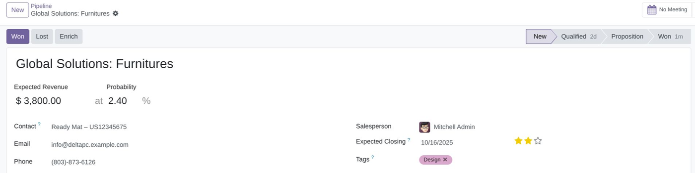
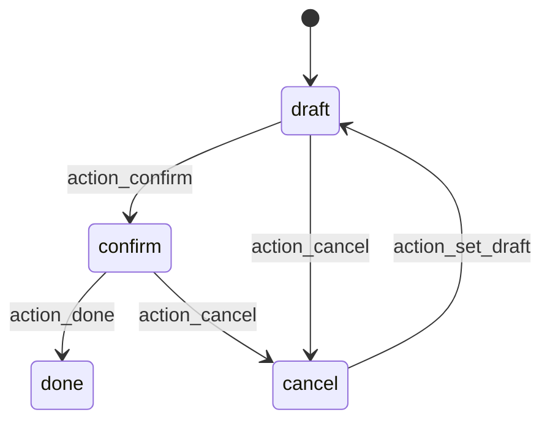
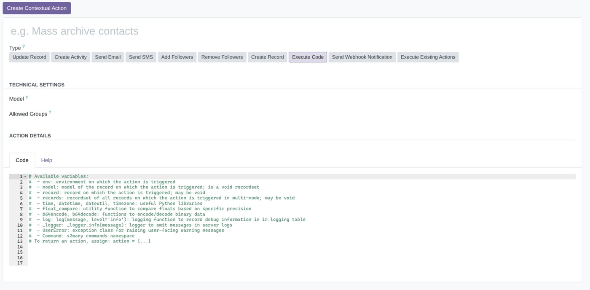
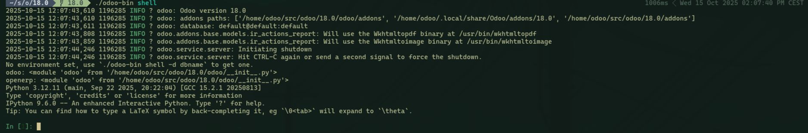

# Chapitre 6 — Méthodes et actions

[⬅ Chapitre 5](05-vues.md) · [Sommaire](../README.md) · [Chapitre 7 ➡](07-heritage.md)

## Objectifs

À la fin de ce chapitre, vous savez :
- ajouter des boutons qui appellent des méthodes Python ;
- gérer un champ d'état et ses transitions ;
- utiliser les méthodes principales de l'ORM (`search`, `create`, `write`…) ;
- surcharger une méthode existante avec `super()` ;
- ajouter des contraintes SQL et Python ;
- numéroter automatiquement les enregistrements avec une séquence ;
- tester du code avec `odoo-bin shell`.

---

## 1. Les boutons dans les vues

Les boutons se placent dans le `<header>` du formulaire, avec la barre d'état à droite :



```xml
<form>
    <header>
        <!-- Appelle une méthode Python du modèle -->
        <button name="action_confirm" type="object" string="Confirmer" class="btn-primary"
                invisible="state != 'draft'"/>

        <!-- Ouvre une action existante (par son XML ID) -->
        <button name="%(openacademy.course_action)d" type="action" string="Voir les cours"/>

        <!-- Affiche l'état sous forme de barre de progression -->
        <field name="state" widget="statusbar" statusbar_visible="draft,confirm,done"/>
    </header>
    <sheet>...</sheet>
</form>
```

| `type` | `name` contient | Effet |
|---|---|---|
| `object` | Le nom d'une méthode Python | Appelle la méthode sur l'enregistrement |
| `action` | `%(module.xml_id)d` | Exécute une action (ouvrir une vue, un wizard…) |

`invisible="state != 'draft'"` : le bouton n'est visible qu'en brouillon.
On peut aussi écrire `readonly="..."` et `required="..."` avec une expression.

> Depuis Odoo 17, l'ancien attribut `attrs` n'existe plus.

### La méthode Python

```python
class Session(models.Model):
    _name = 'openacademy.session'

    state = fields.Selection([
        ('draft', 'Brouillon'),
        ('confirm', 'Confirmé'),
    ], default='draft', readonly=True)

    def action_confirm(self):
        for record in self:          # self peut contenir PLUSIEURS enregistrements
            record.state = 'confirm'
        return True
```

> ⚠️ `self` est un **recordset** : une collection de 0, 1 ou plusieurs enregistrements.
> Bouclez toujours avec `for record in self`.



### ✍️ À vous — Exercice 6.1

**État et boutons sur les sessions.** Implémentez le diagramme ci-dessus :

1. Un champ `state` sur `openacademy.session` : `draft` (Brouillon), `confirm` (Confirmé), `done` (Terminé),
   `cancel` (Annulé). Par défaut `draft`, non modifiable à la main.
2. Les méthodes `action_confirm`, `action_done`, `action_cancel`, `action_set_draft`.
3. Les boutons dans le `<header>` du formulaire, et la barre d'état.
4. Chaque bouton n'est visible que quand la transition est possible.

**Pour vérifier :**
- [ ] Une nouvelle session est en Brouillon.
- [ ] Toutes les transitions du diagramme fonctionnent, et seulement elles.
- [ ] On ne peut pas changer l'état en cliquant sur la barre d'état.

👉 [Réponse commentée](../reponses/06-methodes-actions.md#exercice-61)

### Les actions serveur

Les **actions serveur** exécutent du code Python directement depuis l'interface, sans écrire de module
(**Paramètres → Technique → Actions → Actions serveur**, en mode développeur).
Utiles pour une opération ponctuelle ou une automatisation simple.



> 💡 Avant d'écrire un module, demandez-vous si une action serveur ou une **règle d'automatisation**
> (application Studio / Automatisations) ne suffirait pas.

---

## 2. L'ORM : manipuler les données

| Opération | Méthode | Exemple |
|---|---|---|
| Chercher | `search(domain)` | `self.env['openacademy.course'].search([('level', '=', 'basic')])` |
| Compter | `search_count(domain)` | `self.env['openacademy.course'].search_count([])` |
| Lire par id | `browse(ids)` | `self.env['openacademy.course'].browse(3)` |
| Créer | `create(vals)` | `self.env['openacademy.course'].create({'name': 'SQL'})` |
| Modifier | `write(vals)` | `courses.write({'level': 'advanced'})` |
| Supprimer | `unlink()` | `courses.unlink()` |
| Dupliquer | `copy(default)` | `course.copy({'name': 'Copie'})` |

### Les domaines

Un **domaine** est une liste de conditions `(champ, opérateur, valeur)` :

```python
[('level', '=', 'basic')]
[('start_date', '>=', '2026-01-01'), ('course_id.name', 'ilike', 'python')]   # ET implicite
['|', ('level', '=', 'basic'), ('level', '=', 'medium')]                    # OU (notation préfixe)
```

Opérateurs : `=`, `!=`, `>`, `>=`, `<`, `<=`, `in`, `not in`, `like`, `ilike` (insensible à la casse), `child_of`.

### L'environnement `self.env`

| | |
|---|---|
| `self.env['res.partner']` | Accès à n'importe quel modèle |
| `self.env.user` | L'utilisateur connecté |
| `self.env.company` | La société active |
| `self.env.context` | Le dictionnaire de contexte |

### Tester avec `odoo-bin shell`

Une console Python connectée à votre base, idéale pour essayer l'ORM :

```bash
./odoo-bin shell -d my_database --addons-path=addons,/home/odoo/src/custo
```



```python
>>> courses = env['openacademy.course'].search([])
>>> courses
openacademy.course(1, 2, 3)
>>> courses.mapped('name')
['Python', 'SQL', 'Odoo']
>>> env.cr.commit()      # ⚠️ sans commit, rien n'est enregistré
```

### ✍️ À vous — Exercice 6.2

**Explorer avec le shell.**

1. Affichez les noms de tous les cours de niveau basique.
2. Créez une session pour le premier cours trouvé, avec trois participants.
3. Passez toutes les sessions en brouillon **d'un seul appel**, sans boucle.
4. Comptez les sessions qui commencent ce mois-ci.
5. Que se passe-t-il si vous fermez le shell sans `env.cr.commit()` ?

👉 [Réponse commentée](../reponses/06-methodes-actions.md#exercice-62)

---

## 3. Surcharger une méthode avec `super()`

Pour ajouter un comportement à une méthode existante (`create`, `write`, `copy`, `unlink`…)
**sans perdre** le comportement d'origine :

```python
@api.model_create_multi
def create(self, vals_list):
    # AVANT : on peut modifier les valeurs reçues
    for vals in vals_list:
        vals.setdefault('name', 'Nouvelle session')
    records = super().create(vals_list)   # ← le comportement d'origine
    # APRÈS : on peut agir sur les enregistrements créés
    return records
```

> ⚠️ Oubliez `super()` et l'enregistrement ne sera **jamais** créé.
> Oubliez le `return` et l'appelant recevra `None`.

### ✍️ À vous — Exercice 6.3

**Dupliquer un cours.** Surchargez `copy()` pour que le titre de la copie devienne `Copie de <titre>`.

**Bonus :** si `Copie de Python` existe déjà, la suivante s'appelle `Copie de Python (2)`, puis `(3)`…

<details><summary>💡 Indice : la signature de copy</summary>

```python
def copy(self, default=None):
    default = dict(default or {})
    # ... modifier default['name']
    return super().copy(default)
```

`default` contient les valeurs qui remplacent celles de l'original dans la copie.
</details>

👉 [Réponse commentée](../reponses/06-methodes-actions.md#exercice-63)

---

## 4. Les contraintes

### Contrainte SQL

Vérifiée **par PostgreSQL**. Simple et rapide, mais limitée à ce que SQL sait exprimer.

```python
class Course(models.Model):
    _name = 'openacademy.course'

    _sql_constraints = [
        ('name_unique', 'UNIQUE(name)', "Le titre du cours doit être unique."),
        ('check_percentage', 'CHECK(percentage >= 0 AND percentage <= 100)',
         "Le pourcentage doit être compris entre 0 et 100."),
    ]
```

> En **Odoo 19**, on écrit : `_name_unique = models.Constraint('UNIQUE(name)', "Le titre doit être unique.")`

### Contrainte Python

Pour des règles qui demandent de la logique métier :

```python
from odoo.exceptions import ValidationError

@api.constrains('end_date')
def _check_end_date(self):
    for record in self:
        if record.end_date and record.end_date < fields.Date.today():
            raise ValidationError("La date de fin ne peut pas être dans le passé.")
```

La méthode est appelée à chaque création ou modification d'un des champs listés dans `@api.constrains`.

### ✍️ À vous — Exercice 6.4

**Contraintes.**

1. **SQL** : le titre d'un cours est unique.
2. **SQL** : le nom d'une session est unique.
3. **Python** : la date de fin d'une session ne peut pas être avant la date de début.
4. **Bonus Python** : interdire deux sessions du **même cours** à la **même date de début**.

<details><summary>💡 Indice : la contrainte SQL n'est pas appliquée</summary>

PostgreSQL refuse d'ajouter une contrainte `UNIQUE` si la table contient **déjà** des doublons.
Regardez les logs au démarrage. Supprimez les doublons puis relancez avec `-u`.
</details>

👉 [Réponse commentée](../reponses/06-methodes-actions.md#exercice-64)

---

## 5. Les séquences

La plupart des documents Odoo ont une **référence automatique** : `S00042` pour un devis,
`INV/2026/00017` pour une facture. Ces numéros viennent d'une **séquence** (`ir.sequence`).

```xml
<!-- data/sequence.xml -->
<odoo noupdate="1">
    <record id="seq_openacademy_session" model="ir.sequence">
        <field name="name">Session de formation</field>
        <field name="code">openacademy.session</field>     <!-- le nom utilisé dans le code -->
        <field name="prefix">SESS/%(year)s/</field>        <!-- SESS/2026/ -->
        <field name="padding">4</field>                    <!-- 0001, 0002… -->
    </record>
</odoo>
```

```python
reference = fields.Char(string='Référence', readonly=True, copy=False, default='Nouveau')

@api.model_create_multi
def create(self, vals_list):
    for vals in vals_list:
        if vals.get('reference', 'Nouveau') == 'Nouveau':
            vals['reference'] = self.env['ir.sequence'].next_by_code('openacademy.session')
    return super().create(vals_list)
```

- `next_by_code` renvoie le prochain numéro et **incrémente** le compteur.
- Le numéro est attribué **à la création**, pas à l'ouverture du formulaire.
- Variables utiles dans `prefix` : `%(year)s`, `%(month)s`, `%(day)s`.

### ✍️ À vous — Exercice 6.5

**Une référence pour chaque session.**
Ajoutez un champ `reference` sur les sessions, rempli automatiquement à la création sous la forme
`SESS/2026/0001`. Affichez-le en petit au-dessus du nom dans le formulaire, et en première colonne de la liste.

**Pour vérifier :**
- [ ] Deux sessions créées à la suite ont des références qui se suivent.
- [ ] Dupliquer une session lui donne une **nouvelle** référence.
- [ ] La référence n'est pas modifiable à la main.

<details><summary>💡 Indice : la duplication garde l'ancienne référence</summary>

`copy=False` sur le champ : la copie reprend alors la valeur par défaut (`'Nouveau'`), et `create` lui attribue un nouveau numéro.
</details>

👉 [Réponse commentée](../reponses/06-methodes-actions.md#exercice-65)

---

## 🏁 Défi du chapitre — Exercice 6.6

Dans le module `estate` :
1. Boutons **Vendu** et **Annuler** sur un bien. Un bien annulé ne peut pas être vendu, et inversement
   (levez une `UserError` avec un message clair).
2. Le prix demandé doit être strictement positif (SQL).
3. Le nom d'une étiquette est unique (SQL).

👉 [Réponse commentée](../reponses/06-methodes-actions.md#exercice-66)

---

## Questions de compréhension

1. Pourquoi faut-il toujours boucler sur `self` dans une méthode de modèle ?
2. Quelle est la différence entre `type="object"` et `type="action"` sur un bouton ?
3. Que se passe-t-il si vous surchargez `create` sans appeler `super()` ?
4. Contrainte SQL ou Python : laquelle pour « le prix doit être positif » ? Et pour « la fin après le début » ?
5. Écrivez le domaine « cours de niveau basique **ou** dont le titre contient *odoo* ».
6. Quelle est la différence entre `search` et `browse` ?
7. Pourquoi attribuer le numéro de séquence dans `create` plutôt qu'en valeur par défaut du champ ?

---

[⬅ Chapitre 5](05-vues.md) · [Sommaire](../README.md) · [Chapitre 7 ➡](07-heritage.md)
