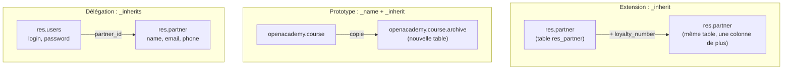
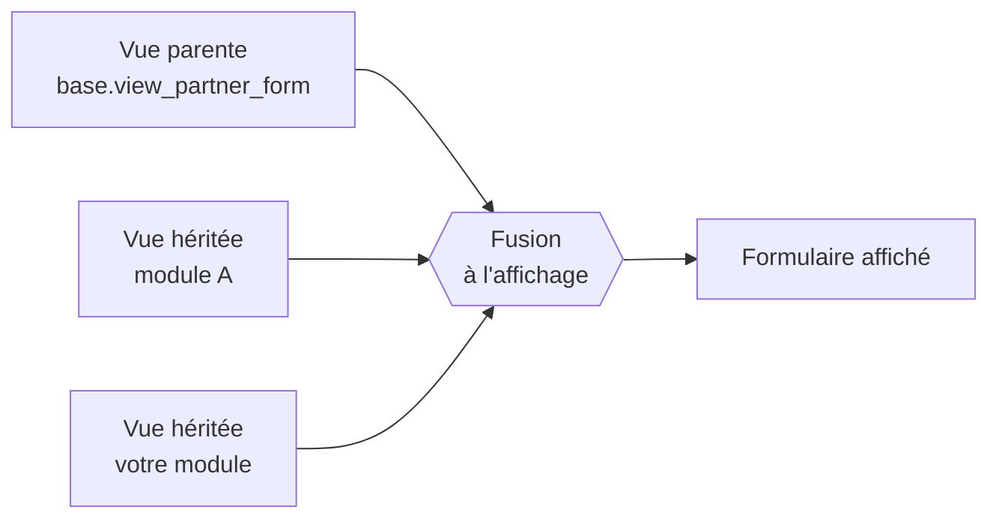

# Chapitre 7 — L'héritage : modèles et vues

[⬅ Chapitre 6](06-methodes-actions.md) · [Sommaire](../README.md) · [Chapitre 8 ➡](08-compute-related.md)

## Objectifs

À la fin de ce chapitre, vous savez :
- distinguer les trois types d'héritage de modèle ;
- ajouter des champs à un modèle standard (`res.partner`, `sale.order`…) ;
- modifier une vue standard avec `inherit_id` et XPath ;
- ajouter le chatter (messages et activités) à un modèle.

> C'est **le** chapitre le plus important du cours. Dans un vrai projet, on crée rarement des modèles
> à partir de rien : on **étend** les modules existants.

---

## 1. Les trois types d'héritage de modèle



| Type | Attributs | Nouvelle table ? | Comportement |
|---|---|---|---|
| **Extension** | `_inherit` | Non | Modifie le modèle original |
| Prototype | `_name` + `_inherit` | Oui | Copie le parent dans un nouveau modèle |
| Délégation | `_inherits` | Oui (table enfant) | Lie un parent via un `Many2one` et expose ses champs |

### Extension (`_inherit`) — le plus courant

On **ajoute** des champs ou des méthodes à un modèle existant, **sans changer son nom ni sa table**.

```python
# models/res_partner.py
from odoo import fields, models


class ResPartner(models.Model):
    _inherit = 'res.partner'

    loyalty_number = fields.Char(string='Numéro de fidélité')
```

- Une colonne `loyalty_number` est ajoutée à la table `res_partner`.
- Le changement s'applique **partout** où `res.partner` est utilisé : clients, fournisseurs, employés…
- Le module doit **dépendre** du module qui définit le modèle (`'depends': ['base']` pour `res.partner`,
  `['sale']` pour `sale.order`…).

### Prototype (`_name` + `_inherit`)

On crée un **nouveau modèle** qui **copie** la structure et les méthodes d'un autre.
Usage le plus fréquent : hériter de **mixins** (`mail.thread`, `mail.activity.mixin`…), voir section 3.

### Délégation (`_inherits`)

Le nouveau modèle **contient** un enregistrement du modèle parent. Exemple réel : **un utilisateur est un contact**,
avec en plus un login et un mot de passe. `user.email` lit en fait `user.partner_id.email`.

```python
class ResUsers(models.Model):
    _name = 'res.users'
    _inherits = {'res.partner': 'partner_id'}

    partner_id = fields.Many2one('res.partner', required=True, ondelete='cascade')
```

### ✍️ À vous — Exercice 7.1

**Utiliser les contacts d'Odoo.**
Pourquoi maintenir notre propre modèle `openacademy.contact` alors qu'Odoo a déjà des contacts ?

1. Remplacez `openacademy.contact` par `res.partner` partout dans votre module
   (professeur et participants des sessions). Supprimez le modèle `openacademy.contact`, ses vues,
   son menu et son droit d'accès.
2. Étendez `res.partner` avec :
   - `is_instructor` (booléen) : ce contact est-il professeur ?
   - `session_ids` : les sessions auxquelles ce contact participe.
3. Dans une session, seuls les contacts `is_instructor` peuvent être choisis comme professeur.
4. Le menu Contacts d'Open Academy ouvre les contacts standards.

**Pour vérifier :**
- [ ] `res_partner` a une colonne `is_instructor`.
- [ ] Le champ Professeur ne propose que les contacts cochés comme professeurs.
- [ ] Un contact créé depuis l'application Contacts peut être ajouté comme participant.

<details><summary>💡 Indice : restreindre les choix du professeur</summary>

L'attribut `domain` d'un champ relationnel filtre les enregistrements proposés.
</details>

<details><summary>💡 Indice : erreur à la mise à jour après suppression du modèle</summary>

Le plus simple sur une base de développement : créez une nouvelle base
(`-d nouvelle_base -i openacademy`).
</details>

👉 [Réponse commentée](../reponses/07-heritage.md#exercice-71)

---

## 2. Héritage de vues

**Ne modifiez jamais une vue standard directement.** Créez une vue qui hérite de l'originale
et décrit seulement les **modifications**. Odoo fusionne les deux à l'affichage.



```xml
<record id="view_partner_form_inherit_loyalty" model="ir.ui.view">
    <field name="name">res.partner.form.inherit.loyalty</field>
    <field name="model">res.partner</field>
    <field name="inherit_id" ref="base.view_partner_form"/>   <!-- la vue parente -->
    <field name="arch" type="xml">
        <xpath expr="//field[@name='vat']" position="after">
            <field name="loyalty_number"/>
        </xpath>
    </field>
</record>
```

### XPath : cibler un élément

| Expression | Cible |
|---|---|
| `//field[@name='vat']` | Le champ `vat` |
| `//page[@name='sales_purchases']` | L'onglet dont le `name` est `sales_purchases` |
| `//notebook` | La barre d'onglets |
| `//header` | L'en-tête du formulaire |

Raccourci pour un champ : `<field name="vat" position="after">…</field>`

### `position` : que faire

| Valeur | Effet |
|---|---|
| `after` / `before` | Ajoute après / avant l'élément ciblé |
| `inside` | Ajoute à l'intérieur (à la fin) |
| `replace` | Remplace l'élément (à utiliser avec prudence) |
| `attributes` | Modifie les attributs de l'élément |

```xml
<xpath expr="//field[@name='phone']" position="attributes">
    <attribute name="required">1</attribute>
</xpath>
```

### Trouver l'ID de la vue à hériter

Mode développeur → ouvrez le formulaire → 🐞 → **Modifier la vue : Formulaire**.
Le champ **ID externe** donne l'identifiant (ex. `base.view_partner_form`).

### ✍️ À vous — Exercice 7.2

**Afficher `is_instructor` dans le formulaire contact.**

1. Trouvez l'ID externe de la vue formulaire de `res.partner`.
2. Ajoutez `is_instructor` sous le champ **Fonction** (`function`).
3. Ajoutez un onglet **Sessions** qui liste les sessions du contact.

**Pour vérifier :**
- [ ] La case « Professeur » apparaît dans le formulaire d'un contact, à l'endroit voulu.
- [ ] L'onglet Sessions liste les bonnes sessions.
- [ ] Aucun fichier d'Odoo n'a été modifié.

<details><summary>💡 Indice : ajouter un onglet</summary>

Ciblez le `notebook` avec `position="inside"` pour ajouter une `<page>` à la fin des onglets.
</details>

👉 [Réponse commentée](../reponses/07-heritage.md#exercice-72)

---

## 3. Ajouter le chatter

Le **chatter** est le fil de messages et d'activités en bas des formulaires Odoo.
On l'obtient en héritant de deux mixins du module `mail` :

```python
class Session(models.Model):
    _name = 'openacademy.session'
    _inherit = ['mail.thread', 'mail.activity.mixin']

    state = fields.Selection([...], tracking=True)   # chaque changement est noté dans le chatter
```

```python
# __manifest__.py
'depends': ['base', 'mail'],
```

```xml
<form>
    <sheet>...</sheet>
    <chatter/>
</form>
```

> En Odoo 17 et avant, on écrivait `<div class="oe_chatter">` avec trois champs. Depuis Odoo 18, `<chatter/>` suffit.

### ✍️ À vous — Exercice 7.3

**Le chatter sur les sessions.**

1. Faites hériter `openacademy.session` de `mail.thread` et `mail.activity.mixin`.
2. Ajoutez `<chatter/>` au formulaire.
3. Activez le suivi (`tracking=True`) sur l'état et le professeur.

**Pour vérifier :**
- [ ] Vous pouvez envoyer un message et planifier une activité sur une session.
- [ ] Changer l'état laisse une trace dans le chatter.

👉 [Réponse commentée](../reponses/07-heritage.md#exercice-73)

---

## 4. Bonnes pratiques

| | |
|---|---|
| **Modèles** | Privilégiez l'extension (`_inherit`) pour ajouter des fonctionnalités métier. |
| **Vues** | Utilisez toujours `inherit_id` et XPath. Ne modifiez jamais le code d'Odoo. |
| **XPath** | Ciblez par `name` plutôt que par position (`group[2]`), qui casse au moindre changement. |
| **Dépendances** | Déclarez dans `depends` tous les modules que vous étendez. |

---

## 🏁 Défi du chapitre — Exercice 7.4

**Étendre un module métier.** Le client veut savoir, sur chaque **commande de vente**, si elle concerne une formation.

1. Ajoutez sur `sale.order` un champ `session_id` (Many2one vers la session).
2. Affichez-le dans le formulaire de commande, juste après le client.
3. Dans le formulaire de la session, ajoutez un onglet avec les commandes liées.

Avant de coder : de quel module faut-il dépendre ? Pourquoi ?

👉 [Réponse commentée](../reponses/07-heritage.md#exercice-74)

---

## Questions de compréhension

1. Quelle est la différence entre `_inherit` seul et `_name` + `_inherit` ? Lequel crée une nouvelle table ?
2. Pourquoi ne faut-il jamais modifier directement une vue standard d'Odoo ?
3. Vous ajoutez un champ sur `sale.order` mais Odoo dit que le modèle n'existe pas. Que manque-t-il ?
4. Pourquoi cibler un élément par son `name` plutôt que par sa position dans XPath ?
5. Qu'apporte `mail.thread` à un modèle ?
6. Un utilisateur Odoo a-t-il une adresse e-mail stockée dans la table `res_users` ? Pourquoi ?

---

[⬅ Chapitre 6](06-methodes-actions.md) · [Sommaire](../README.md) · [Chapitre 8 ➡](08-compute-related.md)
