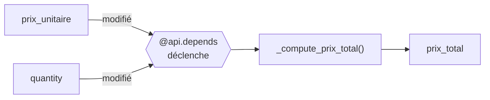
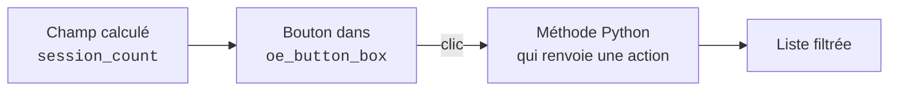

# Chapitre 8 — Champs calculés et liés

[⬅ Chapitre 7](07-heritage.md) · [Sommaire](../README.md) · [Chapitre 9 ➡](09-securite.md)

## Objectifs

À la fin de ce chapitre, vous savez :
- expliquer pourquoi on calcule une valeur plutôt que de la stocker ;
- créer un champ calculé avec `@api.depends` ;
- rendre un champ calculé modifiable (`inverse`) et stocké (`store=True`) ;
- afficher une donnée d'un autre modèle avec `related` ;
- réagir aux modifications dans un formulaire avec `@api.onchange` ;
- créer des boutons intelligents ;
- exécuter une tâche automatique avec une action planifiée.

---

## 1. Normalisation et champs calculés

La **normalisation** d'une base de données évite la redondance : on ne stocke pas une information
qu'on peut déduire d'autres informations.

Exemple : `prix_total = prix_unitaire × quantité`

| Stocké en base | Calculé |
|---|---|
| `prix_unitaire`, `quantity` | `prix_total` |

Si on stockait `prix_total`, il faudrait le mettre à jour à chaque modification du prix ou de la quantité.
Un oubli, et la base devient incohérente.

---

## 2. Champ calculé et `@api.depends`

```python
from odoo import api, fields, models


class OrderLine(models.Model):
    _name = 'demo.order.line'

    prix_unitaire = fields.Float()
    quantity = fields.Float()
    prix_total = fields.Float(compute='_compute_prix_total')

    @api.depends('prix_unitaire', 'quantity')
    def _compute_prix_total(self):
        for record in self:
            record.prix_total = record.prix_unitaire * record.quantity
```



- `compute=` donne le nom de la méthode de calcul.
- `@api.depends(...)` liste les champs dont dépend le calcul, **un argument par champ**.
  On peut suivre des relations : `@api.depends('course_id.level')`.
- La méthode doit **assigner une valeur à chaque enregistrement**, même dans les cas particuliers.
- Par défaut, un champ calculé est **en lecture seule** et **non stocké**.

### ✍️ À vous — Exercice 8.1

**Nombre de participants.** Sur `openacademy.session`, ajoutez un champ calculé `attendee_count` :
le nombre de participants. Affichez-le dans la liste et le formulaire.

**Pour vérifier :**
- [ ] Ajouter un participant met à jour le nombre **immédiatement**, avant d'enregistrer.

👉 [Réponse commentée](../reponses/08-compute-related.md#exercice-81)

---

## 3. `store=True` : stocker le résultat

| | Non stocké (défaut) | `store=True` |
|---|---|---|
| Colonne en base | Non | Oui |
| Recherche, tri, regroupement | ❌ | ✅ |
| Mis à jour | À chaque lecture | Quand un champ de `@api.depends` change |

> ⚠️ Avec `store=True`, un `@api.depends` incomplet donne des valeurs **fausses et figées en base**.

### ✍️ À vous — Exercice 8.2

**Âge des contacts.**

1. Sur `res.partner`, ajoutez `birth_date` (date) et un champ calculé `age`.
2. On doit pouvoir **grouper les contacts par âge** dans la vue liste.

<details><summary>💡 Indice : calculer un âge</summary>

```python
from dateutil.relativedelta import relativedelta
age = relativedelta(fields.Date.today(), record.birth_date).years
```
</details>

<details><summary>💡 Indice : piège</summary>

On ne peut grouper que sur un champ **stocké**. Mais l'âge change chaque année
sans que la date de naissance change… Que devient la valeur stockée ?
</details>

👉 [Réponse commentée](../reponses/08-compute-related.md#exercice-82)

---

## 4. Fonction inverse : rendre le champ modifiable

`inverse=` définit ce qui se passe quand l'utilisateur **modifie** le champ calculé :

```python
total = fields.Float(compute='_compute_total', inverse='_inverse_total')
amount = fields.Float()

@api.depends('amount')
def _compute_total(self):
    for record in self:
        record.total = 2.0 * record.amount

def _inverse_total(self):
    for record in self:
        record.amount = record.total / 2.0
```

### ✍️ À vous — Exercice 8.3

**Date de fin ↔ durée.** Aujourd'hui, la session a une date de début, une date de fin **et** une durée :
trois champs saisis à la main qui peuvent se contredire.

Faites de `end_date` un champ calculé (début + durée), **modifiable** : si l'utilisateur change la date de fin,
la durée est recalculée.

👉 [Réponse commentée](../reponses/08-compute-related.md#exercice-83)

---

## 5. Champs liés (`related`)

Un champ `related` est un raccourci pour un champ calculé qui suit une relation :

```python
course_description = fields.Text(related='course_id.description')
```

C'est l'équivalent, en une ligne, de :

```python
course_description = fields.Text(compute='_compute_course_description')

@api.depends('course_id.description')
def _compute_course_description(self):
    for record in self:
        record.course_description = record.course_id.description
```

Un `related` peut aussi être `store=True`.

### ✍️ À vous — Exercice 8.4

**Afficher le responsable du cours sur la session**, sans le dupliquer, et permettre de **grouper** les sessions par responsable.

👉 [Réponse commentée](../reponses/08-compute-related.md#exercice-84)

---

## 6. `@api.onchange` : réagir dans le formulaire

Un **onchange** modifie d'autres champs du formulaire **pendant la saisie**, avant l'enregistrement.
Il peut aussi afficher un **avertissement** :

```python
@api.onchange('max_participants')
def _onchange_max_participants(self):
    if self.max_participants < 0:
        return {
            'warning': {
                'title': "Valeur incorrecte",
                'message': "Le nombre de places ne peut pas être négatif.",
            }
        }
```

> ⚠️ Un onchange n'est déclenché **que dans un formulaire**. Un `create()` depuis le code, un import CSV
> ou l'API ne le déclenche pas. Ne mettez jamais de logique métier importante dans un onchange.

### ✍️ À vous — Exercice 8.5

**Taux d'occupation.** Sur la session :
1. Un champ `max_participants` : le nombre de places.
2. Un champ calculé `seat_ratio` : le taux d'occupation en %, affiché avec une barre de progression.
3. Un avertissement dans le formulaire si le taux dépasse 100 %.

**Pour vérifier :**
- [ ] Une session à 0 place n'affiche pas d'erreur de division par zéro.
- [ ] Dépasser le nombre de places affiche un avertissement.

<details><summary>💡 Indice : la barre de progression</summary>

`<field name="seat_ratio" widget="progressbar"/>`
</details>

👉 [Réponse commentée](../reponses/08-compute-related.md#exercice-85)

---

## 7. Synthèse

| | Compute | Related | Onchange |
|---|---|---|---|
| Syntaxe | `@api.depends` | `related='…'` | `@api.onchange` |
| Usage | Valeur dérivée d'autres champs | Afficher une donnée d'un modèle lié | Aider la saisie dans un formulaire |
| Fonctionne hors formulaire | ✅ | ✅ | ❌ |
| Peut être stocké | ✅ `store=True` | ✅ `store=True` | — |

**Règle :** compute pour les données dérivées, related pour les données liées, onchange pour l'ergonomie.

---

## 8. Boutons intelligents

Les **boutons intelligents** (*smart buttons*) sont les compteurs en haut à droite d'un formulaire :
« 3 Livraisons », « 2 Factures ». Un clic ouvre la liste correspondante.
Vous les avez utilisés dans l'exercice 1.1.

Un bouton intelligent, c'est la combinaison de trois choses que vous connaissez déjà :



```python
session_count = fields.Integer(compute='_compute_session_count')

@api.depends('session_ids')
def _compute_session_count(self):
    for course in self:
        course.session_count = len(course.session_ids)

def action_view_sessions(self):
    self.ensure_one()
    return {
        'type': 'ir.actions.act_window',
        'name': 'Sessions',
        'res_model': 'openacademy.session',
        'view_mode': 'list,form',
        'domain': [('course_id', '=', self.id)],
        'context': {'default_course_id': self.id},
    }
```

```xml
<sheet>
    <div class="oe_button_box" name="button_box">
        <button name="action_view_sessions" type="object" class="oe_stat_button" icon="fa-calendar">
            <field name="session_count" widget="statinfo" string="Sessions"/>
        </button>
    </div>
    ...
</sheet>
```

- `oe_button_box` : la zone en haut à droite de la feuille.
- `oe_stat_button` + `widget="statinfo"` : le style « compteur ».
- `icon` : une icône [Font Awesome](https://fontawesome.com/v4/icons/) (`fa-calendar`, `fa-users`…).

### ✍️ À vous — Exercice 8.6

**Boutons intelligents.**

1. Sur le formulaire d'un **cours** : un bouton « N Sessions » qui ouvre les sessions de ce cours.
   Une session créée depuis cette liste a le cours pré-rempli.
2. Sur le formulaire d'une **session** : un bouton « N Participants » qui ouvre la liste des participants.

**Pour vérifier :**
- [ ] Le compteur affiche le bon nombre et se met à jour.
- [ ] Le clic ouvre une liste filtrée, avec un fil d'Ariane pour revenir au formulaire.

👉 [Réponse commentée](../reponses/08-compute-related.md#exercice-86)

---

## 9. Actions planifiées

Une **action planifiée** (`ir.cron`) exécute une méthode Python **automatiquement**, à intervalle régulier :
chaque nuit, chaque heure… Pratique pour les tâches de maintenance ou les rappels.

```xml
<!-- data/cron.xml -->
<odoo noupdate="1">
    <record id="cron_close_sessions" model="ir.cron">
        <field name="name">Open Academy : clôturer les sessions passées</field>
        <field name="model_id" ref="model_openacademy_session"/>
        <field name="state">code</field>
        <field name="code">model._cron_close_past_sessions()</field>
        <field name="interval_number">1</field>
        <field name="interval_type">days</field>
    </record>
</odoo>
```

```python
@api.model
def _cron_close_past_sessions(self):
    sessions = self.search([('state', '=', 'confirm'), ('end_date', '<', fields.Date.today())])
    sessions.write({'state': 'done'})
```

- `model` : dans le code de l'action, c'est le modèle (un recordset vide de `openacademy.session`).
- `@api.model` : la méthode ne travaille pas sur des enregistrements précis, elle les cherche elle-même.
- Pour tester sans attendre : **Paramètres → Technique → Actions planifiées** → ouvrez la vôtre → **Exécuter manuellement**.

### ✍️ À vous — Exercice 8.7

**Clôture automatique.** Créez une action planifiée quotidienne qui passe en **Terminé** toutes les sessions
**confirmées** dont la date de fin est passée.

**Bonus :** une deuxième action planifiée qui recalcule l'âge des contacts (exercice 8.2).

**Pour vérifier :**
- [ ] L'action apparaît dans **Paramètres → Technique → Actions planifiées**.
- [ ] **Exécuter manuellement** clôture les sessions concernées, et seulement elles.

👉 [Réponse commentée](../reponses/08-compute-related.md#exercice-87)

---

## 🏁 Défi du chapitre — Exercice 8.8

1. **Nom automatique** : le nom affiché d'une session devient `Session <cours> – <date de début>`
   (ex. `Session Python – 10/10/2026`), partout dans Odoo (fil d'Ariane, listes déroulantes, calendrier).
2. **Prix** : un champ `price_per_participant` sur le cours, et un `total_price` stocké sur la session.
   Affichez le chiffre d'affaires par cours dans la vue graphique.
3. **`estate`** : `total_area` = surface habitable + jardin.

<details><summary>💡 Indice : le nom affiché</summary>

Le nom affiché partout dans Odoo est le champ `display_name`, calculé par `_compute_display_name`.
</details>

👉 [Réponse commentée](../reponses/08-compute-related.md#exercice-88)

---

## Questions de compréhension

1. Pourquoi ne pas simplement stocker `prix_total` dans un champ normal ?
2. Que se passe-t-il si vous oubliez un champ dans `@api.depends` d'un champ `store=True` ?
3. Sur quel type de champ peut-on trier et grouper dans une vue liste ?
4. Votre onchange fonctionne dans le formulaire, mais pas quand les données sont importées en CSV. Pourquoi ?
5. Quelle est la différence entre `related='course_id.level'` et un champ calculé qui fait la même chose ?
6. De quels trois éléments est composé un bouton intelligent ?
7. Pourquoi une méthode appelée par une action planifiée est-elle décorée par `@api.model` ?

---

[⬅ Chapitre 7](07-heritage.md) · [Sommaire](../README.md) · [Chapitre 9 ➡](09-securite.md)
