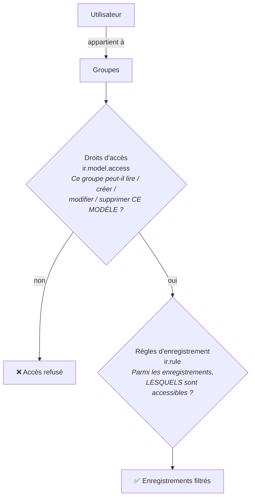

# Chapitre 9 — Sécurité

[⬅ Chapitre 8](08-compute-related.md) · [Sommaire](../README.md) · [Chapitre 10 ➡](10-rapports-pdf.md)

## Objectifs

À la fin de ce chapitre, vous savez :
- créer des groupes d'utilisateurs ;
- donner des droits d'accès à un modèle par groupe (*access rights*) ;
- restreindre l'accès à certains enregistrements (*record rules*) ;
- masquer des champs et protéger des actions selon le groupe.

---

## 1. Le principe

Odoo a deux mécanismes de sécurité, tous deux liés aux **groupes** :



Un utilisateur appartient à plusieurs groupes. Ses droits sont calculés à partir de **tous** ses groupes.

---

## 2. Les groupes (`res.groups`)

| Champ | Rôle |
|---|---|
| `name` | Nom lisible du groupe (le rôle) |
| `category_id` | Catégorie (application) : les groupes d'une même catégorie apparaissent comme un choix exclusif dans le formulaire utilisateur |
| `implied_ids` | Groupes donnés automatiquement avec celui-ci (ex. Responsable implique Utilisateur) |

```xml
<!-- security/security.xml -->
<odoo>
    <record id="module_category_openacademy" model="ir.module.category">
        <field name="name">Open Academy</field>
    </record>

    <record id="group_openacademy_user" model="res.groups">
        <field name="name">Utilisateur</field>
        <field name="category_id" ref="module_category_openacademy"/>
    </record>

    <record id="group_openacademy_manager" model="res.groups">
        <field name="name">Responsable</field>
        <field name="category_id" ref="module_category_openacademy"/>
        <field name="implied_ids" eval="[(4, ref('group_openacademy_user'))]"/>
    </record>
</odoo>
```

Le fichier des groupes doit être chargé **avant** le CSV qui les utilise.

> En **Odoo 19**, la catégorie d'un groupe passe par un « privilège » (`res.groups.privilege`). Le principe reste le même.

---

## 3. Droits d'accès (`ir.model.access`)

Donne l'accès à un **modèle entier** pour certaines opérations.
**Si aucun droit ne correspond, l'accès est refusé.**

```csv
id,name,model_id:id,group_id:id,perm_read,perm_write,perm_create,perm_unlink
access_course_user,course user,model_openacademy_course,group_openacademy_user,1,0,0,0
access_course_manager,course manager,model_openacademy_course,group_openacademy_manager,1,1,1,1
```

- Les droits sont **cumulatifs** : groupe A (lecture + création) + groupe B (modification) = lecture, création, modification.
- `group_id` vide = s'applique à **tout le monde**, y compris les utilisateurs portail et publics. À éviter.

### ✍️ À vous — Exercice 9.1

**Groupes et droits d'accès.**

1. Créez deux groupes dans une catégorie « Open Academy » : **Utilisateur** et **Responsable**
   (le responsable a automatiquement les droits d'utilisateur).
2. Droits :

| Modèle | Utilisateur | Responsable |
|---|---|---|
| `openacademy.session` | Tout | Tout |
| `openacademy.course` | Lecture seule | Tout |

3. Créez deux utilisateurs de test, un dans chaque groupe.

**Pour vérifier :**
- [ ] Dans le formulaire utilisateur, un choix « Open Academy : Utilisateur / Responsable » apparaît.
- [ ] En utilisateur, vous ne pouvez pas modifier un cours, mais vous pouvez créer une session.

<details><summary>💡 Indice : tester avec un autre utilisateur</summary>

Utilisez une fenêtre de navigation privée pour être connecté avec deux comptes en même temps.
N'oubliez pas de définir un mot de passe pour vos utilisateurs de test.
</details>

👉 [Réponse commentée](../reponses/09-securite.md#exercice-91)

---

## 4. Règles d'enregistrement (`ir.rule`)

Filtrent les enregistrements accessibles, avec un **domaine**. Évaluées **après** les droits d'accès.

```xml
<record id="rule_session_own" model="ir.rule">
    <field name="name">Sessions : uniquement les miennes</field>
    <field name="model_id" ref="model_openacademy_session"/>
    <field name="groups" eval="[(4, ref('group_openacademy_user'))]"/>
    <field name="domain_force">[('create_uid', '=', user.id)]</field>
</record>
```

Variables dans `domain_force` : `user` (l'utilisateur connecté), `company_id`, `company_ids`, `time`.

Les `perm_read`, `perm_write`, `perm_create`, `perm_unlink` indiquent ici **à quelles opérations la règle s'applique**
(par défaut : toutes).

### Règles globales et règles de groupe

| | Règle **globale** (sans groupe) | Règle **de groupe** |
|---|---|---|
| Combinaison | Elles s'**intersectent** (ET) : chaque règle restreint davantage | Elles s'**unissent** (OU) : chaque règle peut élargir l'accès |
| Limite | — | Ne peut jamais dépasser ce que permettent les règles globales |

### ✍️ À vous — Exercice 9.2

**Règles d'enregistrement.**

1. Un **responsable** voit toutes les sessions.
2. Un **utilisateur** ne voit que les sessions dont il est le professeur (`instructor_id`).

**Pour vérifier :**
- [ ] En utilisateur, la liste des sessions ne montre que les siennes.
- [ ] En responsable, toutes les sessions apparaissent.

<details><summary>💡 Indice : le domaine de la règle</summary>

Attention aux types : `instructor_id` pointe vers un **contact** (`res.partner`), alors que `user`
est un **utilisateur** (`res.users`). Chaque utilisateur a un contact lié : `user.partner_id`.
</details>

<details><summary>💡 Indice : le responsable ne voit que ses sessions</summary>

Le responsable hérite du groupe utilisateur, donc de sa règle. Ajoutez une règle pour le groupe
responsable avec le domaine `[(1, '=', 1)]` (toujours vrai) : les règles de groupe s'unissent.
</details>

👉 [Réponse commentée](../reponses/09-securite.md#exercice-92)

---

## 5. Visibilité ≠ sécurité

Masquer un élément dans l'interface ne le **protège** pas.

| Où | Code | Effet |
|---|---|---|
| Dans la **vue** | `<field name="notes" groups="openacademy.group_openacademy_manager"/>` | Le champ est **masqué**… mais reste lisible via l'API ou un export |
| Sur le **champ Python** | `notes = fields.Char(groups='openacademy.group_openacademy_manager')` | Le champ est **inaccessible** dans l'ORM pour les autres |
| Dans une **méthode** | `if not self.env.user.has_group('openacademy.group_openacademy_manager'): raise AccessError(...)` | L'**action** est protégée |

> ⚠️ Un bouton caché avec `groups="..."` peut quand même être appelé via l'API.
> Pour une action sensible, vérifiez **aussi** le groupe dans la méthode Python.

### ✍️ À vous — Exercice 9.3

**Champ protégé.** Ajoutez un champ `password` sur la session, visible et lisible **uniquement par les responsables**.

👉 [Réponse commentée](../reponses/09-securite.md#exercice-93)

---

## 🏁 Défi du chapitre — Exercice 9.4

**Validation par un responsable.** Ajoutez un état `review` (À valider) entre `confirm` et `done` :
- un utilisateur qui termine sa session la fait passer en `review` ;
- seul un responsable peut la passer de `review` à `done`.

**Pour vérifier :**
- [ ] En utilisateur, le bouton de validation finale est absent.
- [ ] Même en appelant la méthode depuis le shell avec un utilisateur non responsable, le passage en `done` est refusé.

<details><summary>💡 Indice : tester depuis le shell avec un autre utilisateur</summary>

```python
user = env['res.users'].search([('login', '=', 'user_test')])
session.with_user(user).action_done()
```
</details>

👉 [Réponse commentée](../reponses/09-securite.md#exercice-94)

---

## Questions de compréhension

1. Quelle est la différence entre un droit d'accès et une règle d'enregistrement ?
2. Un utilisateur est dans un groupe qui donne la lecture et dans un autre qui donne la suppression. Que peut-il faire ?
3. Deux règles **globales** s'appliquent au même modèle. L'utilisateur doit-il satisfaire l'une ou les deux ?
4. Pourquoi `groups="..."` sur un bouton ne suffit-il pas à sécuriser une action ?
5. Quelle est la différence entre `groups` dans la vue XML et `groups` sur le champ Python ?
6. Que signifie un `group_id` vide dans `ir.model.access.csv` ? Pourquoi est-ce dangereux ?

---

[⬅ Chapitre 8](08-compute-related.md) · [Sommaire](../README.md) · [Chapitre 10 ➡](10-rapports-pdf.md)
