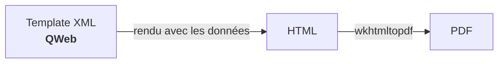
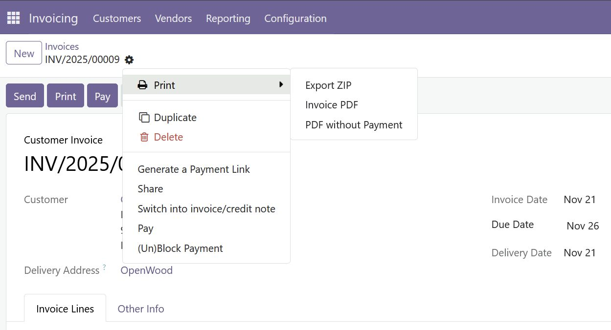
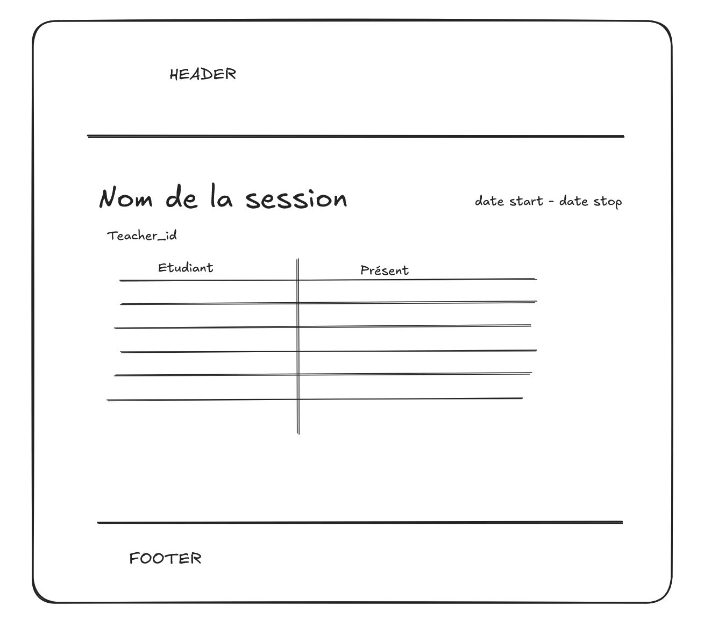

# Chapitre 10 — Rapports PDF

[⬅ Chapitre 9](09-securite.md) · [Sommaire](../README.md) · [Chapitre 11 ➡](11-controleurs-site-web.md)

## Objectifs

À la fin de ce chapitre, vous savez :
- expliquer comment Odoo génère un PDF ;
- déclarer une action de rapport et l'ajouter au menu **Imprimer** ;
- écrire un template QWeb qui affiche les données d'un enregistrement.

---

## 1. Comment Odoo génère un PDF



1. **QWeb** est le moteur de templates d'Odoo : du XML avec des instructions (`t-foreach`, `t-if`, `t-field`…).
2. Le template produit du **HTML**.
3. **wkhtmltopdf** convertit le HTML en PDF (il doit être installé sur le serveur).

Les rapports apparaissent dans le menu **Imprimer** du formulaire :



Documentation : [QWeb](https://www.odoo.com/documentation/18.0/fr/developer/reference/frontend/qweb.html) ·
[Rapports](https://www.odoo.com/documentation/18.0/fr/developer/reference/backend/reports.html)

---

## 2. L'action de rapport (`ir.actions.report`)

```xml
<record id="action_report_session" model="ir.actions.report">
    <field name="name">Feuille de session</field>
    <field name="model">openacademy.session</field>
    <field name="report_type">qweb-pdf</field>
    <field name="report_name">openacademy.report_session</field>
    <field name="print_report_name">'Session - %s' % object.name</field>
    <field name="binding_model_id" ref="model_openacademy_session"/>
    <field name="binding_type">report</field>
</record>
```

| Champ | Rôle |
|---|---|
| `model` | Le modèle concerné |
| `report_type` | `qweb-pdf` (PDF) ou `qweb-html` (aperçu HTML, pratique pour déboguer) |
| `report_name` | L'ID externe du template QWeb |
| `print_report_name` | Expression Python pour le nom du fichier (`object` = l'enregistrement) |
| `binding_model_id` | Fait apparaître le rapport dans le menu **Imprimer** du modèle |
| `paperformat_id` | Format de papier (sinon celui de la société) |
| `attachment_use` / `attachment` | Génère le PDF une seule fois et le conserve en pièce jointe (documents légaux) |

---

## 3. Le template QWeb

```xml
<template id="report_session">
    <t t-call="web.html_container">
        <t t-foreach="docs" t-as="doc">
            <t t-call="web.external_layout">          <!-- en-tête et pied de page de la société -->
                <div class="page">
                    <h2 t-field="doc.name"/>
                    <p>Cours : <span t-field="doc.course_id"/></p>
                </div>
            </t>
        </t>
    </t>
</template>
```

| Directive | Effet |
|---|---|
| `t-foreach="liste" t-as="x"` | Boucle |
| `t-if="condition"` / `t-elif` / `t-else` | Condition |
| `t-field="doc.champ"` | Affiche un champ **formaté** selon son type (date, montant, Many2one…) |
| `t-out="expression"` | Affiche une valeur (échappée) |
| `t-call="template"` | Insère un autre template |
| `t-set="var" t-value="..."` | Définit une variable |

Variables disponibles : `docs` (les enregistrements à imprimer), `user`, `res_company`, `time`, `context_timestamp`.

### ✍️ À vous — Exercice 10.1

**Un premier rapport.** Créez un rapport **Feuille de session** qui affiche seulement le nom de la session
et son cours, disponible dans le menu **Imprimer**.

**Pour vérifier :**
- [ ] **Imprimer → Feuille de session** télécharge un PDF.
- [ ] Le PDF a l'en-tête de la société (logo, adresse).

<details><summary>💡 Indice : déboguer le template</summary>

Passez temporairement `report_type` à `qweb-html` : le rapport s'affiche dans le navigateur
et vous pouvez inspecter le HTML. Repassez en `qweb-pdf` ensuite.
</details>

👉 [Réponse commentée](../reponses/10-rapports-pdf.md#exercice-101)

---

## 4. Tableaux et boucles

Un tableau HTML avec une ligne par participant :

```xml
<table class="table table-sm">
    <thead>
        <tr><th>Participant</th><th>E-mail</th></tr>
    </thead>
    <tbody>
        <tr t-foreach="doc.attendee_ids" t-as="attendee">
            <td t-out="attendee.name"/>
            <td t-out="attendee.email"/>
        </tr>
    </tbody>
</table>
```

Les classes `table`, `table-sm`, `text-end`… viennent de **Bootstrap**, chargé dans tous les rapports.

### ✍️ À vous — Exercice 10.2

**Feuille de présence.** Complétez le rapport pour qu'il ressemble à cette maquette :



- le nom de la session, le professeur, les dates de début et de fin ;
- un tableau avec tous les participants et une colonne vide pour la signature.

**Pour vérifier :**
- [ ] Les dates sont au format de la langue de l'utilisateur.
- [ ] En sélectionnant 3 sessions dans la liste, on obtient un PDF de 3 pages.

👉 [Réponse commentée](../reponses/10-rapports-pdf.md#exercice-102)

---

## 🏁 Défi du chapitre — Exercice 10.3

1. Affichez le nombre de participants et le taux d'occupation en bas du tableau.
2. N'affichez le mot de passe de la session (chapitre 9) que si l'utilisateur qui imprime est responsable.
3. Explorez le rapport de facture d'Odoo (`addons/account/views/report_invoice.xml`) :
   comment est géré le titre d'une facture en brouillon ?

👉 [Réponse commentée](../reponses/10-rapports-pdf.md#exercice-103)

---

## Questions de compréhension

1. Quelles sont les trois étapes de la génération d'un PDF dans Odoo ?
2. À quoi sert `binding_model_id` dans une action de rapport ?
3. Quelle est la différence entre `t-field` et `t-out` ?
4. Que contient la variable `docs` ?
5. Pourquoi conserver un PDF en pièce jointe (`attachment_use`) pour une facture ?

---

[⬅ Chapitre 9](09-securite.md) · [Sommaire](../README.md) · [Chapitre 11 ➡](11-controleurs-site-web.md)
