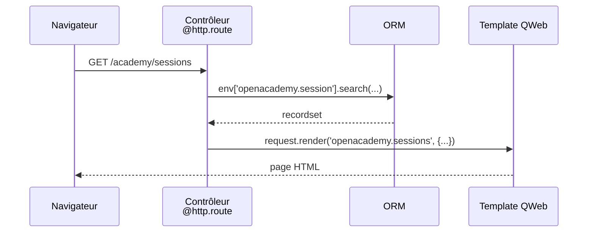

# Chapitre 11 — Contrôleurs et site web

[⬅ Chapitre 10](10-rapports-pdf.md) · [Sommaire](../README.md) · [Chapitre 12 ➡](12-wizards.md)

## Objectifs

À la fin de ce chapitre, vous savez :
- créer une route web avec un contrôleur ;
- afficher une page avec un template QWeb ;
- afficher des données de la base sur une page publique ;
- utiliser des paramètres dans les URLs.

---

## 1. Backend et frontend

| | Backend | Frontend |
|---|---|---|
| Pour qui | Les utilisateurs internes | Les visiteurs, clients, portail |
| URL | `/odoo/...` | `/`, `/shop`, `/academy`… |
| Construit avec | Vues XML, actions, menus | **Contrôleurs** + templates QWeb |


Vidéo d'introduction à l'infrastructure : <https://www.youtube.com/watch?v=SXv9JCCUqXQ>



---

## 2. Les contrôleurs

Un contrôleur est une classe qui hérite de `http.Controller`. Chaque méthode décorée par `@http.route`
répond à une URL :

```python
# controllers/main.py
from odoo import http


class Academy(http.Controller):

    @http.route('/academy/hello', auth='public')
    def hello(self, **kw):
        return "Hello, world!"
```

| Paramètre de `@http.route` | Valeurs |
|---|---|
| `auth` | `'public'` (tout le monde), `'user'` (connecté), `'none'` (sans base de données) |
| `website=True` | Intègre la page au site web (menu, thème…). Nécessite le module `website` |
| `methods` | `['GET']`, `['POST']`… |
| `type` | `'http'` (page) ou `'json'` (API) |

Documentation : [Routing](https://www.odoo.com/documentation/18.0/fr/developer/reference/backend/http.html#routing)

### ✍️ À vous — Exercice 11.1

**Hello world.** Créez une route `/academy/hello` qui affiche `Hello, world!`.

**Pour vérifier :**
- [ ] <http://127.0.0.1:8069/academy/hello> affiche le texte, même en navigation privée.

<details><summary>💡 Indice : 404 Not Found</summary>

- Le dossier `controllers` est-il importé dans le `__init__.py` du module ?
- Avez-vous **redémarré** le serveur ?
- Avec plusieurs bases de données, Odoo ne sait pas laquelle utiliser pour un visiteur anonyme :
  lancez le serveur avec `--db-filter=my_database`.
</details>

👉 [Réponse commentée](../reponses/11-controleurs-site-web.md#exercice-111)

---

## 3. Afficher un template QWeb

Écrire du HTML dans des chaînes Python devient vite illisible. On utilise un **template** :

```python
@http.route('/academy/teachers', auth='public')
def teachers(self, **kw):
    return http.request.render('openacademy.teachers', {
        'teachers': ["Diana Padilla", "Jody Caroll", "Lester Vaughn"],
    })
```

```xml
<!-- views/templates.xml -->
<template id="teachers">
    <title>Academy</title>
    <t t-foreach="teachers" t-as="teacher">
        <p t-out="teacher"/>
    </t>
</template>
```

Le dictionnaire passé à `render` devient les variables du template.

### ✍️ À vous — Exercice 11.2

**Liste statique.** Créez la route `/academy/teachers` qui affiche la liste ci-dessus avec un template.

👉 [Réponse commentée](../reponses/11-controleurs-site-web.md#exercice-112)

---

## 4. Afficher des données de la base

```python
@http.route('/academy/sessions', auth='public', website=True)
def sessions(self, **kw):
    sessions = http.request.env['openacademy.session'].sudo().search([])
    return http.request.render('openacademy.sessions', {'sessions': sessions})
```

```xml
<template id="sessions">
    <t t-call="website.layout">                 <!-- en-tête, menu et pied de page du site -->
        <div class="container">
            <t t-foreach="sessions" t-as="session">
                <p><t t-out="session.name"/> — <span t-field="session.start_date"/></p>
            </t>
        </div>
    </t>
</template>
```

> ⚠️ Un visiteur non connecté (`auth='public'`) est l'utilisateur **Public**, qui n'a pas de droits
> sur vos modèles. `sudo()` contourne les droits : utilisez-le avec précaution et ne montrez que
> ce qui doit être public.

### ✍️ À vous — Exercice 11.3

**Les sessions sur le site web.** Installez le module **Site web**, puis créez la page `/academy/sessions`
qui affiche les sessions **confirmées**, avec le template standard du site.

**Pour vérifier :**
- [ ] La page a l'en-tête et le pied de page du site.
- [ ] Un visiteur non connecté voit les sessions confirmées, pas les brouillons.

👉 [Réponse commentée](../reponses/11-controleurs-site-web.md#exercice-113)

---

## 5. Paramètres dans l'URL

```python
# /academy/diana  →  name = "diana"
@http.route('/academy/<name>', auth='public', website=True)
def by_name(self, name): ...

# /academy/42  →  id = 42 (entier)
@http.route('/academy/<int:id>', auth='public', website=True)
def by_id(self, id): ...

# /academy/session/3  →  Odoo charge directement l'enregistrement
@http.route('/academy/session/<model("openacademy.session"):session>', auth='public', website=True)
def session_page(self, session):
    return http.request.render('openacademy.session_page', {'session': session})
```

---

## 🏁 Défi du chapitre — Exercice 11.4

**Page de détail.** Chaque session de la liste est un lien vers `/academy/session/<id>`, qui affiche
le cours, les dates, le professeur et le nombre de places restantes.

**Pour vérifier :**
- [ ] Le mot de passe de la session (chapitre 9) n'apparaît **nulle part**.
- [ ] Une session en brouillon n'est pas accessible en tapant son URL à la main.

👉 [Réponse commentée](../reponses/11-controleurs-site-web.md#exercice-114)

---

## Questions de compréhension

1. Quelle est la différence entre `auth='public'` et `auth='user'` ?
2. Pourquoi faut-il souvent utiliser `sudo()` dans un contrôleur public ? Quel est le risque ?
3. Vous modifiez une route Python : faut-il redémarrer, mettre à jour avec `-u`, ou les deux ? Et pour un template XML ?
4. Qu'apporte le convertisseur `<model("openacademy.session"):session>` par rapport à `<int:id>` ?

---

[⬅ Chapitre 10](10-rapports-pdf.md) · [Sommaire](../README.md) · [Chapitre 12 ➡](12-wizards.md)
