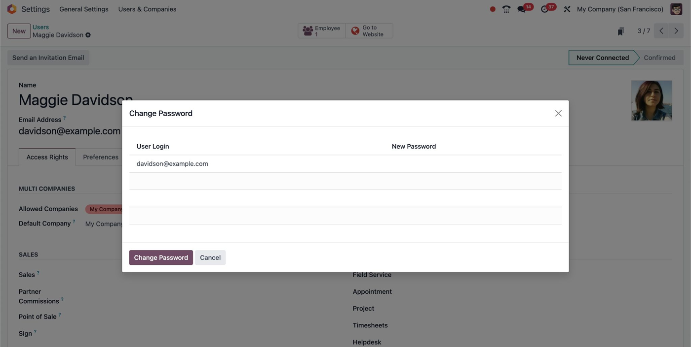
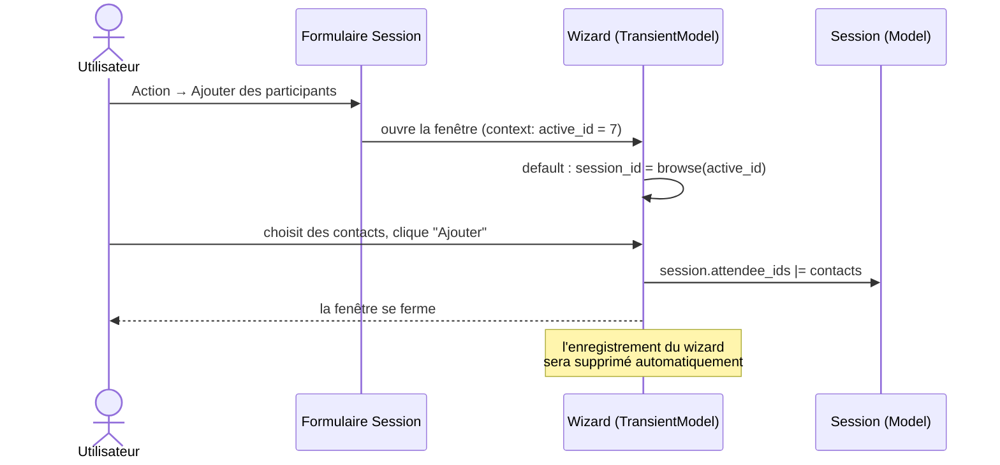
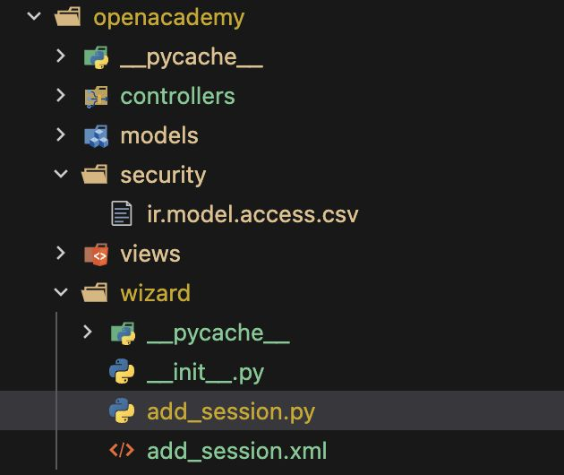
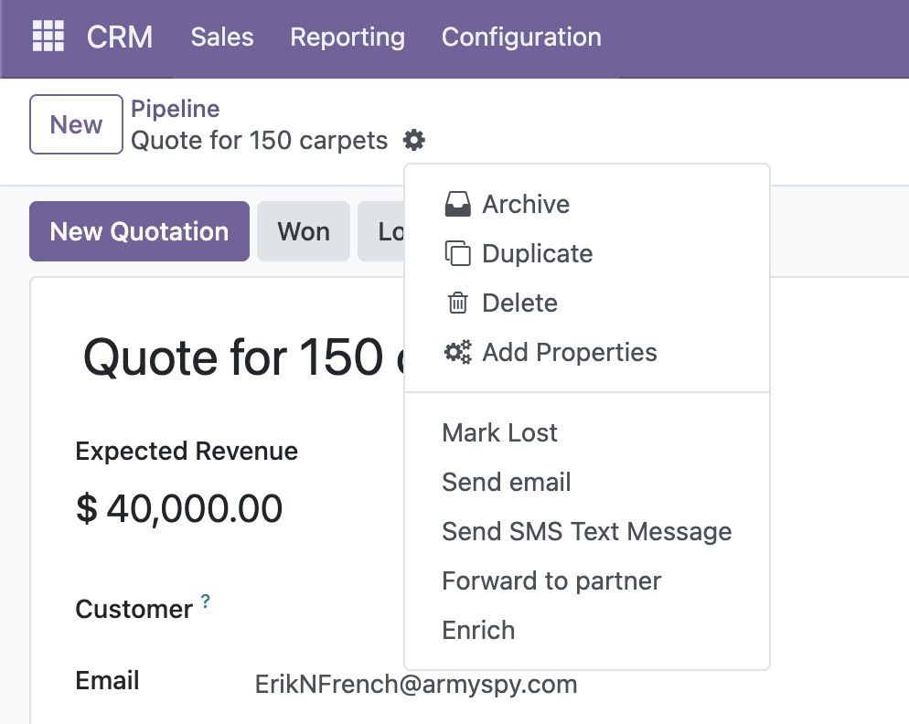
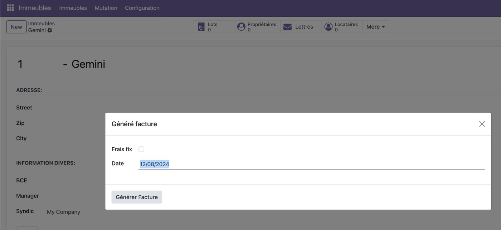
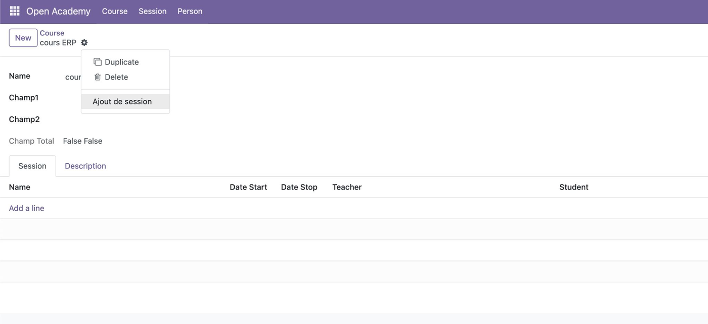
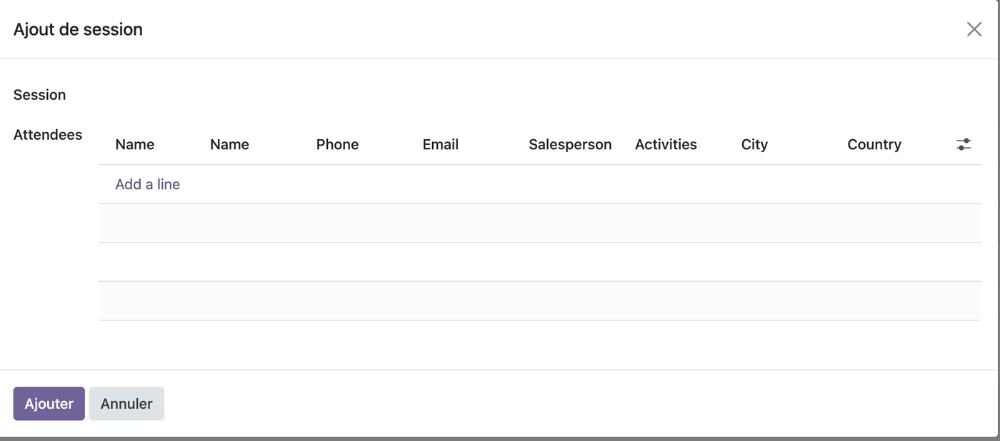

# Chapitre 12 — Wizards

[⬅ Chapitre 11](11-controleurs-site-web.md) · [Sommaire](../README.md)

## Objectifs

À la fin de ce chapitre, vous savez :
- expliquer ce qu'est un wizard et un `TransientModel` ;
- ouvrir un wizard dans une fenêtre modale depuis le menu **Action** ;
- récupérer l'enregistrement d'où l'on vient (`active_id`) ;
- appliquer le résultat du wizard sur les données permanentes.

---

## 1. Qu'est-ce qu'un wizard ?

Un **wizard** (assistant) est une fenêtre modale qui demande quelques informations à l'utilisateur
puis effectue une action. Exemple : **Changer le mot de passe** d'un utilisateur.



Un wizard repose sur un **`TransientModel`** : un modèle dont les enregistrements sont **temporaires**.
Ils sont stockés en base le temps de l'opération, puis supprimés automatiquement par une tâche de nettoyage.

```python
from odoo import fields, models


class AddAttendeesWizard(models.TransientModel):
    _name = 'openacademy.add.attendees.wizard'
    _description = "Ajout de participants"

    session_id = fields.Many2one('openacademy.session', required=True)
    attendee_ids = fields.Many2many('res.partner', string='Participants')

    def action_add(self):
        self.session_id.attendee_ids |= self.attendee_ids   # ajoute sans retirer les existants
```



---

## 2. Où mettre les fichiers ?



```
openacademy/
├── __init__.py              → from . import controllers, models, wizard
├── security/
│   └── ir.model.access.csv  ← le wizard a aussi besoin d'un droit d'accès !
└── wizard/
    ├── __init__.py          → from . import add_attendees
    ├── add_attendees.py     ← le TransientModel
    └── add_attendees.xml    ← sa vue et son action
```

---

## 3. La vue et l'action

L'action apparaît dans le menu **Action** (⚙️) du modèle d'origine :

| Le menu Action | Le wizard ouvert |
|---|---|
|  |  |

```xml
<odoo>
    <record id="add_attendees_wizard_form" model="ir.ui.view">
        <field name="name">openacademy.add.attendees.wizard.form</field>
        <field name="model">openacademy.add.attendees.wizard</field>
        <field name="arch" type="xml">
            <form string="Ajout de participants">
                <group>
                    <field name="session_id"/>
                    <field name="attendee_ids"/>
                </group>
                <footer>
                    <button name="action_add" type="object" string="Ajouter" class="btn-primary"/>
                    <button special="cancel" string="Annuler"/>
                </footer>
            </form>
        </field>
    </record>

    <record id="add_attendees_wizard_action" model="ir.actions.act_window">
        <field name="name">Ajouter des participants</field>
        <field name="res_model">openacademy.add.attendees.wizard</field>
        <field name="view_mode">form</field>
        <field name="target">new</field>                                         <!-- fenêtre modale -->
        <field name="binding_model_id" ref="model_openacademy_session"/>          <!-- menu Action de ce modèle -->
        <field name="binding_view_types">list,form</field>
    </record>
</odoo>
```

| Champ | Rôle |
|---|---|
| `res_model` | Le modèle du wizard (le `TransientModel`) |
| `target="new"` | Ouvre dans une fenêtre modale |
| `binding_model_id` | Ajoute l'action dans le menu **Action** de **ce** modèle (le modèle d'origine) |
| `binding_view_types` | Dans quelles vues l'action apparaît (`list`, `form` ou les deux) |

---

## 4. Savoir d'où l'on vient : `active_id`

Dans le wizard, `self` est le wizard, pas la session. Mais Odoo met dans le **contexte**
l'enregistrement depuis lequel l'action a été lancée :

| Clé du contexte | Contenu |
|---|---|
| `active_model` | Le modèle d'origine (ex. `'openacademy.session'`) |
| `active_id` | L'id de l'enregistrement d'origine |
| `active_ids` | Les ids sélectionnés (si lancé depuis une liste) |

```python
active_id = self.env.context.get('active_id')
session = self.env['openacademy.session'].browse(active_id)
```

> ⚠️ `active_id` est un **entier**, pas un recordset. Il faut appeler `browse()` pour obtenir l'enregistrement.

### ✍️ À vous — Exercice 12.1

**Inscrire plusieurs participants d'un coup.** Depuis le formulaire d'une session, ajoutez dans le menu
**Action** un wizard **Ajouter des participants** :
- la session est pré-remplie avec celle d'où l'on vient ;
- l'utilisateur choisit plusieurs contacts ;
- **Ajouter** les inscrit, sans retirer les participants existants ;
- **Annuler** ferme la fenêtre sans rien faire.

**Pour vérifier :**
- [ ] **Action → Ajouter des participants** apparaît dans le formulaire de session.
- [ ] Le champ Session est pré-rempli.
- [ ] Les participants déjà inscrits sont toujours là après l'ajout.
- [ ] Un utilisateur non administrateur peut utiliser le wizard.

<details><summary>💡 Indice : pré-remplir la session</summary>

Utilisez une valeur par défaut (`default=`) qui lit `active_id` dans le contexte.
</details>

<details><summary>💡 Indice : « You are not allowed to access … wizard »</summary>

Un `TransientModel` a aussi besoin d'une ligne dans `ir.model.access.csv`.
</details>

👉 [Réponse commentée](../reponses/12-wizards.md#exercice-121)

### ✍️ À vous — Exercice 12.2

**Inscrire à plusieurs sessions.** Modifiez le wizard pour qu'il fonctionne **depuis la vue liste** :
l'utilisateur sélectionne plusieurs sessions, et les contacts choisis sont inscrits à **toutes**.

<details><summary>💡 Indice</summary>

Remplacez le `Many2one` vers la session par un `Many2many`, et utilisez `active_ids`.
</details>

👉 [Réponse commentée](../reponses/12-wizards.md#exercice-122)

---

## 🏁 Défi du chapitre — Exercice 12.3

**Depuis un cours.** Depuis le formulaire d'un **cours**, ajoutez une action **Ajout de session**
qui crée une nouvelle session pour ce cours et y inscrit directement plusieurs participants.

| Le menu Action du cours | Le wizard attendu |
|---|---|
|  |  |

👉 [Réponse commentée](../reponses/12-wizards.md#exercice-123)

---

## Questions de compréhension

1. Quelle est la différence entre un `Model` et un `TransientModel` ?
2. À quoi sert `target="new"` dans l'action ?
3. Pourquoi `binding_model_id` pointe-t-il vers le modèle d'origine et non vers le wizard ?
4. `self.env.context.get('active_id')` renvoie-t-il un enregistrement ? Comment l'obtenir ?
5. Un wizard est-il soumis aux droits d'accès ?

---

[⬅ Chapitre 11](11-controleurs-site-web.md) · [Sommaire](../README.md)
