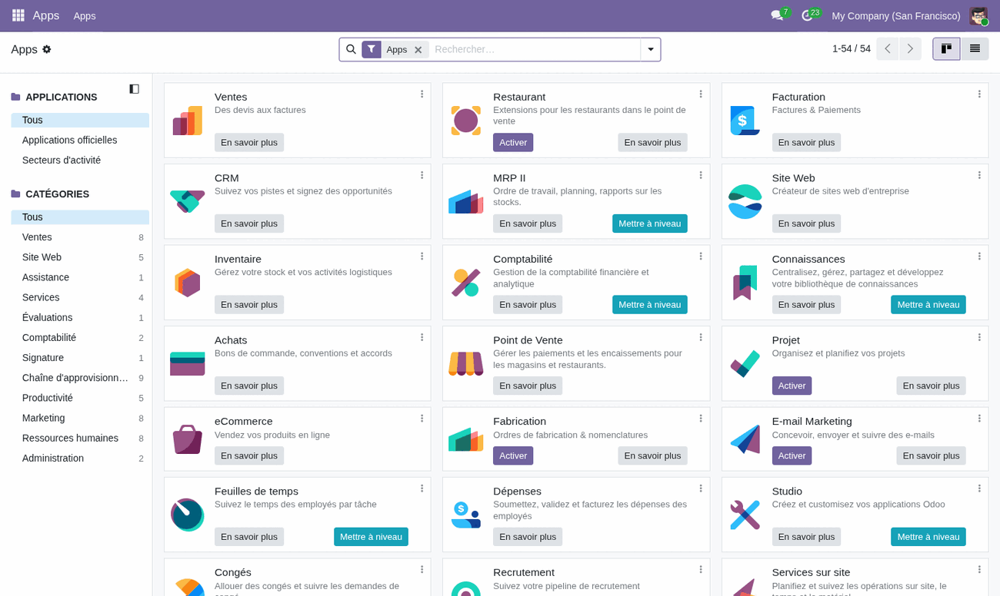
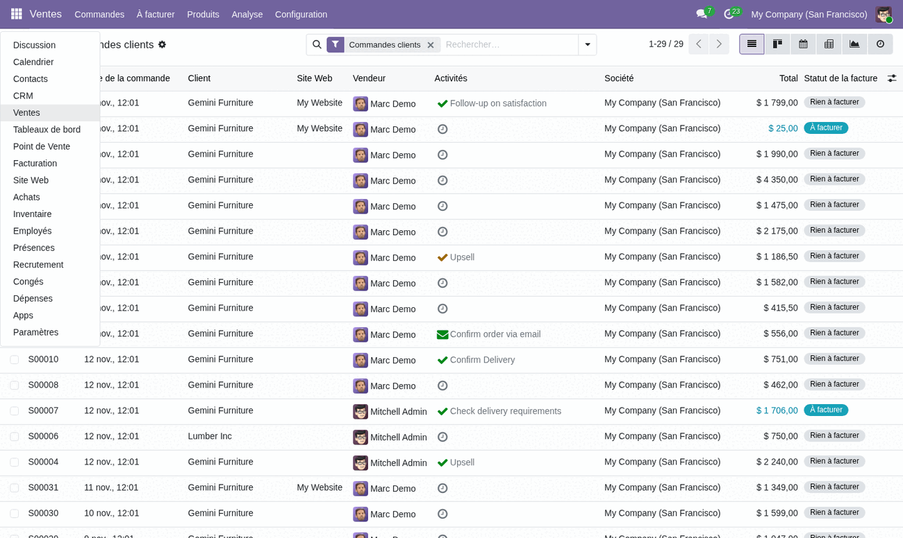
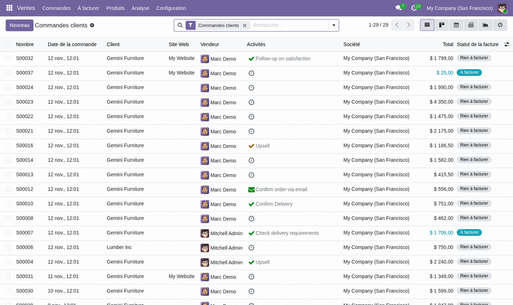
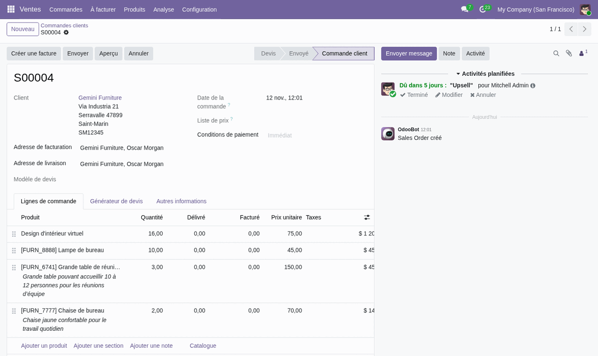
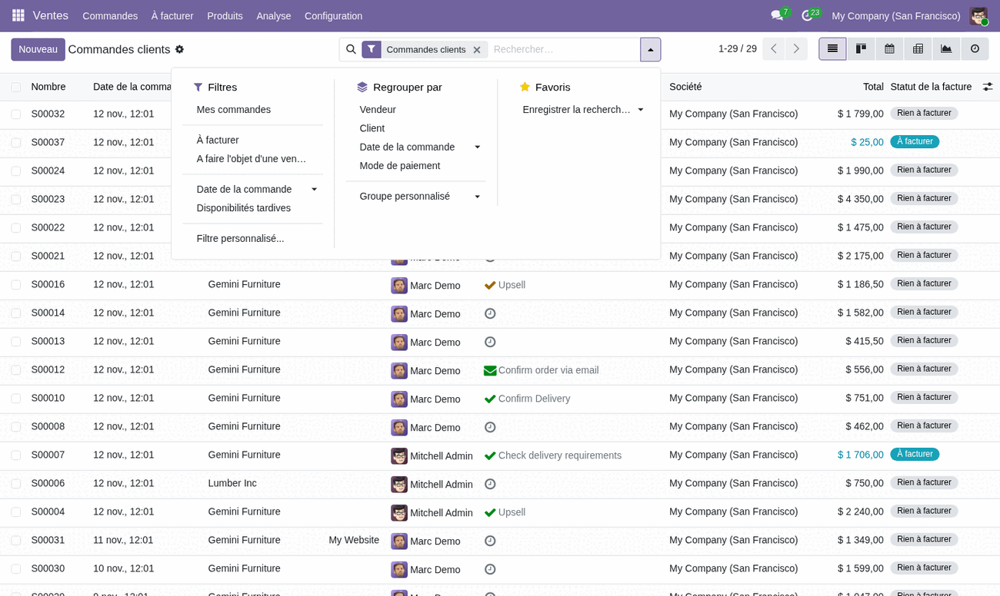
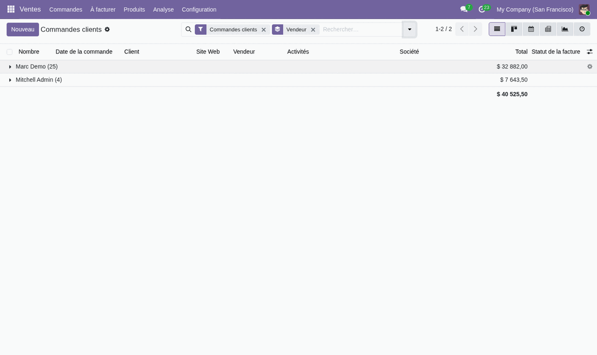
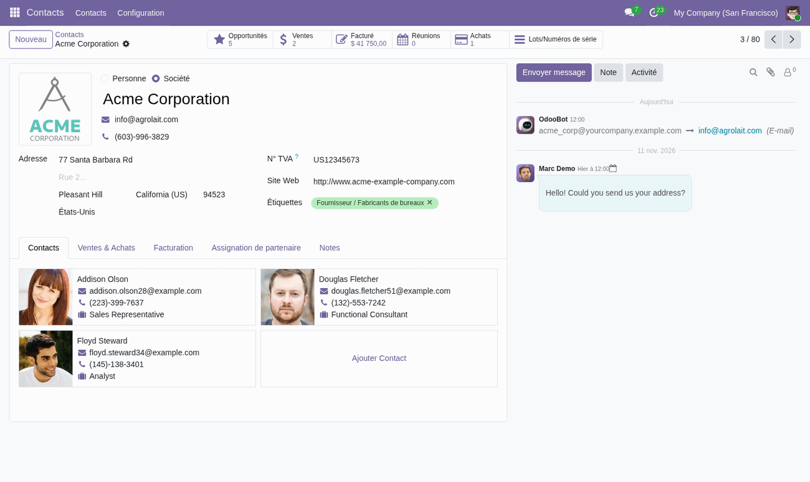
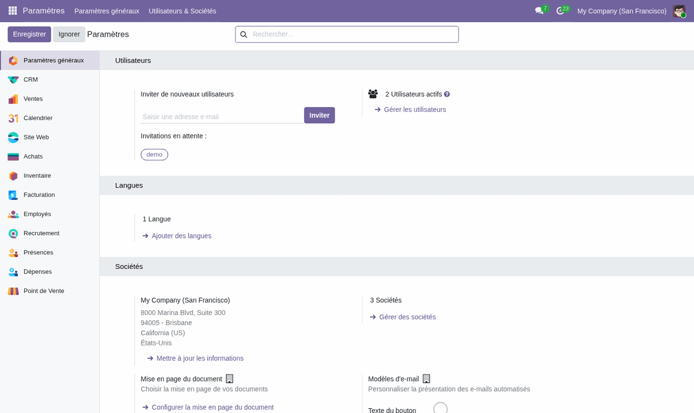
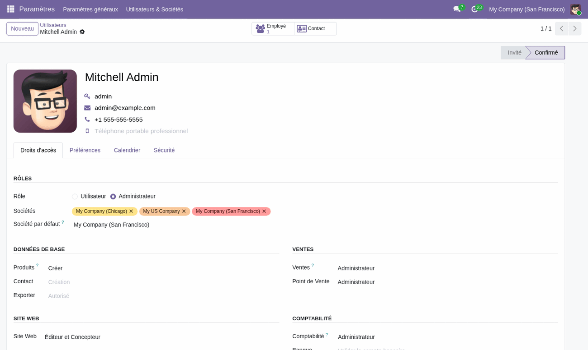

# Chapitre 1 — Odoo en général

[⬅ Sommaire](README.md) · [Chapitre 2 ➡](02-crm.md)

## Objectifs

À la fin de ce chapitre, vous savez :
- installer Odoo 19 Community et créer une base avec des données de démonstration ;
- installer des applications et naviguer entre elles ;
- utiliser les vues (liste, kanban, formulaire), la recherche, les filtres et les regroupements ;
- utiliser le chatter et les activités ;
- configurer la société et créer des utilisateurs avec des droits.

---

## 1. Installer Odoo 19 Community

Le plus simple est Docker, avec les images officielles d'Odoo et de PostgreSQL.
Créez un dossier `odoo19/` avec ce fichier `docker-compose.yml` :

```yaml
services:
  db:
    image: postgres:16
    environment:
      POSTGRES_USER: odoo
      POSTGRES_PASSWORD: odoo
      POSTGRES_DB: postgres
    volumes:
      - db-data:/var/lib/postgresql/data

  odoo:
    image: odoo:19.0
    depends_on:
      - db
    ports:
      - "8069:8069"
    environment:
      HOST: db
      USER: odoo
      PASSWORD: odoo
    volumes:
      - odoo-data:/var/lib/odoo

volumes:
  db-data:
  odoo-data:
```

```bash
docker compose up -d
```

Ouvrez <http://localhost:8069>. Odoo affiche le **gestionnaire de bases de données** :

| Champ | Valeur |
|---|---|
| Mot de passe principal | Notez-le bien : il protège la création et la suppression des bases |
| Nom de la base | `sablon` |
| E-mail / Mot de passe | Votre identifiant administrateur |
| Langue | **Français (BE)** |
| Pays | **Belgique** (euros, TVA belge, plan comptable belge) |
| Données de démonstration | ✅ **Cochez** : des clients, produits et commandes fictifs pour s'entraîner |

> 💡 Gardez **deux bases** : une avec démo pour explorer, une sans démo pour le projet.
> Les données de démonstration ne peuvent pas être retirées proprement d'une base.

---

## 2. Les applications

Odoo est un ensemble d'**applications** qui partagent la même base de données.
On les installe depuis le menu **Apps** :



Le bouton **Activer** installe l'application et **toutes ses dépendances**. Les applications marquées
« Mettre à niveau » n'existent que dans l'édition Enterprise 🔒.

On passe d'une application à l'autre avec le menu en haut à gauche (l'icône en grille) :



### ✍️ À vous — Exercice 1.1

**Installer les applications de Torréfaction Sablon.**
Dans votre base `sablon` (sans démo), installez : **CRM**, **Ventes**, **Inventaire**, **Facturation**, **Achats**,
**Site Web**, **eCommerce**, **Point de Vente**, **Employés**.

1. Quelles applications supplémentaires sont apparues dans le menu ? Pourquoi ?
2. Quelles applications de la liste sont marquées « Mettre à niveau » ? Que signifie ce bouton ?

👉 [Réponse commentée](reponses/01-odoo-general.md#exercice-11)

---

## 3. Les vues

Chaque application affiche ses données dans plusieurs **vues**, qu'on choisit avec les boutons en haut à droite.

| Vue | Usage | Exemple |
|---|---|---|
| **Liste** | Voir beaucoup d'enregistrements, trier, sélectionner | Commandes, factures |
| **Kanban** | Des cartes, souvent par étape | Pipeline CRM, candidats |
| **Formulaire** | Le détail d'un enregistrement | Une commande |
| **Calendrier** | Ce qui a une date | Congés, rendez-vous |
| **Graphique / Pivot** | Analyser | Chapitre 9 |



Un clic sur une ligne ouvre le **formulaire** :



Dans un formulaire, retrouvez :
- en haut à gauche, les **boutons d'action** (Envoyer, Confirmer…) ;
- en haut à droite, la **barre d'état** (Devis → Commande client) ;
- les **boutons intelligents** (Livraison, Facture…), qui ouvrent les documents liés ;
- à droite (ou en dessous), le **chatter**.

---

## 4. Rechercher, filtrer, regrouper

La barre de recherche est la même partout. Tapez un texte : Odoo propose de chercher dans plusieurs champs.
La flèche à droite ouvre les **filtres**, les **regroupements** et les **favoris** :



| | Effet |
|---|---|
| **Filtres** | Ne garder que certains enregistrements (« À facturer », « Mes commandes »…) |
| **Regrouper par** | Faire des groupes, avec des sous-totaux (par vendeur, par client, par mois…) |
| **Favoris** | Enregistrer une recherche pour la réutiliser |



Deux filtres d'une **même** colonne se combinent en **OU**, deux filtres de colonnes **différentes** en **ET**.

### ✍️ À vous — Exercice 1.2

**Chercher l'information.** Dans votre base **avec démo** :

1. Combien de commandes clients ont été passées par le client *Gemini Furniture* ?
2. Quel vendeur a le plus gros total de commandes ?
3. Affichez les devis **non confirmés** de plus de 1 000 €, et enregistrez cette recherche en favori « Gros devis ».

<details><summary>💡 Indice : « plus de 1 000 € »</summary>

Ce filtre n'existe pas tout fait : utilisez **Ajouter un filtre personnalisé** en bas de la colonne des filtres.
</details>

👉 [Réponse commentée](reponses/01-odoo-general.md#exercice-12)

---

## 5. Le chatter et les activités

Le **chatter** est l'historique d'un enregistrement : messages, notes internes, modifications importantes.



| Bouton | Effet |
|---|---|
| **Envoyer message** | E-mail aux **abonnés** du document (le client, par exemple) |
| **Note** | Commentaire **interne**, invisible pour le client. `@nom` pour notifier un collègue |
| **Activité** | Une tâche planifiée : appel, e-mail, réunion, à faire… avec une échéance et un responsable |

Les activités en retard apparaissent dans l'icône 🕒 en haut à droite, et dans la colonne « Activités » des listes.

### ✍️ À vous — Exercice 1.3

**Travailler en équipe.** Sur une commande client de la démo :

1. Ajoutez une **note** qui mentionne un autre utilisateur.
2. Planifiez une **activité** « Appel » pour demain, assignée à vous-même.
3. Retrouvez cette activité depuis l'icône 🕒, puis marquez-la comme faite.

👉 [Réponse commentée](reponses/01-odoo-general.md#exercice-13)

---

## 6. Configurer la société et les utilisateurs

### La société

**Paramètres → Paramètres généraux → Sociétés → Mettre à jour les informations** :
nom, adresse, numéro de TVA, logo. Ces informations apparaissent sur tous les documents (devis, factures).



### Les utilisateurs et les droits

**Paramètres → Utilisateurs & Sociétés → Utilisateurs**. Pour chaque application, on choisit le **rôle** de l'utilisateur :



| Rôle (exemple Ventes) | Peut… |
|---|---|
| *(vide)* | Ne pas voir l'application |
| Utilisateur : ses propres documents | Voir et gérer **ses** devis et commandes |
| Utilisateur : tous les documents | Voir et gérer ceux de toute l'équipe |
| Administrateur | Tout, y compris la configuration |

> ⚠️ Chaque utilisateur interne compte comme une licence en Enterprise. En Community, c'est gratuit,
> mais attribuez quand même les droits **au plus juste** : un vendeur n'a pas besoin de voir la comptabilité.

### ✍️ À vous — Exercice 1.4

**La société Torréfaction Sablon.** Dans votre base `sablon` :

1. Configurez la société : *Torréfaction Sablon*, Rue de la Paille 12, 1000 Bruxelles, Belgique, TVA BE0123456789.
2. Créez ces utilisateurs avec les bons droits :

| Nom | Poste | Doit pouvoir… |
|---|---|---|
| Sophie Laurent | Gérante | Tout faire |
| Karim Benali | Responsable commerciale | Gérer toutes les ventes, voir le stock |
| Lucas Peeters | Magasinier | Gérer le stock, rien d'autre |
| Inès Dubois | Comptable | Gérer la facturation, voir les ventes |

**Pour vérifier :**
- [ ] Le nom et l'adresse apparaissent en en-tête d'un devis imprimé.
- [ ] Connecté en tant que Lucas, seule l'application Inventaire (et Discussion) est visible.

👉 [Réponse commentée](reponses/01-odoo-general.md#exercice-14)

---

## 🔍 Enquête

**« Je ne vois pas l'application ! »** Inès, la comptable, se connecte et vous appelle :
elle ne voit pas l'application Ventes, alors qu'elle doit pouvoir consulter les commandes. Vous avez pourtant installé Ventes.
Que vérifiez-vous, et dans quel ordre ?

👉 [Explication](reponses/01-odoo-general.md#enquête)

---

## 🏁 Défi du chapitre — Exercice 1.5

Dans la base de démo, préparez pour la gérante un **favori partagé** « Commandes du mois par vendeur » :
les commandes confirmées du mois en cours, regroupées par vendeur, visible par tous les utilisateurs.

👉 [Réponse commentée](reponses/01-odoo-general.md#exercice-15)

---

## 📁 Dans votre projet

1. Quelles applications Odoo votre client doit-il installer ? Lesquelles sont 🔒 Enterprise ?
2. Listez les utilisateurs de votre client et leur rôle dans chaque application.
3. Quelles informations de la société doivent apparaître sur ses documents ?

---

## Questions de compréhension

1. Pourquoi l'installation d'une application en installe-t-elle parfois d'autres ?
2. Quelle est la différence entre une **note** et un **message** dans le chatter ?
3. Deux filtres sur le même champ se combinent-ils en ET ou en OU ? Et sur deux champs différents ?
4. Pourquoi ne pas utiliser la base de démonstration pour le vrai projet du client ?
5. Quelle est la différence entre les rôles « ses propres documents » et « tous les documents » ?

---

[⬅ Sommaire](README.md) · [Chapitre 2 ➡](02-crm.md)
