# Chapitre 2 — CRM et ventes

[⬅ Chapitre 1](01-odoo-general.md) · [Sommaire](README.md) · [Chapitre 3 ➡](03-stock.md)

## Objectifs

À la fin de ce chapitre, vous savez :
- organiser un pipeline commercial en étapes ;
- distinguer une piste d'une opportunité, et convertir l'une en l'autre ;
- planifier et suivre les activités commerciales ;
- marquer une opportunité comme gagnée ou perdue, avec un motif ;
- transformer une opportunité en devis, l'envoyer et le faire signer en ligne ;
- analyser le pipeline et les ventes.

> Applications nécessaires : **CRM** et **Ventes**.

---

## 1. Du prospect au client

Avant de vendre, il faut **trouver** et **convaincre** des clients. C'est le rôle du **CRM**
(*Customer Relationship Management*, gestion de la relation client).

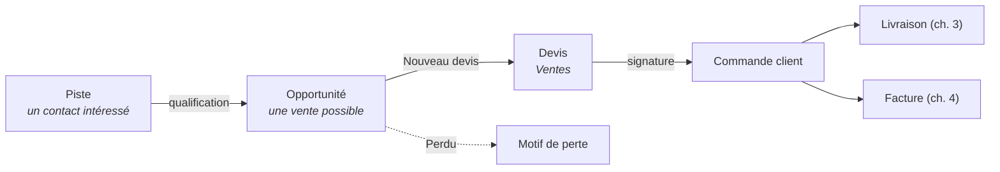

Le CRM et les Ventes partagent les mêmes clients : un prospect gagné devient un client, sans ressaisie,
et le devis garde le lien vers l'opportunité d'origine.

---

## 2. Le pipeline

**CRM → Ventes → Mon pipeline** affiche les opportunités en **kanban**, une colonne par **étape** :

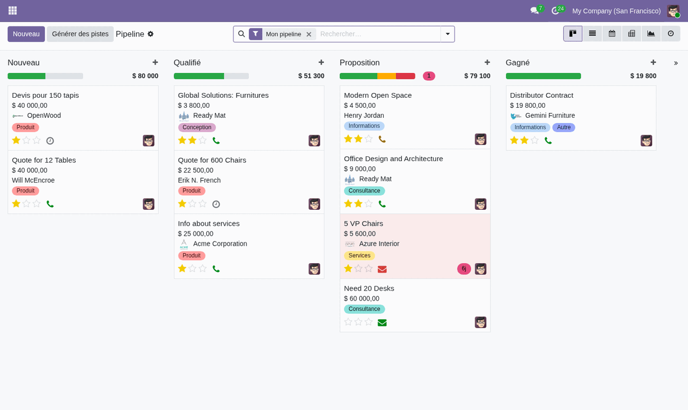

Chaque carte montre le nom de l'opportunité, le **revenu attendu**, le client, les **étiquettes**, la **priorité** (étoiles)
et la prochaine **activité**. On fait avancer une opportunité en **glissant sa carte** dans l'étape suivante.
En haut de chaque colonne, la barre de couleur résume les activités (en retard, aujourd'hui, planifiées) et le total attendu.

Le bouton **+** en haut d'une colonne crée une opportunité en quelques secondes :

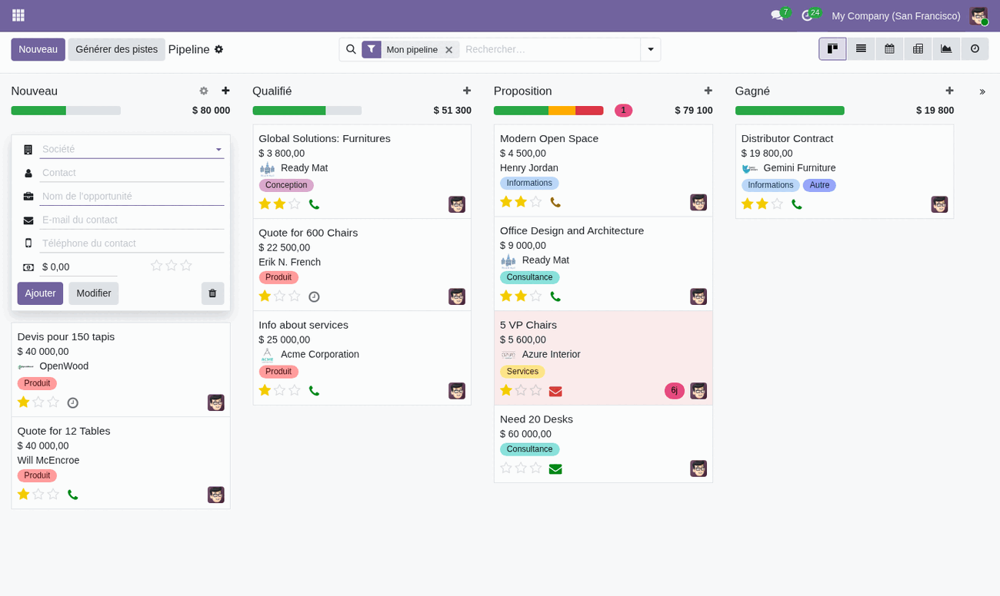

Un clic sur une carte ouvre l'opportunité :

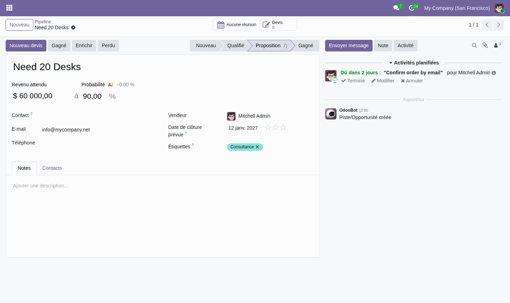

| Champ | Signification |
|---|---|
| **Revenu attendu** | Le montant espéré de la vente |
| **Probabilité** | La chance de gagner, en %. Odoo la calcule selon l'étape et l'historique ; on peut la forcer |
| **Date de clôture prévue** | Quand on pense conclure |
| **Vendeur / Équipe commerciale** | Qui s'en occupe |
| **Étiquettes** | Classer : produit, secteur, origine… |

Les étapes se configurent dans **CRM → Configuration → Pipeline → Étapes**.

### ✍️ À vous — Exercice 2.1

**Le pipeline de Torréfaction Sablon.** Karim prospecte les restaurants et les hôtels.

1. Créez l'équipe commerciale **Restaurants**, avec Karim comme chef d'équipe.
2. Adaptez les étapes du pipeline : *Nouveau → Qualifié → Dégustation planifiée → Proposition → Gagné*.
3. Créez trois opportunités dans le pipeline de l'équipe :
   - *Brasserie de la Grand-Place* — 6 000 €/an ;
   - *Hôtel du Mont des Arts* — 12 000 €/an ;
   - *Café Le Cercle* — 2 500 €/an.

**Pour vérifier :**
- [ ] Le pipeline de l'équipe Restaurants affiche les 5 étapes et un total attendu de 20 500 €.

👉 [Réponse commentée](reponses/02-crm.md#exercice-21)

---

## 3. Pistes et opportunités

Une **piste** (*lead*) est un contact pas encore qualifié : quelqu'un a rempli le formulaire du site, laissé une carte
de visite sur un salon, appelé pour un renseignement… On ne sait pas encore s'il y a une vraie vente.

Une **opportunité** est une piste **qualifiée** : un besoin réel, un budget, une échéance.

| | Piste | Opportunité |
|---|---|---|
| Où | **CRM → Pistes** (liste) | **Pipeline** (kanban) |
| Quoi | À trier, vérifier, qualifier | À suivre jusqu'à la vente |
| Qui | Souvent un assistant commercial, ou automatique (formulaire web) | Le vendeur |

Les pistes sont optionnelles : on les active dans **CRM → Configuration → Paramètres → Pistes**.

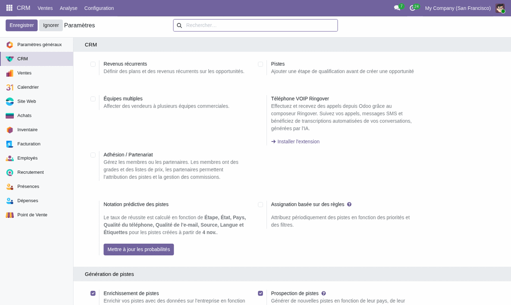

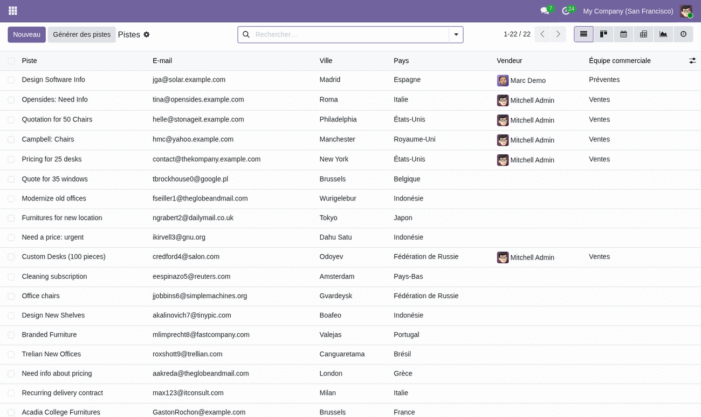

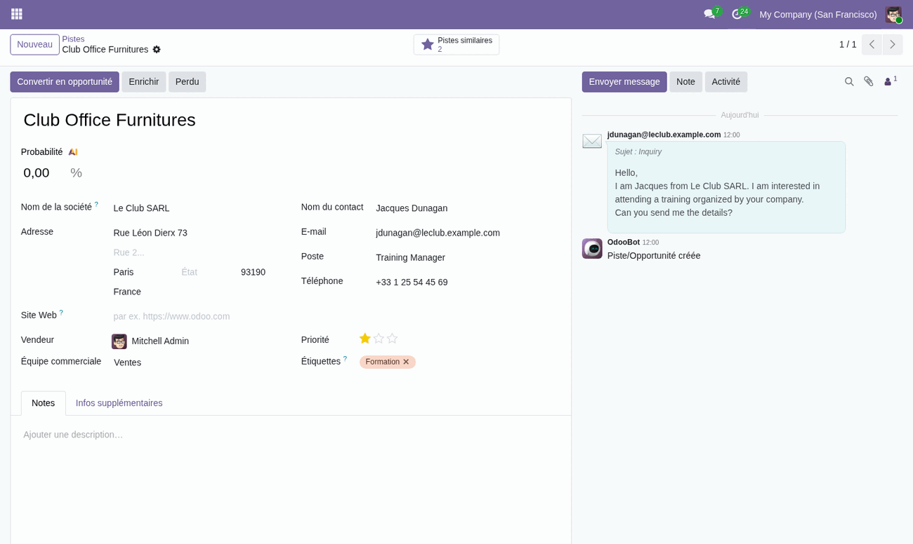

Le bouton **Convertir en opportunité** fait passer la piste dans le pipeline. Odoo propose de l'assigner à un vendeur,
de la **fusionner** avec une opportunité existante du même client (pour éviter les doublons), et de créer ou retrouver le client :

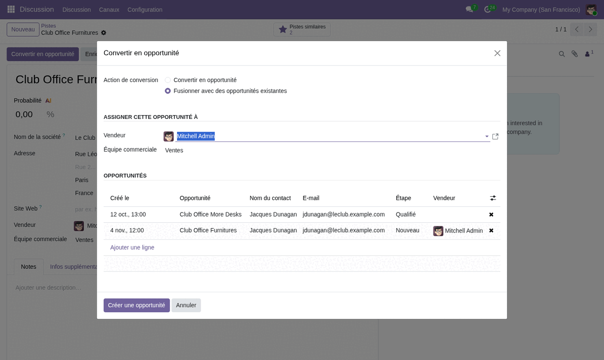

### ✍️ À vous — Exercice 2.2

**Un contact au salon Horeca Expo.**

1. Activez les **pistes**.
2. Créez une piste : *Restaurant La Truffe Noire*, contact *Marc Lemaire*, marc@truffenoire.be,
   note : « Rencontré au salon, cherche un café d'exception pour ses desserts ».
3. Après un appel, la piste est qualifiée : convertissez-la en opportunité pour Karim, en **créant** le client.

**Pour vérifier :**
- [ ] L'opportunité apparaît dans le pipeline de l'équipe Restaurants, à l'étape *Nouveau*.
- [ ] Le contact *Restaurant La Truffe Noire* existe dans les Contacts.

👉 [Réponse commentée](reponses/02-crm.md#exercice-22)

---

## 4. Les activités

Une vente se gagne par le **suivi** : un appel, puis un e-mail, une dégustation, une relance… Chaque étape est une **activité**
(voir chapitre 1), avec une date et un responsable.

**CRM → Ventes → Mes activités** liste tout ce que le vendeur doit faire, en commençant par les retards :

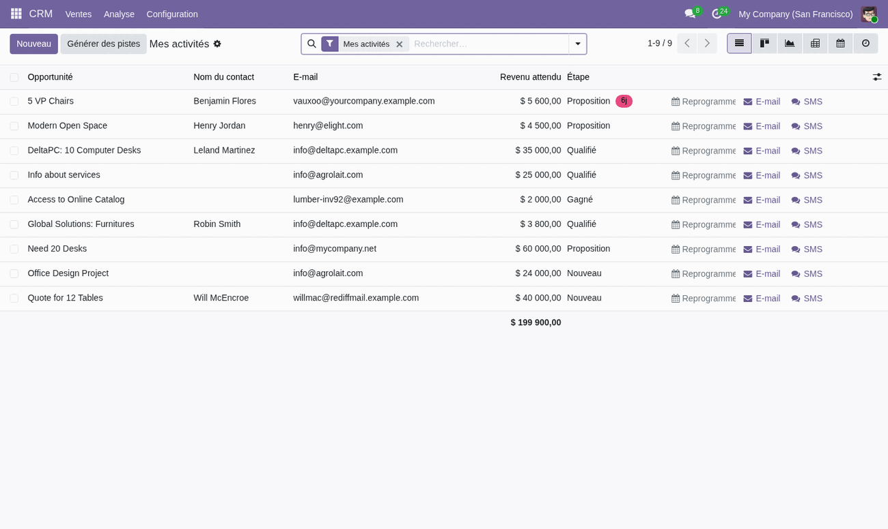

> 💡 Une opportunité **sans activité planifiée** est une opportunité qu'on va oublier. Bonne règle : chaque opportunité
> ouverte a toujours une prochaine activité. Les **plans d'activité** (**Configuration → Activités → Plans d'activité**)
> planifient une série d'activités en un clic (« appel J+0, e-mail J+2, relance J+7 »).

### ✍️ À vous — Exercice 2.3

**Le suivi de La Truffe Noire.**

1. Planifiez un **appel** à Marc Lemaire pour demain.
2. Marquez l'appel comme fait, avec le compte rendu « Intéressé, veut goûter l'Éthiopie », et planifiez
   immédiatement une **réunion** « Dégustation » dans une semaine.
3. Déplacez l'opportunité à l'étape *Dégustation planifiée*.

👉 [Réponse commentée](reponses/02-crm.md#exercice-23)

---

## 5. Gagné ou perdu

Toute opportunité finit **gagnée** ou **perdue** :
- **Gagné** : bouton en haut du formulaire, ou glisser dans la colonne *Gagné*. Un bandeau « Gagné » s'affiche.
- **Perdu** : bouton **Perdu**, avec un **motif de perte** et une note. L'opportunité est **archivée** : elle disparaît du pipeline,
  mais reste consultable (filtre *Perdu*).

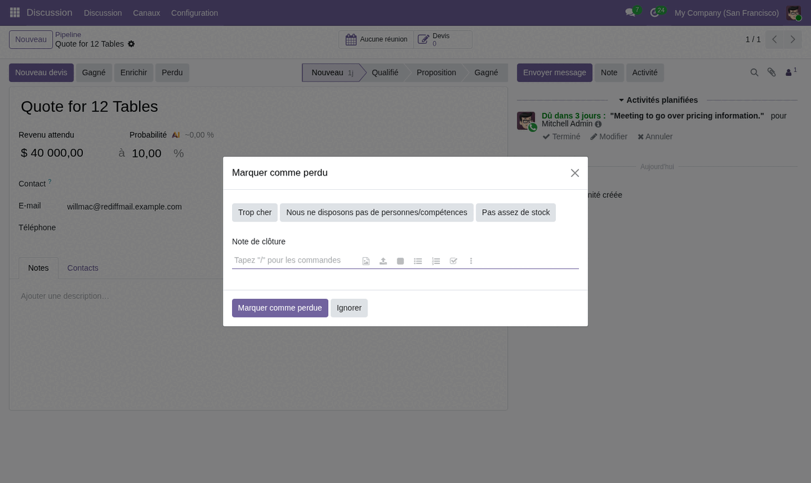

> Les motifs de perte (*Trop cher*, *Pas les compétences*, *Concurrent*…) sont précieux : après six mois, on sait
> **pourquoi** on perd des ventes, et on peut agir.

### ✍️ À vous — Exercice 2.4

1. Le *Café Le Cercle* a signé avec un concurrent sous contrat de 3 ans. Créez le motif de perte
   **« Concurrent sous contrat »** et marquez l'opportunité comme perdue.
2. Retrouvez-la dans Odoo.

👉 [Réponse commentée](reponses/02-crm.md#exercice-24)

---

## 6. De l'opportunité au devis

Dans une opportunité, le bouton **Nouveau devis** crée un devis pour ce client, lié à l'opportunité :

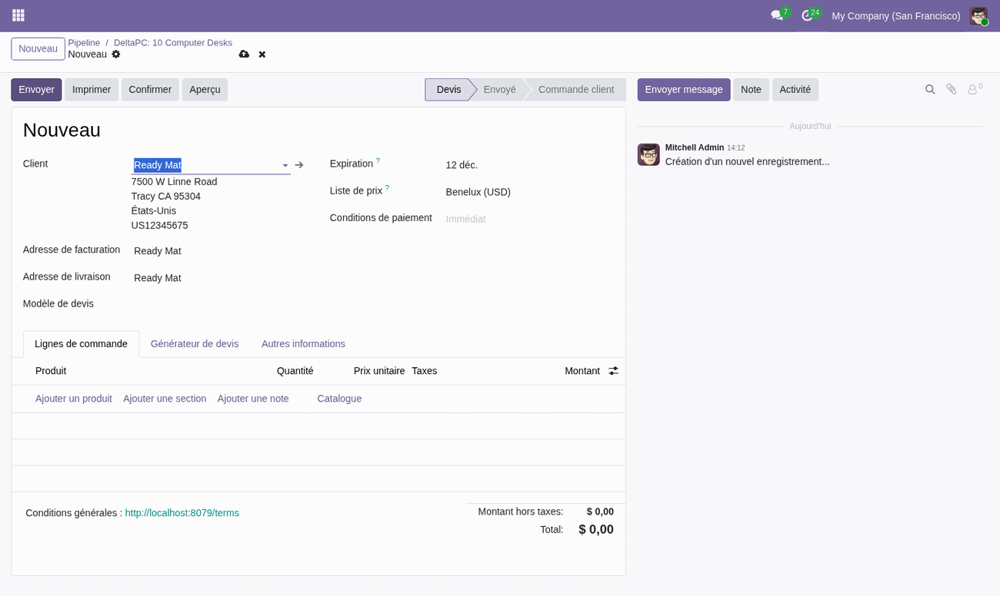

Le devis est un document de l'application **Ventes** :

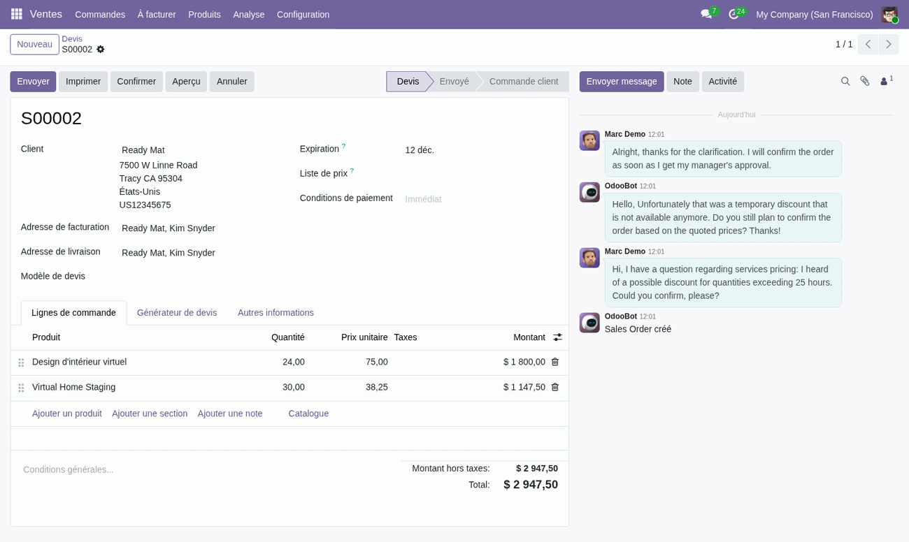

| Bouton | Effet |
|---|---|
| **Envoyer** | E-mail au client avec le devis en PDF et un **lien vers son portail** |
| **Aperçu** | Voir le devis comme le client le verra |
| **Confirmer** | Le devis devient une **commande client** (et déclenche livraison et facturation) |

Le client reçoit un lien vers son **portail** : il peut consulter le devis, poser une question, et **signer en ligne** :

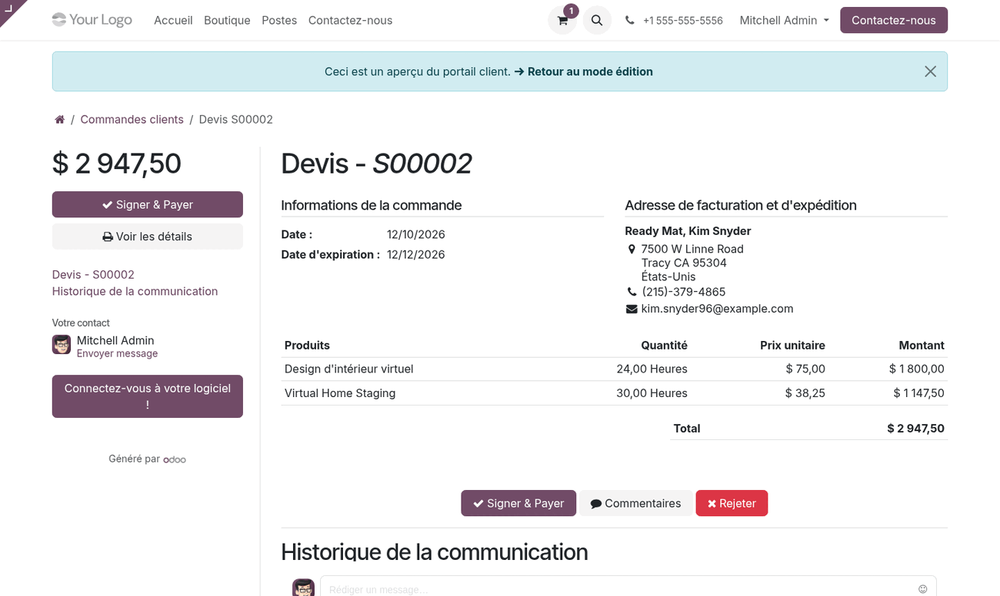

Les options de vente se règlent dans **Ventes → Configuration → Paramètres** : signature en ligne, paiement en ligne,
modèles de devis, listes de prix, remises…

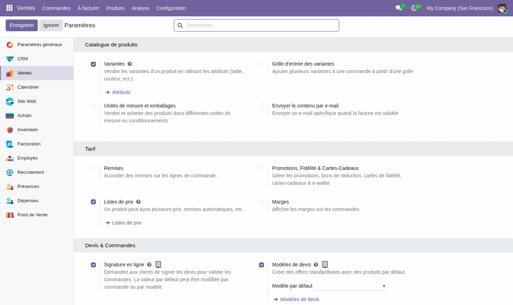

### ✍️ À vous — Exercice 2.5

**La proposition à La Truffe Noire.** La dégustation s'est bien passée.

1. Depuis l'opportunité, créez un devis : 8 Café Éthiopie et 4 Café Brésil par mois, avec **5 % de remise** sur l'Éthiopie,
   valable 15 jours.
2. Envoyez-le, puis ouvrez l'**aperçu client** et signez-le comme le ferait Marc Lemaire.
3. Que devient le devis ? Et l'opportunité ?

**Pour vérifier :**
- [ ] L'opportunité affiche un bouton intelligent vers le devis / la commande.
- [ ] La commande est confirmée, et l'opportunité est marquée **Gagné**.

👉 [Réponse commentée](reponses/02-crm.md#exercice-25)

---

## 7. Analyser le pipeline

**CRM → Analyse → Pipeline** : le revenu attendu par étape, par vendeur, par mois de clôture…

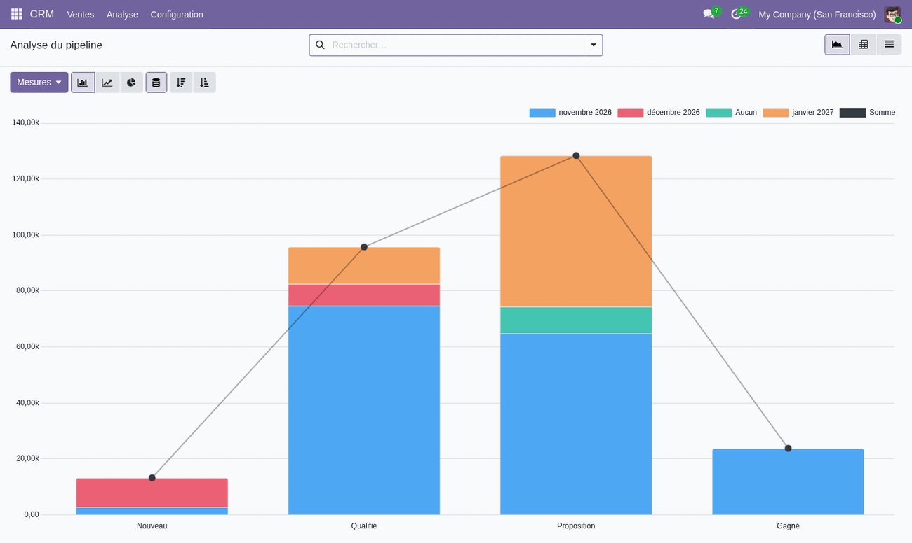

Les vues graphique et pivot sont détaillées au [chapitre 9](09-tableaux-de-bord.md).

---

## 🔍 Enquête

**« L'opportunité a disparu ! »** Karim cherche l'opportunité *Hôtel du Mont des Arts*, sur laquelle il travaille depuis
un mois. Elle n'est plus dans le pipeline, et la recherche par nom ne donne rien. Il accuse un collègue de l'avoir supprimée.
Que s'est-il probablement passé, et comment la retrouver ?

👉 [Explication](reponses/02-crm.md#enquête)

---

## 🏁 Défi du chapitre — Exercice 2.6

**Le tableau de bord commercial de Karim.** En fin de trimestre, Karim doit présenter à la gérante :
1. le **revenu attendu** de son pipeline, pondéré par la probabilité ;
2. le nombre d'opportunités **gagnées** et **perdues**, et le **taux de transformation** ;
3. les trois **motifs de perte** les plus fréquents.

Trouvez chaque chiffre dans Odoo (base de démo), et notez le chemin pour y arriver.

👉 [Réponse commentée](reponses/02-crm.md#exercice-26)

---

## 📁 Dans votre projet

1. Comment votre client trouve-t-il ses clients aujourd'hui ? Quelles sont les étapes de sa vente ?
2. A-t-il besoin des pistes (beaucoup de contacts entrants à trier) ou seulement des opportunités ?
3. Quelles équipes commerciales ? Quels motifs de perte ?
4. Ses devis doivent-ils être signés ou payés en ligne ?

---

## Questions de compréhension

1. Quelle est la différence entre une piste et une opportunité ?
2. Que se passe-t-il quand on marque une opportunité comme perdue ? Est-elle supprimée ?
3. Pourquoi est-il important de renseigner un motif de perte ?
4. Quel est le lien entre une opportunité et un devis ?
5. Que peut faire le client sur son portail ?
6. Pourquoi chaque opportunité ouverte devrait-elle avoir une prochaine activité ?

---

[⬅ Chapitre 1](01-odoo-general.md) · [Sommaire](README.md) · [Chapitre 3 ➡](03-stock.md)
