# Chapitre 3 — Facturation

[⬅ Chapitre 2](02-stock.md) · [Sommaire](README.md) · [Chapitre 4 ➡](04-site-web.md)

## Objectifs

À la fin de ce chapitre, vous savez :
- configurer les taxes et les conditions de paiement ;
- facturer une commande client, ou créer une facture directement ;
- enregistrer un paiement, complet ou partiel ;
- corriger une facture avec un avoir ;
- enregistrer une facture fournisseur liée à un achat ;
- suivre ce qui reste à encaisser.

> Application nécessaire : **Facturation** (installée automatiquement avec Ventes).
> 🔒 La **Comptabilité** complète (rapprochement bancaire avancé, relances automatiques, déclarations) est en Enterprise.
> La Facturation Community suffit pour facturer, encaisser et suivre les paiements.

---

## 1. Le tableau de bord

**Facturation → Tableau de bord** : une carte par **journal** (Ventes, Achats, Banque, Espèces…).

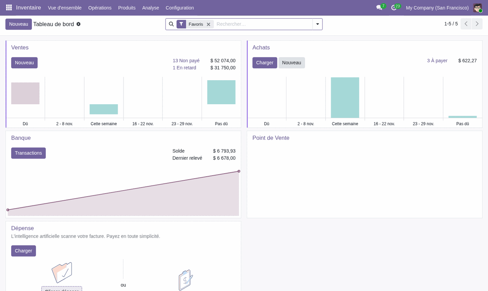

Un **journal** est un « carnet » où sont enregistrées les pièces d'un même type. Chaque journal a sa propre numérotation :
`FAC/2026/00001` pour les factures clients, `FACTU/…` pour les factures fournisseurs.

---

## 2. Taxes et conditions de paiement

### Les taxes

**Facturation → Configuration → Comptabilité → Taxes**

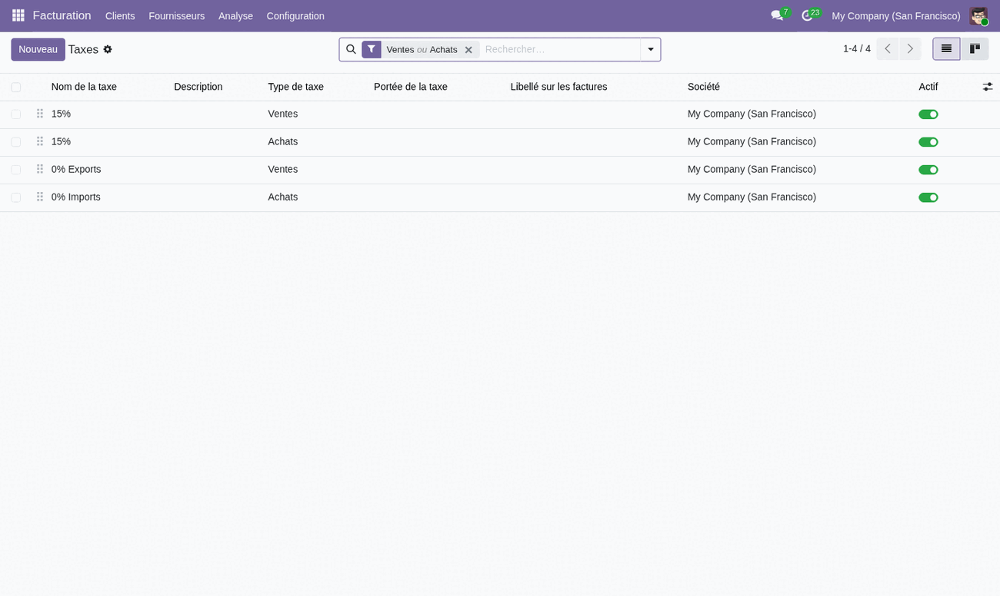

Si la base a été créée avec le pays **Belgique**, les taxes belges sont déjà là : TVA 21 %, 12 %, 6 %, 0 %…
Chaque produit porte une **taxe de vente** et une **taxe d'achat** par défaut (fiche produit, onglet *Informations générales*).

> 💡 En Belgique, le café (denrée alimentaire) est soumis à la TVA à **6 %**, mais un atelier de dégustation (service) à **21 %**.
> Une mauvaise taxe sur un produit, c'est une erreur sur **chaque** facture.

### Les conditions de paiement

**Facturation → Configuration → Facturation → Conditions de paiement**

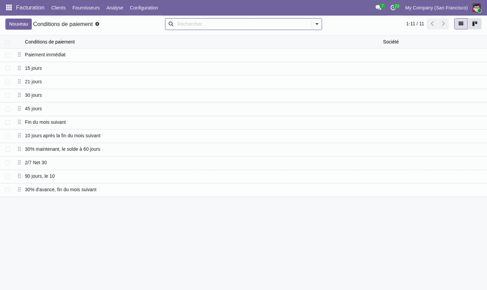

Elles calculent la **date d'échéance** d'une facture : immédiat, 30 jours, fin du mois suivant, 30 % maintenant et le solde à 60 jours…
On les définit par client (fiche contact, onglet **Ventes & Achats**) ou sur chaque facture.

### ✍️ À vous — Exercice 3.1

**Configurer Torréfaction Sablon.**

1. Vérifiez que les trois cafés ont la TVA **6 %** en vente, et l'atelier dégustation **21 %**.
2. Créez une condition de paiement **« 30 jours fin de mois »**.
3. Appliquez-la par défaut au client **Café du Sablon**.

**Pour vérifier :**
- [ ] Une nouvelle commande pour Café du Sablon reprend automatiquement la condition « 30 jours fin de mois ».

👉 [Réponse commentée](reponses/03-facturation.md#exercice-31)

---

## 3. Facturer une commande client

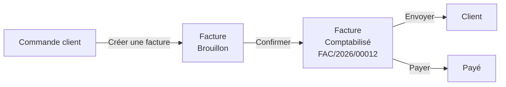

Sur une commande confirmée, le bouton **Créer une facture** génère une facture en **brouillon**.
Ce qu'Odoo propose de facturer dépend de la **politique de facturation** du produit :

| Politique | On facture… | Typique pour |
|---|---|---|
| **Quantités commandées** | Ce qui a été commandé, dès la confirmation | Services, acomptes, abonnements |
| **Quantités livrées** | Seulement ce qui a été **livré** | Produits physiques |

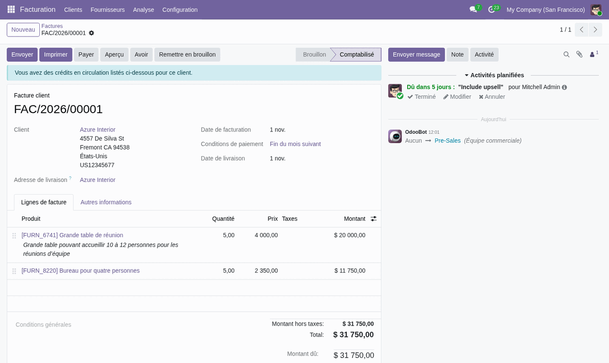

Une facture en **brouillon** n'a pas de numéro et peut être modifiée librement.
**Confirmer** la comptabilise : elle reçoit son numéro définitif et génère les écritures comptables.

> ⚠️ Une facture comptabilisée est un **document légal**. On ne la supprime pas : on la corrige avec un **avoir**.

### ✍️ À vous — Exercice 3.2

**Facturer le Café du Sablon.** Reprenez la commande de l'exercice 2.3 (10 Brésil, 15 Éthiopie, livrée en partie).

1. Cliquez sur **Créer une facture**. Que propose Odoo ? Pourquoi ?
2. Confirmez la facture et envoyez-la par e-mail.

**Pour vérifier :**
- [ ] La facture a un numéro `FAC/2026/…`.
- [ ] La commande affiche un bouton intelligent **Facture** et le statut de facturation adéquat.

👉 [Réponse commentée](reponses/03-facturation.md#exercice-32)

### Une facture sans commande

Pour une prestation ponctuelle, on crée directement la facture : **Clients → Factures → Nouveau**.

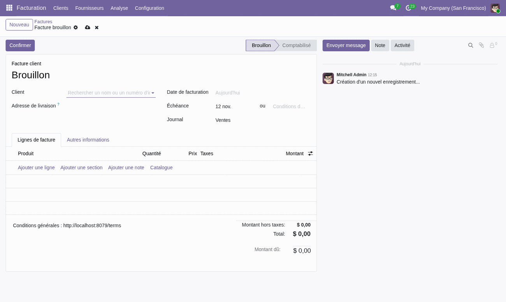

### ✍️ À vous — Exercice 3.3

**L'atelier dégustation.** Le restaurant **Le Petit Sablon** a réservé un atelier dégustation pour 8 personnes.
Créez et confirmez la facture, **sans** passer par une commande.

👉 [Réponse commentée](reponses/03-facturation.md#exercice-33)

---

## 4. Encaisser

Sur une facture comptabilisée, le bouton **Payer** ouvre l'assistant de paiement :

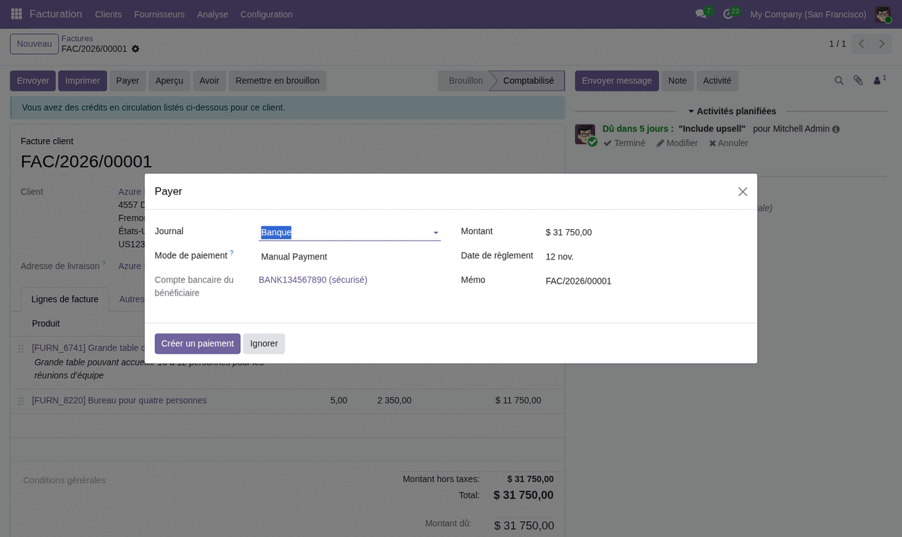

| Champ | |
|---|---|
| Journal | **Banque** (virement) ou **Espèces** |
| Montant | Proposé automatiquement : le montant dû. Modifiable pour un **paiement partiel** |
| Mémo | La communication (référence de la facture) |

L'état de paiement passe à **Payé**, **Partiellement payé**, ou **En paiement** (paiement enregistré, mais pas encore
rapproché avec le relevé bancaire).

**Clients → Factures**, filtre **Non payées** et regroupement par client : la liste de ce que chaque client doit encore.

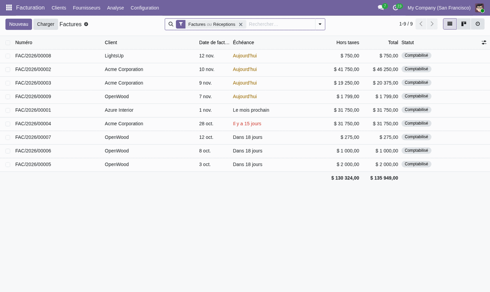

### ✍️ À vous — Exercice 3.4

**Le Café du Sablon paie en deux fois.**

1. Il verse d'abord **100 €** par virement.
2. Puis le solde, deux semaines plus tard.

**Pour vérifier :**
- [ ] Après le premier versement, la facture est **Partiellement payé** et le montant dû a diminué.
- [ ] Après le second, elle est **Payé** (ou **En paiement**).

👉 [Réponse commentée](reponses/03-facturation.md#exercice-34)

---

## 5. Corriger : l'avoir

Un **avoir** (note de crédit) annule tout ou partie d'une facture comptabilisée. Bouton **Avoir** sur la facture.

| Cas | Que faire |
|---|---|
| La facture est **entièrement** fausse | Avoir complet, puis nouvelle facture correcte |
| Le client renvoie **une partie** | Avoir partiel, en ne gardant que les lignes concernées |
| Geste commercial | Avoir d'un montant libre |

### ✍️ À vous — Exercice 3.5

Le Café du Sablon a reçu **2 sacs de Café Brésil** abîmés et vous les renvoie. Faites-lui un avoir pour ces 2 sacs uniquement.

**Pour vérifier :**
- [ ] L'avoir est lié à la facture d'origine (référence `Annulation de : FAC/…`).
- [ ] **Clients → Avoirs** le liste.

👉 [Réponse commentée](reponses/03-facturation.md#exercice-35)

---

## 6. Les factures fournisseurs

**Fournisseurs → Factures fournisseurs**

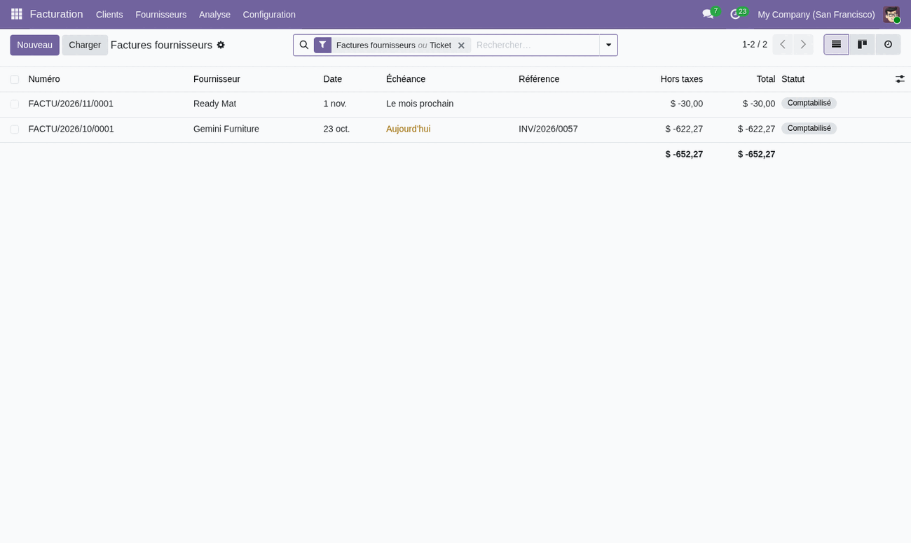

Le plus fiable est de créer la facture **depuis la commande fournisseur** (Achats) : Odoo reprend les produits, les
quantités **reçues** et les prix. On compare ensuite avec la facture papier du fournisseur.

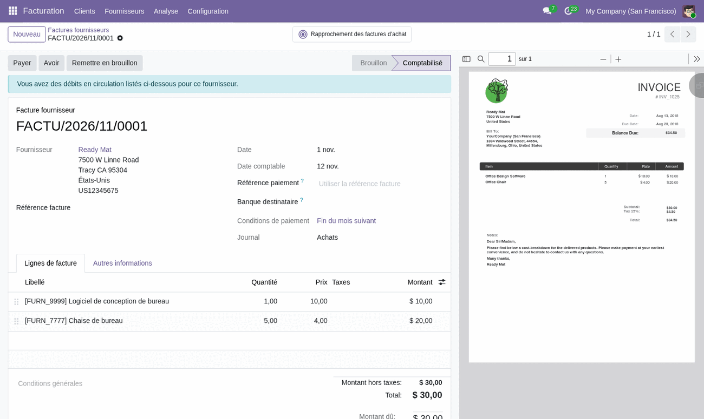

> Ce contrôle « commande ↔ réception ↔ facture » s'appelle le **rapprochement à trois voies** : on ne paie que ce qui a été
> commandé **et** reçu, au prix convenu.
>
> 🔒 La lecture automatique des factures PDF (OCR) est un service payant d'Odoo. En Community, on charge le PDF
> (bouton **Charger**) pour l'avoir à côté, mais on saisit les lignes soi-même.

### ✍️ À vous — Exercice 3.6

Café Import Antwerpen vous envoie sa facture pour la commande de l'exercice 2.2.
Enregistrez-la depuis la commande fournisseur, puis payez-la.

1. Combien de Café Éthiopie Odoo propose-t-il de facturer ? Pourquoi ?
2. La facture papier mentionne 30 Café Éthiopie. Que faites-vous ?

👉 [Réponse commentée](reponses/03-facturation.md#exercice-36)

---

## 7. Analyser

**Analyse → Gestion → Analyse des factures** : chiffre d'affaires par client, par produit, par mois…

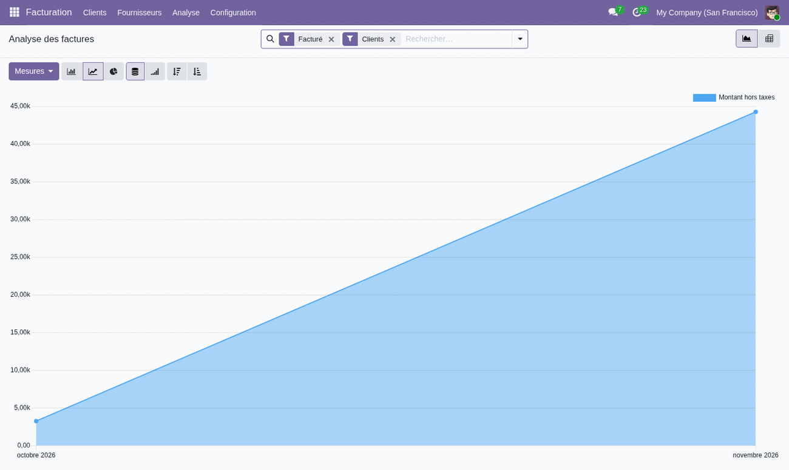

Les vues d'analyse (graphique, pivot) sont détaillées au [chapitre 6](06-tableaux-de-bord.md).

---

## 🔍 Enquête

**« Je ne peux plus modifier la facture ! »** Inès a confirmé une facture avec une faute dans l'adresse du client.
Tous les champs sont maintenant grisés. Elle veut « juste corriger l'adresse ». Que lui conseillez-vous ?

👉 [Explication](reponses/03-facturation.md#enquête)

---

## 🏁 Défi du chapitre — Exercice 3.7

**La facturation mensuelle.** Le restaurant **Le Petit Sablon** commande chaque semaine.
Il veut **une seule facture par mois**, avec toutes ses livraisons du mois.

1. Créez 3 commandes pour ce client, livrez-les.
2. Générez **une seule** facture pour les trois.
3. Quel réglage du client garantit qu'il recevra toujours ses factures à 30 jours fin de mois ?

👉 [Réponse commentée](reponses/03-facturation.md#exercice-37)

---

## 📁 Dans votre projet

1. Quels taux de TVA s'appliquent aux produits et services de votre client ?
2. Votre client facture-t-il à la commande ou à la livraison ? Pour quels produits ?
3. Quelles conditions de paiement propose-t-il, et à quels clients ?
4. A-t-il besoin de fonctions 🔒 Enterprise (relances automatiques, rapprochement bancaire, OCR) ?

---

## Questions de compréhension

1. Quelle est la différence entre une facture en brouillon et une facture comptabilisée ?
2. Pourquoi ne supprime-t-on pas une facture comptabilisée ?
3. Quelle est la différence entre les politiques de facturation « quantités commandées » et « quantités livrées » ?
4. Que signifie l'état de paiement « En paiement » ?
5. Qu'est-ce que le rapprochement à trois voies, et pourquoi est-il important ?
6. Pourquoi est-il important de mettre la bonne taxe sur la fiche produit plutôt que sur chaque facture ?

---

[⬅ Chapitre 2](02-stock.md) · [Sommaire](README.md) · [Chapitre 4 ➡](04-site-web.md)
