# Chapitre 3 — Stock

[⬅ Chapitre 2](02-crm.md) · [Sommaire](README.md) · [Chapitre 4 ➡](04-facturation.md)

## Objectifs

À la fin de ce chapitre, vous savez :
- créer des produits stockables et comprendre les types de produits ;
- suivre une réception (achat) et une livraison (vente) ;
- lire l'état du stock et l'historique des mouvements ;
- organiser un entrepôt en emplacements ;
- corriger le stock (inventaire physique, rebut) ;
- automatiser le réapprovisionnement.

> Applications nécessaires : **Inventaire**, **Ventes**, **Achats**.

---

## 1. Le principe : tout est un mouvement

Odoo ne stocke pas « une quantité » : il enregistre des **mouvements** d'un **emplacement** vers un autre.
Le stock d'un produit, c'est la somme des mouvements entrés moins ceux sortis.

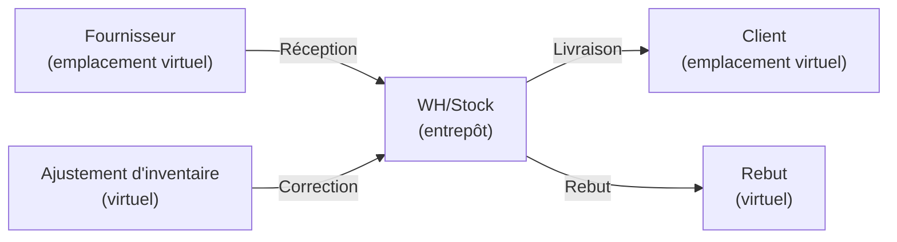

Les emplacements « Fournisseur », « Client », « Rebut »… sont **virtuels** : ils n'existent pas physiquement,
mais permettent de savoir d'où vient et où va chaque produit.

L'application s'ouvre sur la **vue d'ensemble** des opérations à traiter :

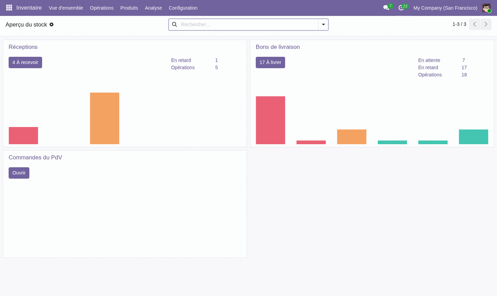

---

## 2. Les produits

**Inventaire → Produits → Produits**

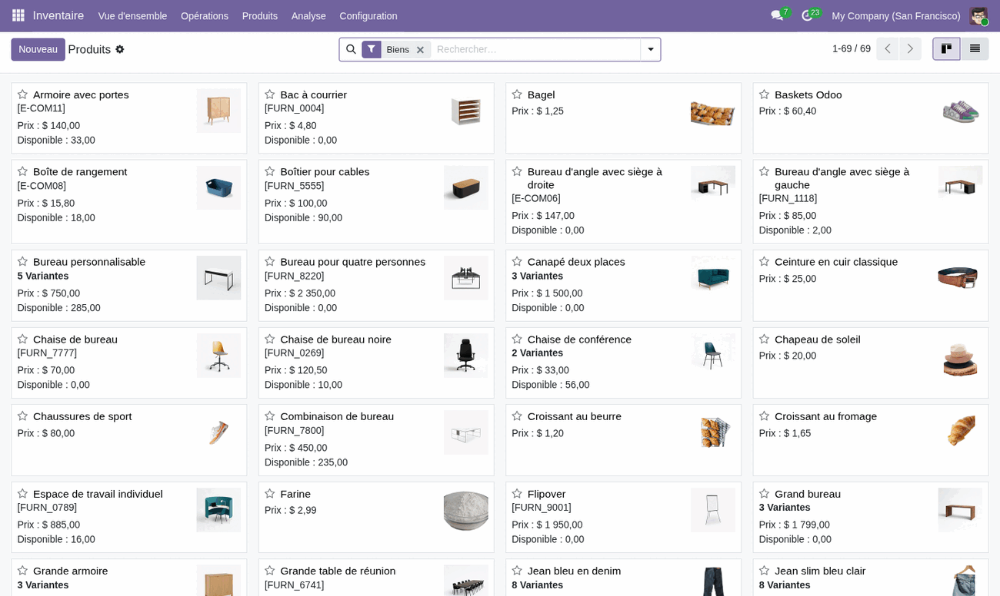

Le champ le plus important est le **type de produit** :

| Type | Stock suivi ? | Exemple chez Sablon |
|---|---|---|
| **Biens** avec **Suivre l'inventaire** coché | ✅ Oui, Odoo connaît la quantité | Café en grains 1 kg |
| **Biens** sans suivi | ❌ Non (consommable) | Sacs en papier, rubans |
| **Service** | ❌ Non, rien à livrer | Atelier de dégustation |
| **Combo** | Selon les produits qui le composent | Coffret découverte |

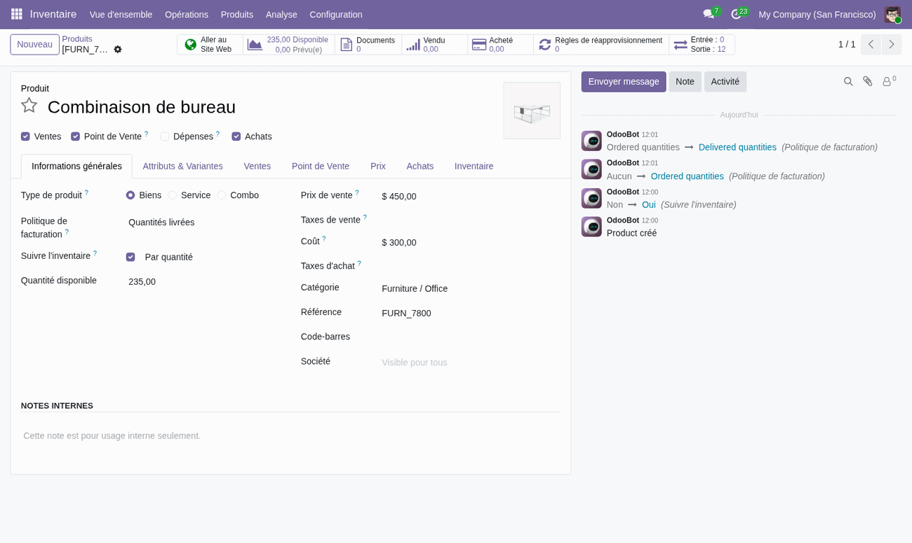

L'onglet **Inventaire** contient la logistique : poids, volume, délai de livraison, responsable…

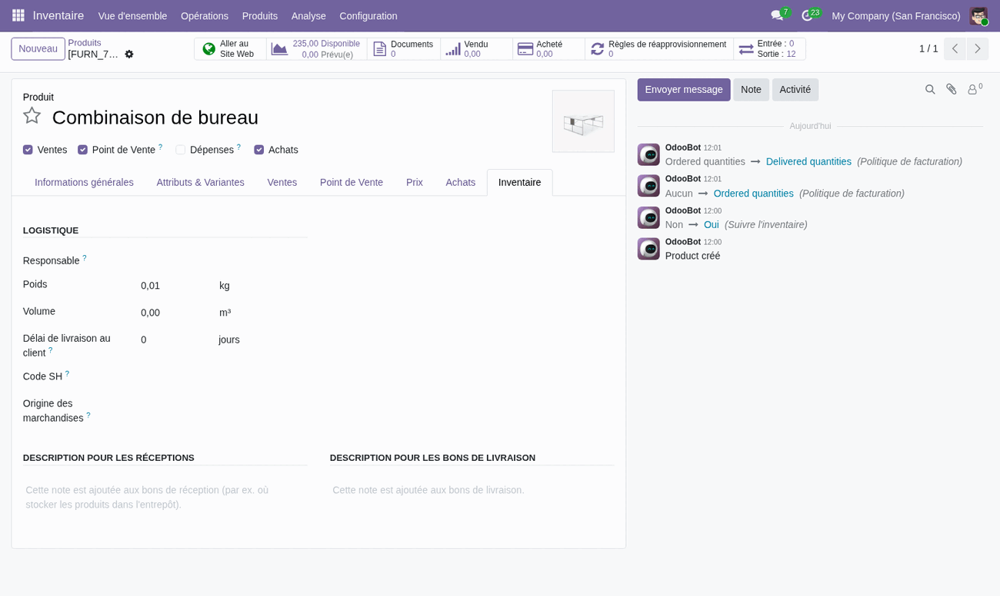

En haut, les **boutons intelligents** donnent la quantité **disponible**, la quantité **prévue**
(en tenant compte des achats et ventes à venir), et l'historique des entrées et sorties.

### ✍️ À vous — Exercice 3.1

**Le catalogue de Torréfaction Sablon.** Créez ces produits :

| Produit | Type | Prix de vente | Coût |
|---|---|---|---|
| Café Brésil grains 1 kg | Biens, inventaire suivi | 24,00 € | 11,00 € |
| Café Éthiopie grains 1 kg | Biens, inventaire suivi | 29,00 € | 14,00 € |
| Café Maison moulu 250 g | Biens, inventaire suivi | 7,50 € | 3,20 € |
| Sac kraft vide | Biens, **sans** suivi | — | 0,15 € |
| Atelier dégustation | Service | 35,00 € | — |

Rangez les trois cafés dans une catégorie de produits **Café**.

**Pour vérifier :**
- [ ] Les trois cafés affichent « Disponible : 0,00 » en haut de leur fiche.
- [ ] Le sac kraft et l'atelier n'ont **pas** de bouton de quantité disponible.

👉 [Réponse commentée](reponses/03-stock.md#exercice-31)

---

## 3. Recevoir de la marchandise

Une **commande fournisseur** (application Achats), une fois confirmée, crée automatiquement une **réception** dans l'Inventaire.

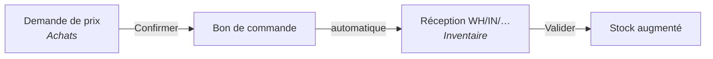

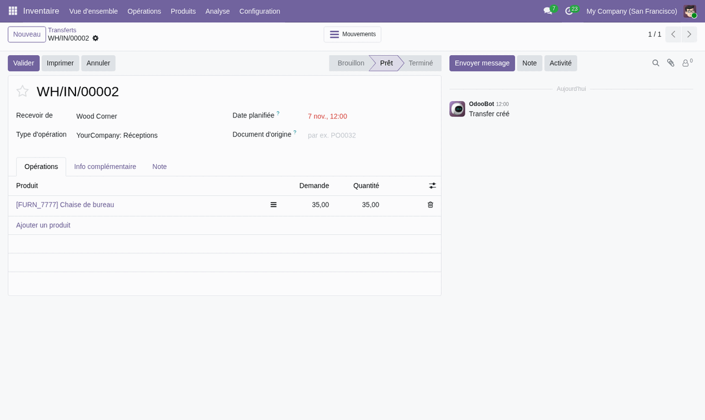

Une réception passe par les états **Brouillon → Prêt → Terminé**. Le bouton **Valider** confirme que la marchandise
est arrivée. Si la quantité reçue est inférieure à la quantité commandée, Odoo propose de créer un **reliquat**
(*backorder*) pour le reste.

### ✍️ À vous — Exercice 3.2

**Première livraison du fournisseur.**

1. Créez le fournisseur **Café Import Antwerpen**.
2. Dans **Achats**, commandez-lui : 50 × Café Brésil, 30 × Café Éthiopie, 100 × Café Maison moulu.
3. Confirmez la commande, ouvrez la réception et validez-la… mais vous n'avez reçu que **20** Café Éthiopie.

**Pour vérifier :**
- [ ] Le stock disponible est de 50 Brésil, 20 Éthiopie, 100 Maison.
- [ ] Une nouvelle réception (reliquat) de 10 Café Éthiopie attend.
- [ ] La commande fournisseur affiche 20 / 30 reçus pour l'Éthiopie.

💡 Indice : modifier la quantité reçue

Dans la réception, colonne **Quantité** : remplacez 30 par 20 avant de cliquer sur **Valider**.

👉 [Réponse commentée](reponses/03-stock.md#exercice-32)

---

## 4. Livrer un client

De la même façon, une **commande client** confirmée crée une **livraison** :

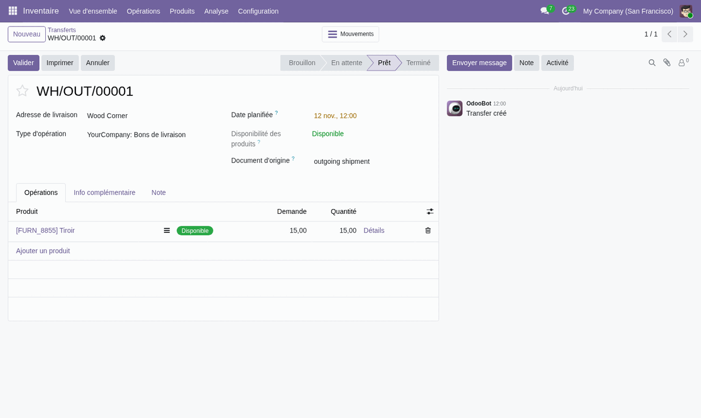

La livraison est **Prête** si le stock est suffisant, **En attente** sinon. Valider la livraison fait sortir le stock.

### ✍️ À vous — Exercice 3.3

**Le Café du Sablon commande.**

1. Créez le client **Café du Sablon** et un devis : 10 × Café Brésil, 15 × Café Éthiopie.
2. Confirmez. Quel est l'état de la livraison ? Pourquoi ?
3. Livrez ce qui est disponible maintenant, et le reste plus tard.

👉 [Réponse commentée](reponses/03-stock.md#exercice-33)

---

## 5. Où en est le stock ?

| Menu | Pour savoir… |
|---|---|
| **Analyse → Stock** | Combien de chaque produit, et sa valeur |
| **Analyse → Historique des mouvements** | Qui a bougé quoi, quand, de où vers où |
| **Analyse → Emplacements** | Ce qu'il y a dans chaque emplacement |

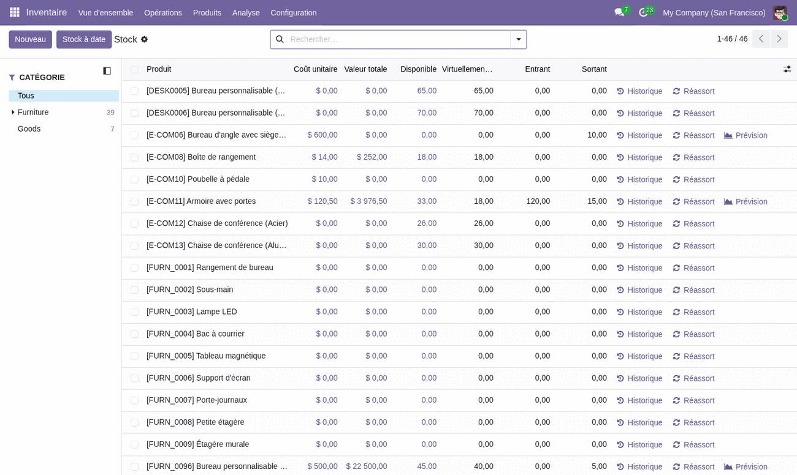

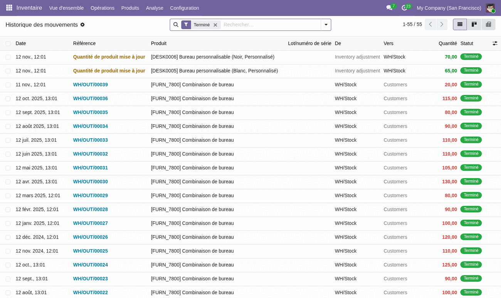

---

## 6. Organiser l'entrepôt

Par défaut, un entrepôt a un seul emplacement de stock (`WH/Stock`). Pour gérer des étagères, des zones ou une réserve,
activez **Inventaire → Configuration → Paramètres → Emplacements de stockage**.

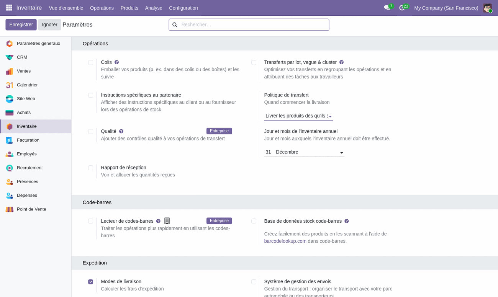

Les emplacements apparaissent dans **Configuration → Gestion de l'entrepôt → Emplacements** :

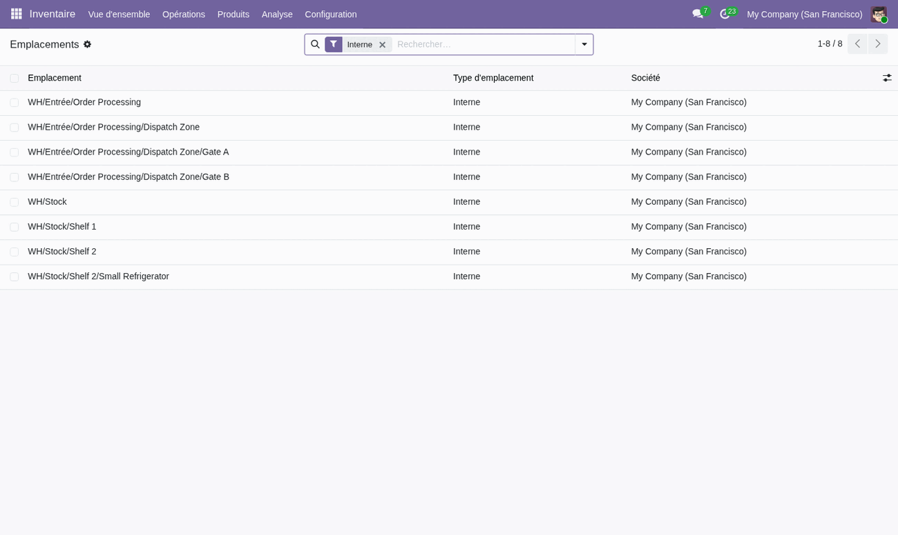

Ensuite, un **transfert interne** déplace des produits d'un emplacement à l'autre.

### ✍️ À vous — Exercice 3.4

**La réserve et la boutique.** Torréfaction Sablon stocke ses sacs dans une **réserve**, et une partie en **boutique**.

1. Activez les emplacements de stockage.
2. Créez deux sous-emplacements de `WH/Stock` : **Réserve** et **Boutique**.
3. Faites un transfert interne : 10 × Café Maison moulu de *Réserve* vers *Boutique*.

**Pour vérifier :**
- [ ] **Analyse → Stock**, regroupé par emplacement, montre la répartition.
- [ ] Le stock **total** du produit n'a pas changé.

👉 [Réponse commentée](reponses/03-stock.md#exercice-34)

---

## 7. Corriger le stock

La réalité finit toujours par différer de l'ordinateur : casse, vol, erreur de comptage.

| Situation | Outil |
|---|---|
| On compte et on trouve une autre quantité | **Opérations → Ajustements → Inventaire physique** |
| Un produit est abîmé et jeté | **Opérations → Ajustements → Rebut** |

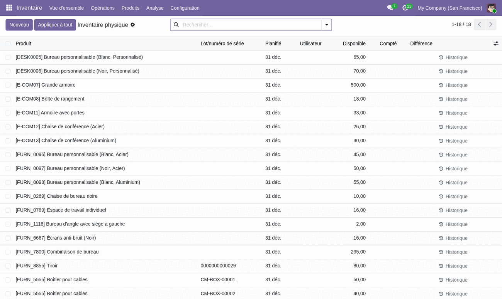

Dans l'inventaire physique, on saisit la quantité **comptée** ; Odoo calcule la **différence** et, avec **Appliquer**,
crée un mouvement depuis ou vers l'emplacement virtuel « Ajustement d'inventaire ».

### ✍️ À vous — Exercice 3.5

1. Au comptage, il y a **48** Café Brésil au lieu de 50 (après les livraisons de l'exercice 3.3, adaptez). Corrigez.
2. Un paquet de Café Maison moulu est tombé et s'est ouvert : mettez-le au rebut.

👉 [Réponse commentée](reponses/03-stock.md#exercice-35)

---

## 8. Réapprovisionner automatiquement

Une **règle de réapprovisionnement** dit : « quand le stock descend sous le **minimum**, recommande jusqu'au **maximum** ».

**Opérations → Approvisionnement → Réassort**

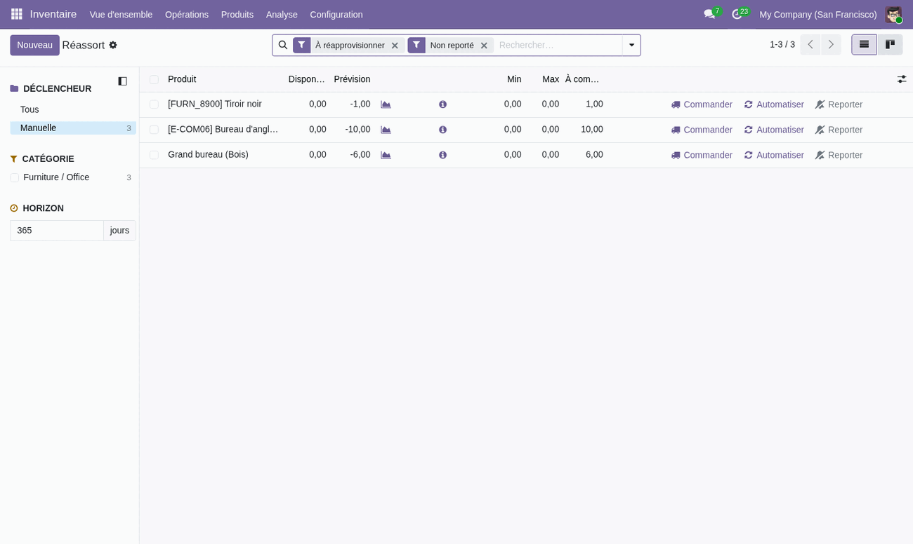

Pour qu'Odoo crée lui-même une demande de prix, le produit doit avoir :
1. un **fournisseur** (onglet **Achats** du produit) ;
2. la route **Acheter** (onglet **Inventaire**).

### ✍️ À vous — Exercice 3.6

Le Café Brésil ne doit jamais descendre sous **20 kg**. En dessous, on recommande pour remonter à **80 kg**,
chez Café Import Antwerpen, à 11 € le kg.

Configurez-le, puis vendez assez de Café Brésil pour passer sous le minimum. Que se passe-t-il ?

👉 [Réponse commentée](reponses/03-stock.md#exercice-36)

---

## 🔍 Enquête

**« Le stock ne bouge pas ! »** Karim a vendu 5 Sacs kraft. Lucas, le magasinier, a bien reçu une livraison
pour les sacs et l'a validée. Mais la quantité en stock des sacs n'apparaît nulle part, et la gérante voudrait savoir
combien il en reste. Karim pense qu'Odoo est « buggé ». Qu'en pensez-vous ?

👉 [Explication](reponses/03-stock.md#enquête)

---

## 🏁 Défi du chapitre — Exercice 3.7

Un client commande 30 Café Éthiopie alors que vous n'en avez que 10 (après l'exercice 3.3).
Il accepte une livraison en deux fois. Organisez tout le flux pour qu'à la fin :
- le client ait reçu ses 30 sacs ;
- le fournisseur ait été recommandé automatiquement ;
- vous puissiez montrer à la gérante l'historique complet des mouvements de ce produit.

👉 [Réponse commentée](reponses/03-stock.md#exercice-37)

---

## 📁 Dans votre projet

1. Quels produits de votre client sont stockables, consommables ou des services ?
2. Combien d'entrepôts et d'emplacements faut-il ? Dessinez-les.
3. Quels produits doivent être réapprovisionnés automatiquement ? Avec quels minimum et maximum ?

---

## Questions de compréhension

1. Quelle est la différence entre un produit « Biens » avec et sans suivi de l'inventaire ?
2. Pourquoi Odoo utilise-t-il des emplacements virtuels (Fournisseur, Client, Rebut) ?
3. Qu'est-ce qu'un reliquat, et quand est-il créé ?
4. Quelle est la différence entre la quantité **disponible** et la quantité **prévue** ?
5. Que faut-il configurer pour qu'une règle de réapprovisionnement crée une demande de prix ?
6. Un ajustement d'inventaire est-il une vente ? D'où vient la marchandise « ajoutée » ?

---

[⬅ Chapitre 2](02-crm.md) · [Sommaire](README.md) · [Chapitre 4 ➡](04-facturation.md)
