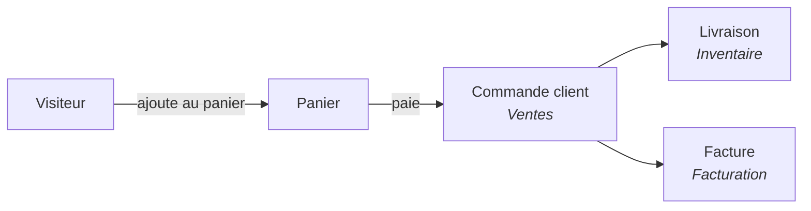
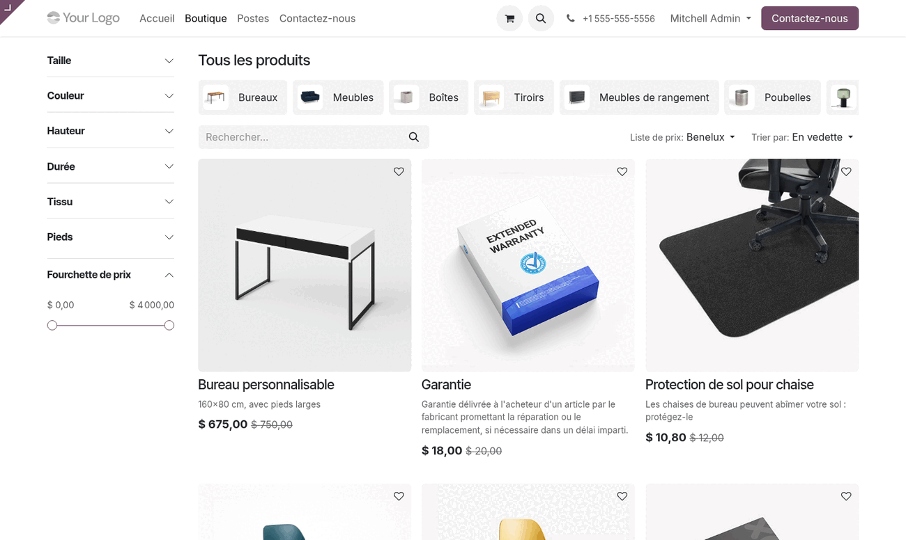
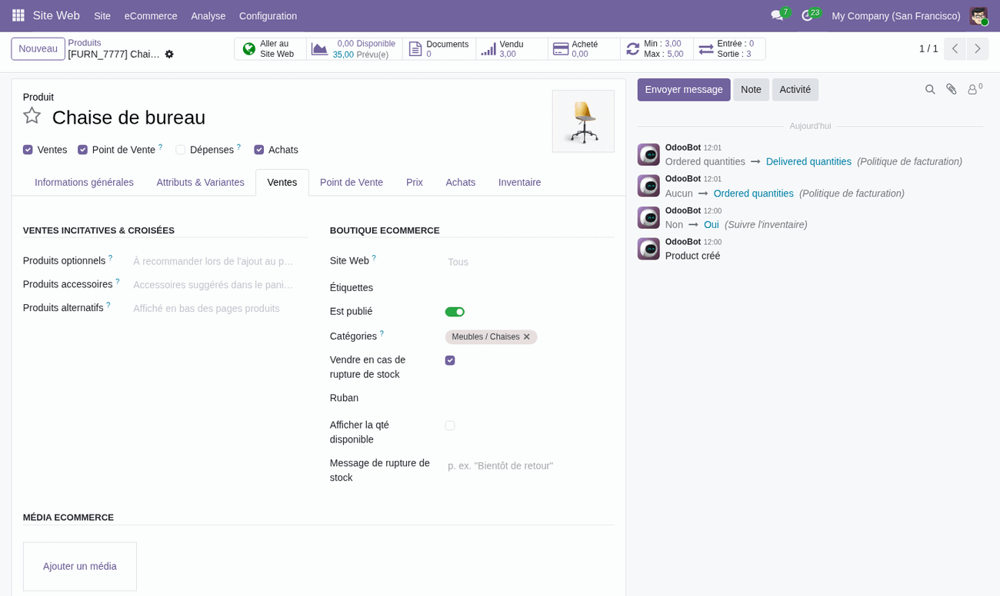
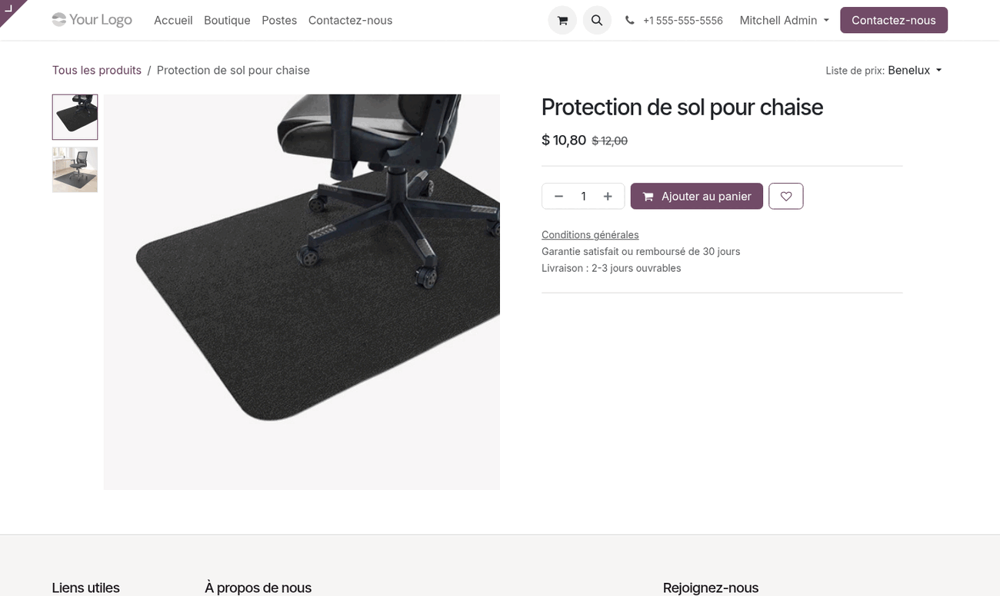
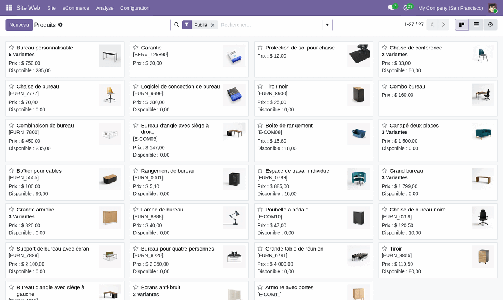
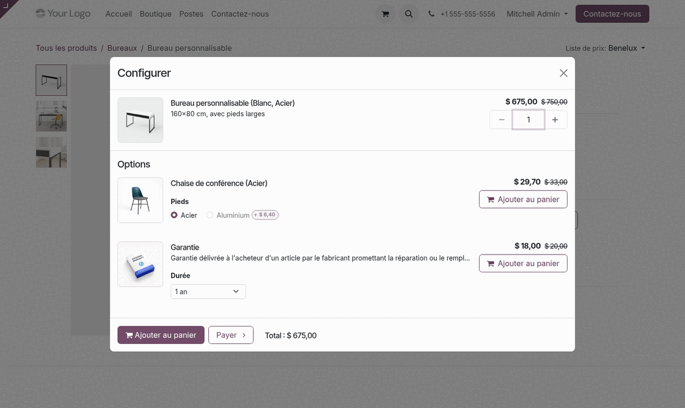
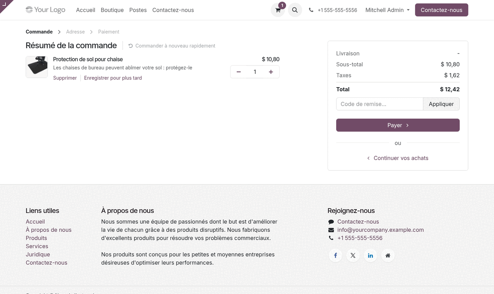
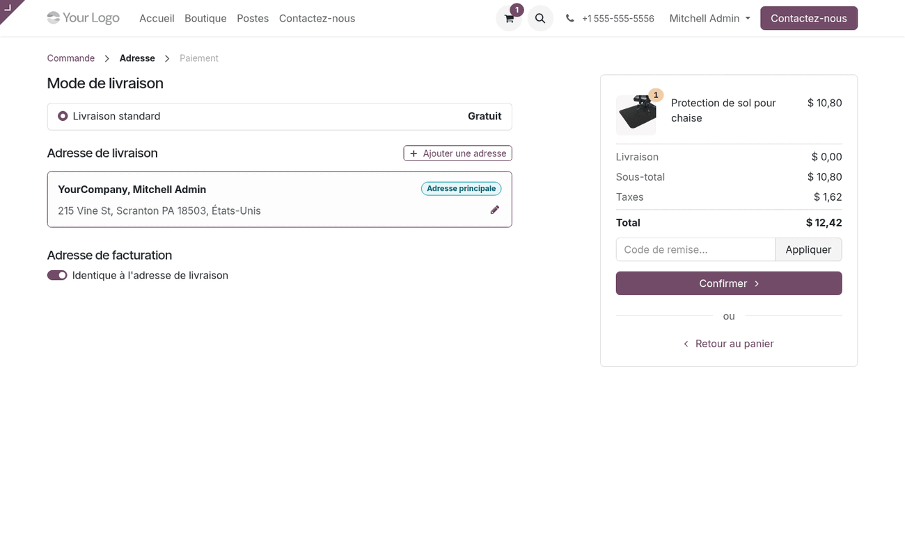
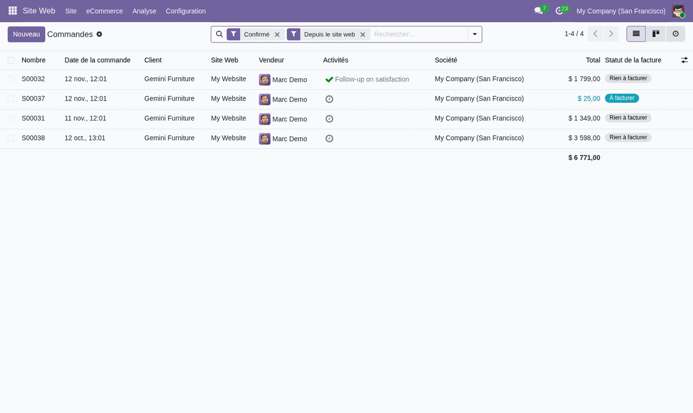
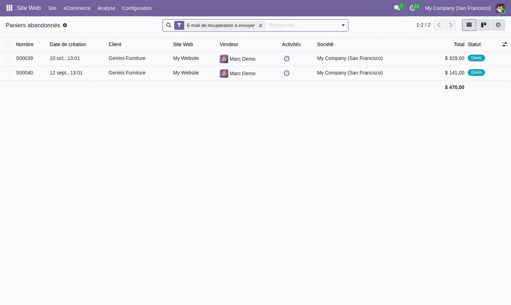

# Chapitre 5 — eCommerce

[⬅ Chapitre 4](04-site-web.md) · [Sommaire](README.md) · [Chapitre 6 ➡](06-tableaux-de-bord.md)

## Objectifs

À la fin de ce chapitre, vous savez :
- publier des produits dans la boutique en ligne et les ranger en catégories ;
- créer des variantes (mouture, taille…) ;
- configurer les modes de livraison et de paiement ;
- suivre une commande en ligne jusqu'à la livraison et la facture ;
- gérer l'affichage du stock et les paniers abandonnés.

> Applications nécessaires : **eCommerce** (installe Site Web et Ventes), **Inventaire**, **Facturation**.

---

## 1. Une boutique branchée sur l'ERP

Une commande passée sur le site est une **commande client** comme une autre. Elle suit exactement le même chemin
qu'aux chapitres 2 et 3 :

Aucune ressaisie : le magasinier voit la livraison à préparer, le comptable la facture, le gérant le chiffre d'affaires.

La boutique se trouve à l'adresse `/shop` :

---

## 2. Publier un produit

Un produit apparaît dans la boutique s'il est **publié**. Deux façons :
- sur le site, page du produit → interrupteur **Publié** ;
- dans le formulaire du produit, onglet **Ventes** → section **Boutique eCommerce** → **Est publié**.

Dans cette section, on règle aussi :

| Option | Effet |
|---|---|
| **Catégories** | Les rayons de la boutique (filtre à gauche) |
| **Ruban** | Un bandeau sur la vignette : *Nouveau*, *Promo*, *Épuisé*… |
| **Vendre en cas de rupture de stock** | Accepter les commandes même sans stock |
| **Afficher la quantité disponible** | « Plus que 3 en stock » |
| **Produits optionnels / accessoires / alternatifs** | Suggestions au moment d'ajouter au panier |

La page produit, côté visiteur :

Les produits de la boutique : **Site Web → eCommerce → Produits → Produits**.

### ✍️ À vous — Exercice 5.1

**Mettre en ligne les cafés.**

1. Créez la catégorie eCommerce **Cafés**.
2. Publiez les trois cafés dans cette catégorie, chacun avec une photo et une description courte (origine, goût).
3. Ne publiez **pas** le sac kraft ni l'atelier dégustation.

**Pour vérifier :**
- [ ] En navigation privée, `/shop` affiche les trois cafés, et le filtre **Cafés** fonctionne.
- [ ] Le sac kraft n'apparaît pas.

👉 [Réponse commentée](reponses/05-ecommerce.md#exercice-51)

---

## 3. Les variantes

Un même café existe en plusieurs **moutures** : en grains, moulu espresso, moulu filtre. Plutôt que trois produits,
on crée **un produit avec trois variantes**.

1. Activez **Ventes → Configuration → Paramètres → Variantes**.
2. Créez un **attribut** (*Mouture*) avec ses **valeurs** (*Grains*, *Espresso*, *Filtre*).
3. Sur le produit, onglet **Attributs & Variantes**, ajoutez l'attribut et ses valeurs.

Chaque variante a son propre stock, sa propre référence, et éventuellement un supplément de prix.
Sur le site, le visiteur choisit la variante sur la page du produit :

### ✍️ À vous — Exercice 5.2

Le **Café Brésil 1 kg** existe en trois moutures : Grains, Espresso, Filtre. La mouture fine *Espresso*
coûte **1 € de plus**. Configurez-le.

**Pour vérifier :**
- [ ] La page du produit propose les trois moutures, et le prix change en choisissant *Espresso*.
- [ ] **Inventaire → Produits → Variantes de produit** liste trois variantes de Café Brésil.

👉 [Réponse commentée](reponses/05-ecommerce.md#exercice-52)

---

## 4. Le panier et le paiement

Le visiteur passe par trois étapes : **Commande** (le panier) → **Adresse** (et mode de livraison) → **Paiement**.

| Panier | Adresse et livraison |
|---|---|
|  |  |

### Les modes de livraison

**Site Web → Configuration → eCommerce → Modes de livraison** (ou **Inventaire → Configuration → Livraison**).
Prix fixe, gratuit au-delà d'un montant, basé sur des règles (poids, destination)…

> 🔒 Les connecteurs vers les transporteurs (bpost, DHL, UPS…) qui calculent le prix réel et impriment les étiquettes
> sont en Enterprise. En Community, on définit ses propres tarifs.

### Les modes de paiement

**Site Web → Configuration → eCommerce → Fournisseurs de paiement**. Tant qu'aucun n'est activé, Odoo affiche un bandeau
d'avertissement et les visiteurs ne peuvent pas payer.

| Fournisseur | Usage |
|---|---|
| **Virement bancaire** | Le client vire l'argent ; vous confirmez la commande à réception |
| **Paiement comptant à la livraison** | Le client paie à la réception du colis |
| **Stripe, Mollie, PayPal…** | Paiement par carte ou Bancontact en ligne. Nécessite un compte chez le prestataire |

Chaque fournisseur a un **mode test** pour faire des essais sans argent réel.

### ✍️ À vous — Exercice 5.3

**Livraison et paiement.**

1. Créez deux modes de livraison :
   - **Livraison bpost** : 5,95 €, **gratuite à partir de 50 €** ;
   - **Retrait en boutique** : gratuit.
2. Activez le paiement par **virement bancaire**.

👉 [Réponse commentée](reponses/05-ecommerce.md#exercice-53)

---

## 5. Suivre les commandes en ligne

**Site Web → eCommerce → Commandes**

| Menu | Contenu |
|---|---|
| **Commandes** | Les commandes passées sur le site |
| **Commandes non payées** | Commandes en attente de paiement (virement pas encore reçu…) |
| **Paniers abandonnés** | Des visiteurs identifiés ont rempli un panier sans commander |

Depuis les paniers abandonnés, on peut envoyer un **e-mail de relance** au client : « Vous avez oublié quelque chose ? »

### ✍️ À vous — Exercice 5.4

**Votre première commande en ligne.** En navigation privée, comme un vrai client :

1. Commandez 2 Café Brésil (mouture Espresso) et 1 Café Maison moulu, livraison bpost, paiement par virement.
   Créez un compte client pendant la commande.
2. Côté Odoo, retrouvez la commande. Dans quel état est-elle ?
3. Le virement est arrivé : confirmez le paiement, préparez la livraison et facturez.

**Pour vérifier :**
- [ ] Les frais de livraison sont bien de 0 € (la commande dépasse 50 €).
- [ ] La commande a une livraison validée et une facture payée.
- [ ] Le stock de Café Brésil *Espresso* a diminué de 2.

👉 [Réponse commentée](reponses/05-ecommerce.md#exercice-54)

---

## 🔍 Enquête

**« Mon café n'est pas dans la boutique ! »** Karim a créé un nouveau produit *Café Colombie grains 1 kg*, avec photo et
description. Il le voit dans **Site Web → eCommerce → Produits**, mais les clients ne le trouvent pas sur `/shop`.
Quelles sont les causes possibles ?

👉 [Explication](reponses/05-ecommerce.md#enquête)

---

## 🏁 Défi du chapitre — Exercice 5.5

**La gestion du stock en ligne.**

1. Le Café Éthiopie est rare : on ne doit **jamais** le vendre en ligne s'il n'y en a plus en stock, et on veut afficher
   « Plus que X en stock » quand il en reste moins de 5.
2. Mettez un ruban **Nouveau** sur le Café Éthiopie.
3. Videz le stock d'Éthiopie (inventaire physique) et vérifiez ce que voit le visiteur.
4. Proposez le **Café Maison moulu** comme produit optionnel quand on ajoute un café en grains au panier.

👉 [Réponse commentée](reponses/05-ecommerce.md#exercice-55)

---

## 📁 Dans votre projet

1. Votre client vend-il en ligne ? Quels produits, avec quelles variantes ?
2. Quels modes de livraison et de paiement lui faut-il ? Lesquels nécessitent Enterprise 🔒 ?
3. Que doit-il se passer quand un produit est en rupture de stock ?

---

## Questions de compréhension

1. En quoi une commande eCommerce est-elle différente d'une commande créée dans l'application Ventes ?
2. Quel est l'intérêt d'un produit avec variantes plutôt que de plusieurs produits séparés ?
3. Pourquoi une commande payée par virement reste-t-elle en attente ?
4. Qu'est-ce qu'un panier abandonné, et comment l'utiliser commercialement ?
5. Citez trois raisons pour lesquelles un produit peut ne pas apparaître dans la boutique.

---

[⬅ Chapitre 4](04-site-web.md) · [Sommaire](README.md) · [Chapitre 6 ➡](06-tableaux-de-bord.md)
