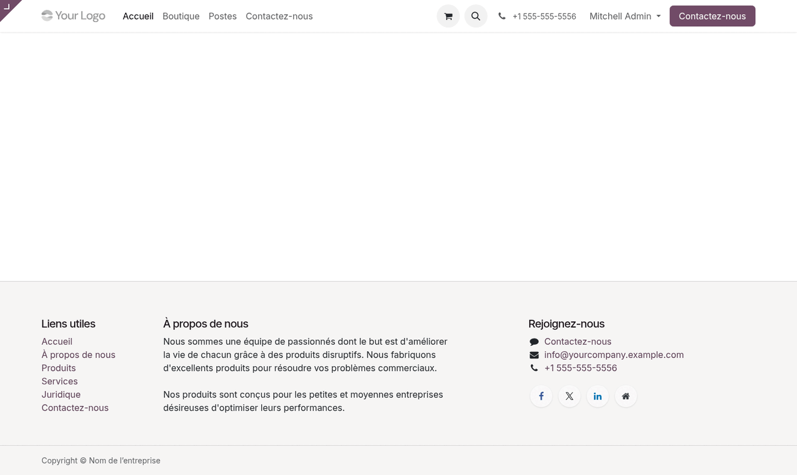
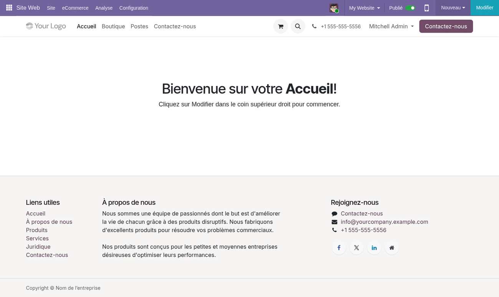
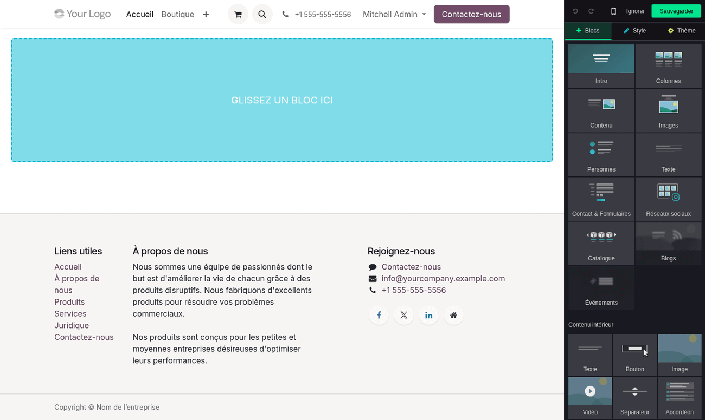
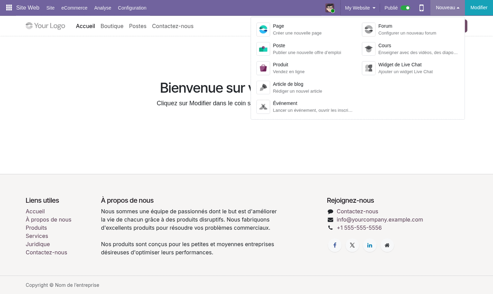
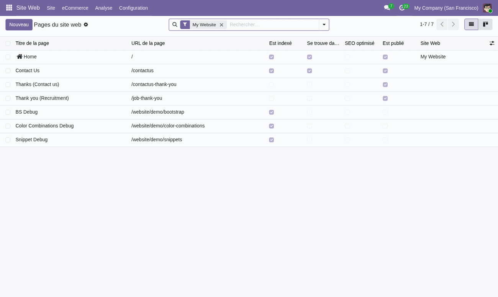
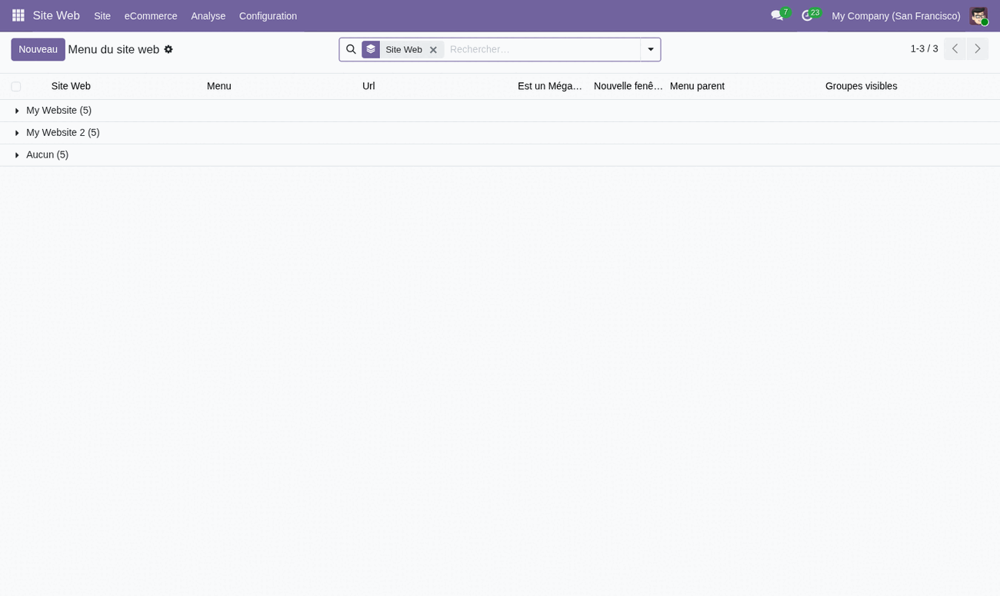
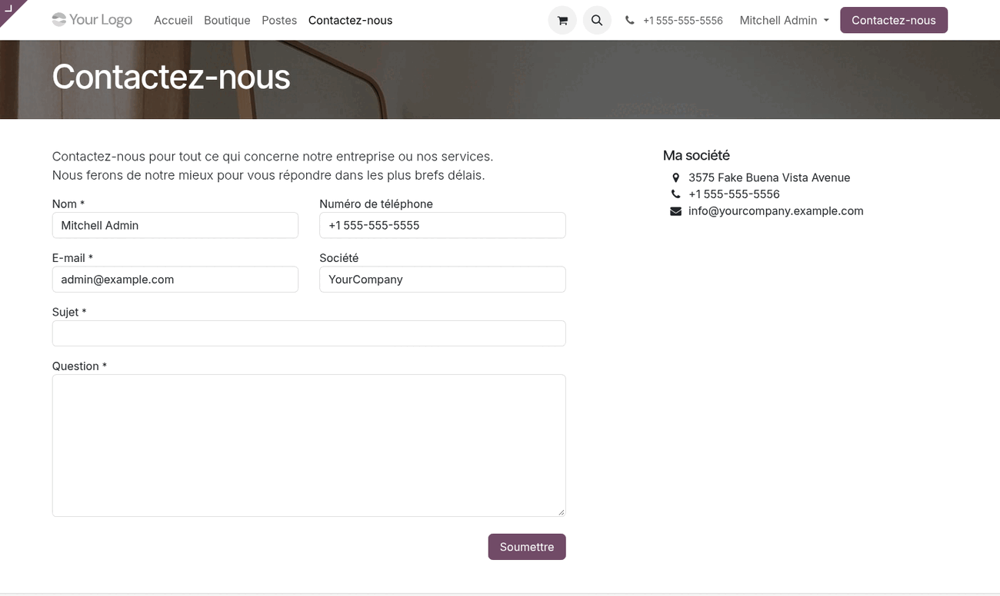
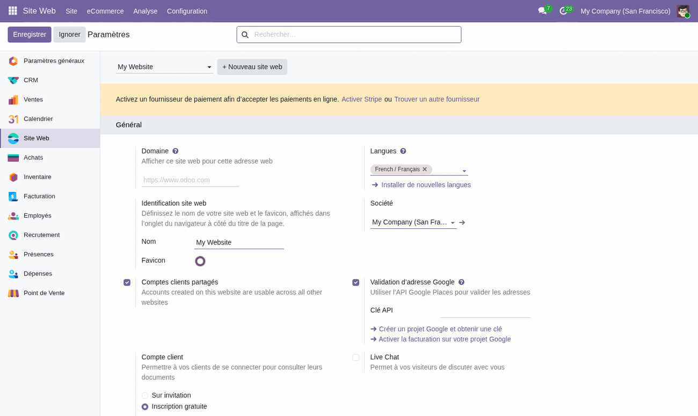

# Chapitre 5 — Site web

[⬅ Chapitre 4](04-facturation.md) · [Sommaire](README.md) · [Chapitre 6 ➡](06-ecommerce.md)

## Objectifs

À la fin de ce chapitre, vous savez :
- modifier les pages d'un site avec l'éditeur par glisser-déposer ;
- créer de nouvelles pages et les ajouter au menu ;
- personnaliser le thème (couleurs, polices, logo) ;
- publier ou dépublier du contenu ;
- optimiser le référencement (SEO) d'une page ;
- comprendre où arrivent les messages du formulaire de contact.

> Application nécessaire : **Site Web**.

---

## 1. Le site web dans Odoo

Le site web d'Odoo n'est pas un outil à part : il utilise **les mêmes données** que le reste de l'ERP.
Les produits de la boutique sont ceux de l'Inventaire, les messages du formulaire de contact arrivent dans le CRM,
les offres d'emploi viennent du Recrutement.

Après installation, le site a déjà une page d'accueil, une page *Contactez-nous* et un pied de page :

L'application **Site Web** affiche le site avec une barre d'outils en haut :

| Élément | Rôle |
|---|---|
| **Nouveau** | Créer une page, un produit, un article de blog, une offre d'emploi… |
| **Modifier** | Ouvrir l'éditeur sur la page affichée |
| **Publié / Non publié** | Rendre la page visible (ou non) pour les visiteurs |
| 📱 | Aperçu sur mobile |
| **Site / eCommerce / Analyse / Configuration** | Les menus d'administration |

---

## 2. L'éditeur

**Modifier** ouvre l'éditeur. À droite, trois onglets :

| Onglet | Contenu |
|---|---|
| **Blocs** | Les briques à glisser sur la page : bannière, texte et image, colonnes, galerie, citations, chiffres clés, formulaire… |
| **Style** | Les options du bloc sélectionné : couleurs, fond, espacements, animation… |
| **Thème** | Les réglages de tout le site : couleurs, polices, boutons, en-tête, pied de page |

On travaille ainsi :
1. **Glisser** un bloc sur la page.
2. **Cliquer** sur un texte pour le modifier, sur une image pour la remplacer.
3. **Sélectionner** un bloc pour régler son style à droite.
4. **Sauvegarder** (en haut à droite). **Ignorer** annule toutes les modifications.

> 💡 Un site se construit avec des **blocs prêts à l'emploi**, pas en partant d'une page blanche.
> C'est la même logique que l'ERP : on part du standard et on adapte.

### ✍️ À vous — Exercice 5.1

**La page d'accueil de Torréfaction Sablon.** Remplacez le contenu par défaut par :

1. Une **bannière** avec une photo de café, le titre « Torréfaction Sablon » et le sous-titre
   « Café torréfié à Bruxelles depuis 1987 », avec un bouton « Découvrir nos cafés ».
2. Un bloc **texte + image** qui présente l'entreprise en 3 phrases.
3. Un bloc de **chiffres clés** : 12 origines, 3 tonnes torréfiées par an, 40 restaurants partenaires.

**Pour vérifier :**
- [ ] Après **Sauvegarder**, la page s'affiche correctement en navigation privée.
- [ ] L'aperçu 📱 mobile est lisible.

👉 [Réponse commentée](reponses/05-site-web.md#exercice-51)

### ✍️ À vous — Exercice 5.2

**Le thème.** Dans l'onglet **Thème** :
1. Ajoutez le logo de l'entreprise (n'importe quelle image fera l'affaire).
2. Choisissez une palette de couleurs brunes, « café ».
3. Changez la police des titres.

👉 [Réponse commentée](reponses/05-site-web.md#exercice-52)

---

## 3. Les pages et les menus

**Nouveau → Page** crée une page, avec un modèle de mise en page au choix, et propose de l'ajouter au menu.

Toutes les pages sont listées dans **Site → Contenu → Pages** :

Pour chaque page : son URL, si elle est **publiée**, si elle est **indexée** par les moteurs de recherche, sa date de publication…

Le menu du site se modifie avec **Site → Éditeur de menu** (ou en éditant le menu directement sur le site) :

### ✍️ À vous — Exercice 5.3

**Deux nouvelles pages.**

1. Créez une page **« Notre histoire »** (URL `/notre-histoire`), avec un titre, deux paragraphes et une image.
2. Créez une page **« Nos ateliers »** qui présente l'atelier dégustation (prix, durée, nombre de personnes).
3. Organisez le menu : *Accueil · Notre histoire · Nos ateliers · Contactez-nous*.

**Pour vérifier :**
- [ ] Les deux pages sont accessibles depuis le menu, en navigation privée.
- [ ] L'URL de la première page est bien `/notre-histoire`.

👉 [Réponse commentée](reponses/05-site-web.md#exercice-53)

---

## 4. Le formulaire de contact

La page **Contactez-nous** contient un formulaire :

Où arrive le message d'un visiteur ? Ça dépend des applications installées :
- **sans CRM** : un e-mail est envoyé à l'adresse de la société ;
- **avec CRM** : une **piste** (*lead*) est créée dans le CRM ([chapitre 2](02-crm.md)), avec le nom, l'e-mail et le message du visiteur.

En mode édition, cliquez sur le formulaire : dans l'onglet de droite, l'option **Action** indique ce que fait le formulaire
(envoyer un e-mail, créer une piste, créer un candidat…).

### ✍️ À vous — Exercice 5.4

En navigation privée, envoyez un message via le formulaire de contact : « Je voudrais réserver un atelier pour 6 personnes ».
Retrouvez ce message dans Odoo.

👉 [Réponse commentée](reponses/05-site-web.md#exercice-54)

---

## 5. Le référencement (SEO)

Pour être bien classé dans Google, chaque page a besoin de :

| Élément | Où | Exemple |
|---|---|---|
| **Titre** | Onglet du navigateur, résultat Google | « Torréfaction Sablon — Café torréfié à Bruxelles » |
| **Description** | Texte sous le titre dans Google | 150 caractères qui donnent envie de cliquer |
| **Mots-clés** | Mots que les gens cherchent | café Bruxelles, torréfacteur, café en grains |
| **URL lisible** | `/notre-histoire`, pas `/page-12` | |

Sur la page affichée : **Site → Cette page → Optimisation SEO**.

### ✍️ À vous — Exercice 5.5

Optimisez le SEO de la page d'accueil et de la page *Notre histoire*.

👉 [Réponse commentée](reponses/05-site-web.md#exercice-55)

---

## 6. Les paramètres

**Configuration → Paramètres** : nom du site, domaine, langues, favicon, bannière de cookies, Google Analytics…

> 💡 Odoo gère **plusieurs sites** dans une même base (**Configuration → Sites web**), chacun avec son domaine,
> ses pages et son thème. Pratique pour une entreprise qui a deux marques.

---

## 🔍 Enquête

**« Ma page n'existe pas ! »** Sophie a créé une page « Promotions de Noël » hier. Elle la voit très bien quand elle est
connectée. Mais un client lui dit qu'il ne la trouve pas, et quand elle envoie le lien à une amie, celle-ci obtient une erreur 404.
Donnez au moins deux causes possibles et comment les vérifier.

👉 [Explication](reponses/05-site-web.md#enquête)

---

## 🏁 Défi du chapitre — Exercice 5.6

**Réserver un atelier.** Sur la page *Nos ateliers*, ajoutez un **formulaire** « Réserver un atelier » avec : nom, e-mail,
téléphone, date souhaitée, nombre de personnes. Les demandes doivent arriver dans le **CRM**, avec le nombre de personnes
visible dans la piste. Testez-le en navigation privée.

👉 [Réponse commentée](reponses/05-site-web.md#exercice-56)

---

## 📁 Dans votre projet

1. Votre client a-t-il besoin d'un site web ? Quelles pages ?
2. Que doivent devenir les messages envoyés par les visiteurs (CRM, e-mail, candidature) ?
3. Quels mots-clés ses clients tapent-ils dans Google pour le trouver ?

---

## Questions de compréhension

1. Quel est l'avantage d'un site web intégré à l'ERP plutôt qu'un site séparé (WordPress, Wix…) ?
2. Quelle est la différence entre les onglets **Style** et **Thème** de l'éditeur ?
3. Une page existe mais les visiteurs ne la voient pas. Quelles sont les causes possibles ?
4. Où arrive le message du formulaire de contact quand le CRM est installé ?
5. Pourquoi une URL lisible est-elle importante pour le référencement ?

---

[⬅ Chapitre 4](04-facturation.md) · [Sommaire](README.md) · [Chapitre 6 ➡](06-ecommerce.md)
