# Chapitre 7 — Point de vente

[⬅ Chapitre 6](06-ecommerce.md) · [Sommaire](README.md) · [Chapitre 8 ➡](08-rh.md)

## Objectifs

À la fin de ce chapitre, vous savez :
- configurer un point de vente (caisse) : produits, catégories, moyens de paiement ;
- ouvrir une session avec un fond de caisse ;
- encaisser une vente, appliquer une remise, rendre la monnaie ;
- vendre à un client identifié et lui faire une facture ;
- rembourser un article ;
- clôturer une session et comprendre son impact sur le stock et la comptabilité.

> Application nécessaire : **Point de Vente**.

---

## 1. Le point de vente

Le **Point de Vente** (PdV, *POS*) est la caisse enregistreuse d'Odoo. Elle fonctionne dans un navigateur,
sur un ordinateur, une tablette ou un écran tactile, et continue à fonctionner **hors ligne** si Internet coupe :
les ventes sont synchronisées au retour de la connexion.

Une boutique peut avoir plusieurs caisses. Chaque caisse est un **point de vente** :

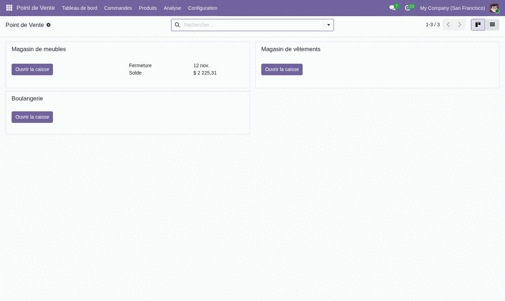

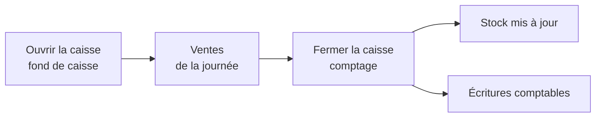

Une **session** va de l'ouverture à la fermeture de la caisse, en général une journée.

---

## 2. Configurer un point de vente

**Point de Vente → Configuration → Point de vente**

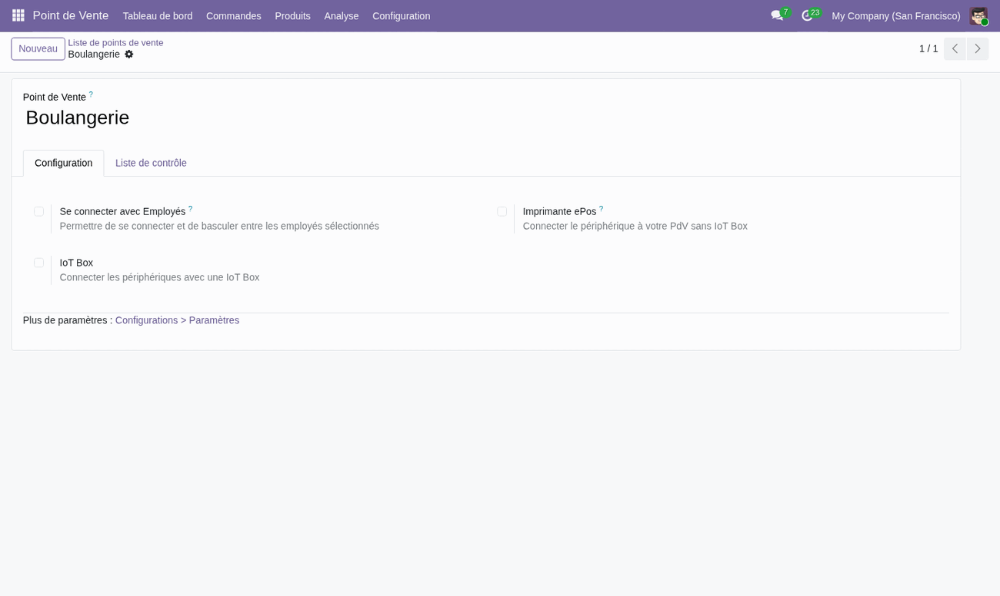

Les réglages détaillés sont dans **Configuration → Paramètres**, en choisissant le point de vente en haut de la page :
moyens de paiement, catégories de produits proposées, listes de prix, en-tête et pied du ticket, arrondi des espèces…

### Les produits en caisse

Un produit est proposé en caisse si, dans sa fiche, onglet **Point de Vente** :
- **Disponible dans le PdV** est coché ;
- il a une **catégorie PdV** (les onglets de couleur en haut de l'écran de caisse).

### Les moyens de paiement

**Configuration → Modes de paiement** : *Espèces*, *Carte*, *Compte client* (le client paiera plus tard sur facture).

> 💡 Les terminaux de paiement (Bancontact) peuvent être reliés à la caisse pour envoyer le montant automatiquement.
> Sans connexion, le vendeur tape le montant sur le terminal et choisit **Carte** dans Odoo.

### ✍️ À vous — Exercice 7.1

**La caisse de la boutique du Sablon.**

1. Créez un point de vente **Boutique Sablon**.
2. Créez une catégorie PdV **Cafés** et une catégorie **Accessoires**.
3. Rendez disponibles en caisse : les trois cafés (catégorie Cafés), le sac kraft vendu 0,20 € (catégorie Accessoires).
4. Moyens de paiement : **Espèces** et **Carte**.

**Pour vérifier :**
- [ ] En ouvrant la caisse, les deux catégories et les quatre produits apparaissent.

👉 [Réponse commentée](reponses/07-point-de-vente.md#exercice-71)

---

## 3. Ouvrir la caisse

Sur le tableau de bord, **Ouvrir la caisse**. Odoo demande le **fond de caisse** (les espèces présentes dans le tiroir
au début de la journée) :

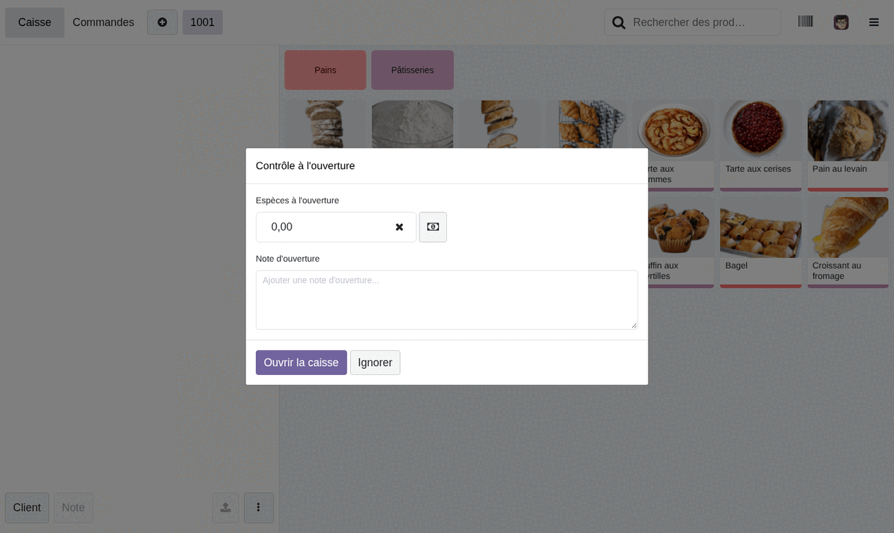

L'écran de caisse s'affiche :

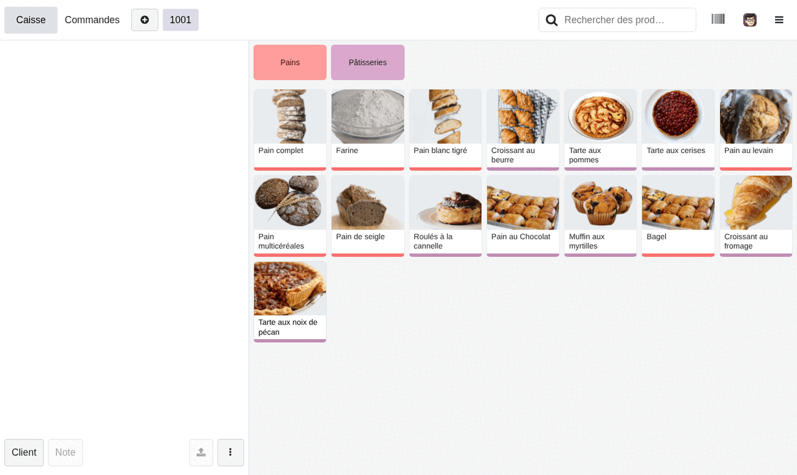

| Zone | Rôle |
|---|---|
| À droite | Les produits, par catégorie, et la recherche |
| À gauche | Le ticket en cours |
| Pavé numérique | **Qté**, **%** (remise), **Prix** : choisir le mode, puis taper le chiffre |
| **Client** | Associer la vente à un client |
| **Paiement** | Passer à l'encaissement |

---

## 4. Encaisser

Un clic sur un produit l'ajoute au ticket (un deuxième clic augmente la quantité) :

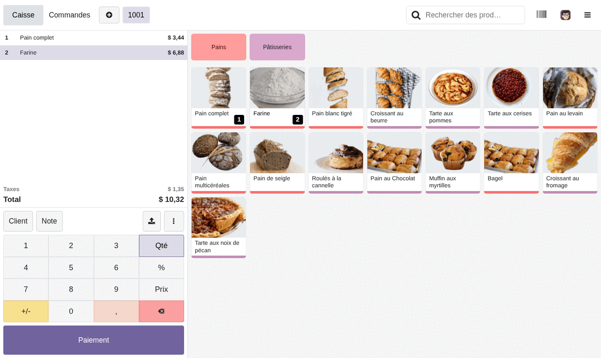

**Paiement** ouvre l'écran d'encaissement. On choisit le moyen de paiement ; pour les espèces, on tape le montant
donné par le client et Odoo calcule la **monnaie** à rendre :

| Écran de paiement | Espèces sélectionnées |
|---|---|
| 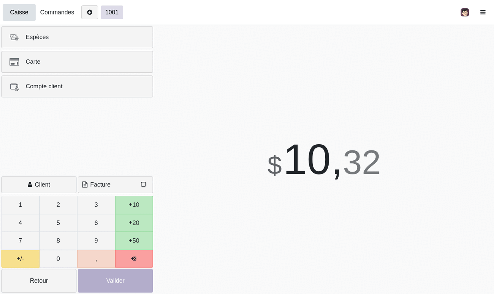 | 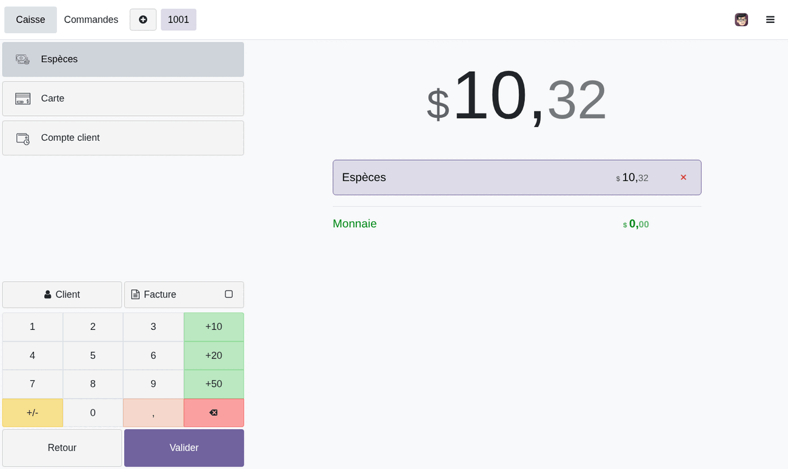 |

**Valider** termine la vente et affiche le ticket :

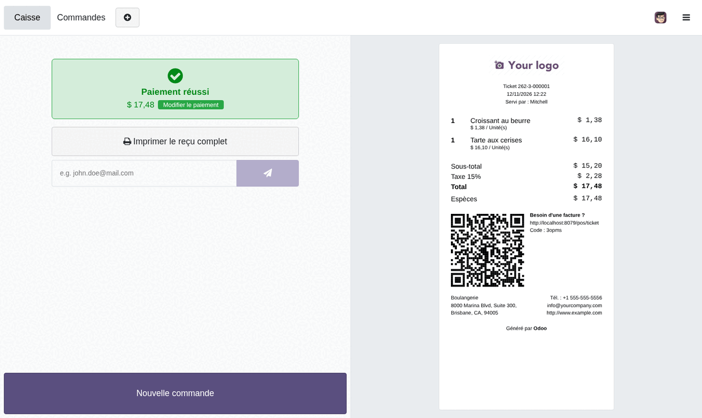

### ✍️ À vous — Exercice 7.2

**La première matinée.**

1. Ouvrez la caisse *Boutique Sablon* avec un fond de caisse de **150 €**.
2. Vente 1 : 2 × Café Maison moulu + 1 sac kraft. Le client paie avec un **billet de 20 €**. Combien rendez-vous ?
3. Vente 2 : 1 Café Éthiopie, payé par **carte**.

👉 [Réponse commentée](reponses/07-point-de-vente.md#exercice-72)

---

## 5. Client, remise et facture

- **Client** : choisir (ou créer) un client avant le paiement. Indispensable pour lui faire une facture
  ou pour un programme de fidélité.
- **Remise** : sélectionner la ligne → bouton **%** → taper le pourcentage.
- **Facture** : sur l'écran de paiement, activer **Facture**. Odoo crée une vraie facture au nom du client,
  que l'on peut imprimer ou envoyer.

### ✍️ À vous — Exercice 7.3

Le gérant du **Café du Sablon** passe à la boutique et achète 5 Café Brésil. Il a droit à **10 % de remise**
et veut une **facture** pour sa comptabilité. Il paie par carte.

👉 [Réponse commentée](reponses/07-point-de-vente.md#exercice-73)

---

## 6. Rembourser

Un client revient avec un article : **Commandes** (en haut de l'écran de caisse) → retrouver la vente →
sélectionner la ligne → **Rembourser**. Odoo crée une commande avec une quantité négative ; on rend l'argent
avec le moyen de paiement choisi.

### ✍️ À vous — Exercice 7.4

Le client de la vente 1 revient : un des deux Café Maison moulu ne lui convient pas. Remboursez-le en espèces.

👉 [Réponse commentée](reponses/07-point-de-vente.md#exercice-74)

---

## 7. Fermer la caisse

En fin de journée : menu **≡** (en haut à droite de l'écran de caisse) → **Fermer la caisse**.
Odoo affiche le résumé de la session et demande de **compter les espèces** du tiroir.

| | |
|---|---|
| Fond de caisse | 150,00 € |
| + ventes en espèces | … |
| − remboursements en espèces | … |
| = **Espèces attendues** | Calculé par Odoo |
| **Espèces comptées** | Saisi par le vendeur |
| **Différence** | Doit être 0. Sinon, elle est enregistrée et visible par le responsable |

Après la fermeture, Odoo :
- **sort du stock** tous les produits vendus (une livraison par session ou par commande) ;
- **comptabilise** les ventes et les paiements (une écriture regroupée par session, plus les factures demandées).

Les sessions et les commandes se retrouvent dans le back-office :

| Commandes | Sessions |
|---|---|
| 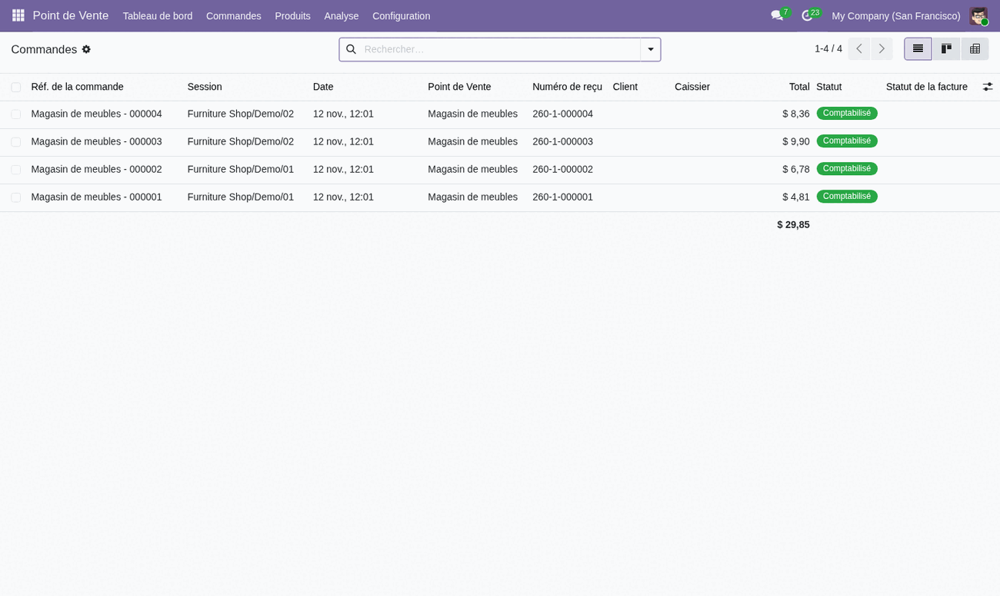 | 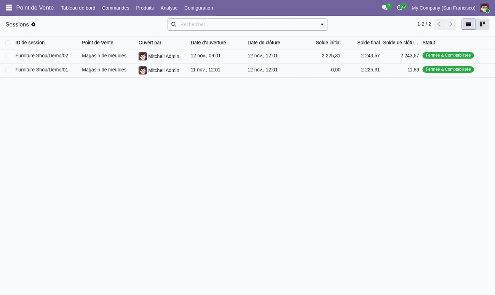 |

### ✍️ À vous — Exercice 7.5

Fermez la session. En comptant le tiroir, vous trouvez **2 € de moins** que prévu.

1. Que fait Odoo de cette différence ?
2. Où voir que le stock a diminué ?
3. Où retrouver la facture du Café du Sablon (exercice 7.3) ?

👉 [Réponse commentée](reponses/07-point-de-vente.md#exercice-75)

---

## 🔍 Enquête

**« Le nouveau café n'est pas dans la caisse ! »** Karim a créé le *Café Colombie grains 1 kg* ce matin, avec un prix
et une photo. Le vendeur, qui a ouvert la caisse à 9 h, ne le trouve pas, même en le cherchant par son nom.
Quelles sont les causes possibles ?

👉 [Explication](reponses/07-point-de-vente.md#enquête)

---

## 🏁 Défi du chapitre — Exercice 7.6

**Une journée complète.** Simulez une journée de la boutique, avec au moins 6 ventes (espèces, carte, une remise,
une facture, un remboursement). Puis, côté back-office :
1. Quel est le chiffre d'affaires de la journée, par moyen de paiement ?
2. Quel produit s'est le mieux vendu ?
3. Le stock du site web (chapitre 6) a-t-il été impacté par les ventes en boutique ? Pourquoi ?

👉 [Réponse commentée](reponses/07-point-de-vente.md#exercice-76)

---

## 📁 Dans votre projet

1. Votre client vend-il au comptoir ? Combien de caisses, dans combien de magasins ?
2. Quels moyens de paiement accepte-t-il ? A-t-il besoin de terminaux de paiement connectés ?
3. Quels produits doivent être vendus en caisse, et dans quelles catégories ?
4. Est-ce un restaurant (tables, envoi en cuisine) ? Le module **Restaurant** est disponible en Community.

---

## Questions de compréhension

1. Qu'est-ce qu'une session de point de vente ?
2. À quoi sert le fond de caisse ?
3. Pourquoi faut-il choisir un client pour pouvoir faire une facture ?
4. Que fait Odoo d'une différence de caisse à la fermeture ?
5. Quand le stock est-il mis à jour pour une vente en caisse ?
6. Pourquoi un produit créé pendant une session peut-il ne pas apparaître en caisse ?

---

[⬅ Chapitre 6](06-ecommerce.md) · [Sommaire](README.md) · [Chapitre 8 ➡](08-rh.md)
