# Chapitre 8 — Ressources humaines

[⬅ Chapitre 7](07-point-de-vente.md) · [Sommaire](README.md) · [Chapitre 9 ➡](09-tableaux-de-bord.md)

## Objectifs

À la fin de ce chapitre, vous savez :
- organiser l'entreprise en départements et créer les fiches employés ;
- gérer les droits aux congés, les demandes et leur approbation ;
- suivre un recrutement, de l'offre d'emploi à l'embauche ;
- traiter une dépense d'employé, de la note de frais au remboursement ;
- enregistrer les présences.

> Applications nécessaires : **Employés**, **Congés**, **Recrutement**, **Dépenses**, **Présences**.
> 🔒 La **Paie**, les **Évaluations**, le **Planning** et la **Signature** électronique sont en Enterprise.

---

## 1. Les employés et les départements

**Employés → Employés**

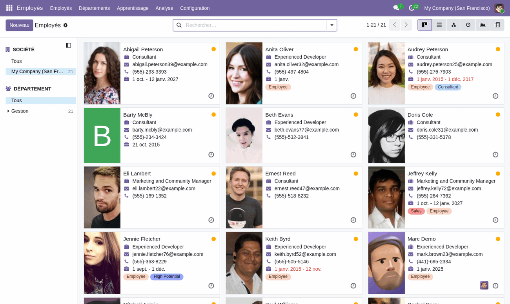

La fiche employé contient tout ce qui concerne la personne dans l'entreprise :

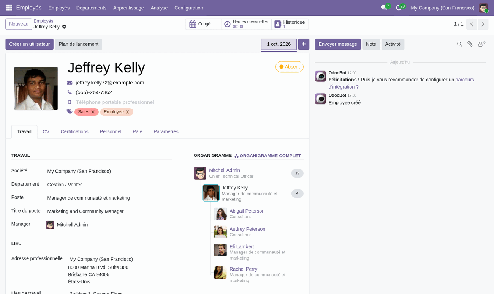

| Onglet | Contenu |
|---|---|
| **Travail** | Département, poste, **manager**, lieu de travail, horaire, organigramme |
| **CV** | Expériences, formations, **compétences** |
| **Personnel** | Adresse privée, contact d'urgence, situation familiale, numéro national (données sensibles, accès restreint) |
| **Paramètres** | **Utilisateur lié**, badge, code PIN |

> ⚠️ **Employé ≠ utilisateur.** Un **employé** est une personne qui travaille dans l'entreprise. Un **utilisateur**
> est quelqu'un qui se connecte à Odoo. Un vendeur en boutique peut être employé sans être utilisateur (il utilise
> la caisse avec un code PIN). Le lien entre les deux se fait dans l'onglet **Paramètres** de l'employé.

**Employés → Départements** :

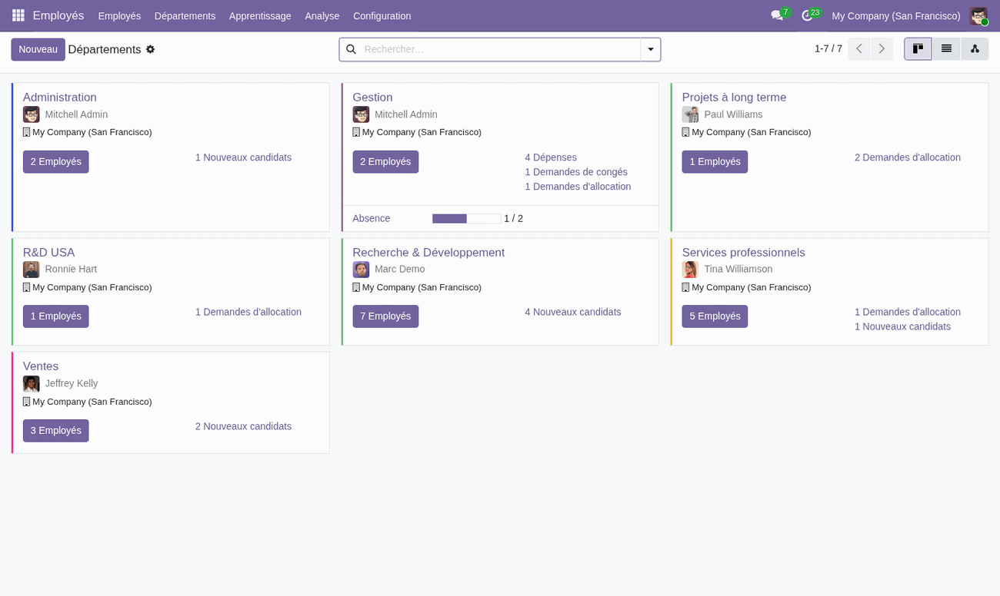

Le **manager** d'un département est celui qui, par défaut, **approuve** les congés et les dépenses de son équipe.

### ✍️ À vous — Exercice 8.1

**L'équipe de Torréfaction Sablon.**

1. Créez trois départements : **Direction** (manager : Sophie), **Production** (manager : Sophie),
   **Vente** (manager : Karim).
2. Créez les 8 employés de l'entreprise (voir le [fil rouge](README.md)), avec leur département, leur poste et leur manager.
3. Liez les employés Sophie, Karim, Lucas et Inès aux **utilisateurs** créés au chapitre 1.

**Pour vérifier :**
- [ ] L'organigramme d'un vendeur montre Karim au-dessus de lui, puis Sophie.
- [ ] Le département Vente compte le bon nombre d'employés.

👉 [Réponse commentée](reponses/08-rh.md#exercice-81)

---

## 2. Les congés

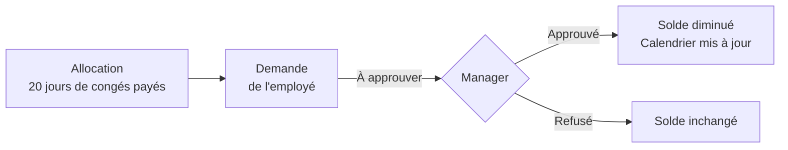

| Notion | Signification |
|---|---|
| **Type de congé** | Congés payés, maladie, compensation… Chaque type dit s'il faut une **allocation** et qui **approuve** |
| **Allocation** | Le nombre de jours auxquels l'employé a droit pour un type (ex. 20 jours de congés payés pour l'année) |
| **Demande** | L'employé demande des jours ; ils sont déduits de son solde une fois approuvés |
| **Jours fériés** | Non comptés dans la durée d'un congé |

L'employé voit ses soldes et fait ses demandes depuis **Congés → Mon temps → Tableau de bord** :

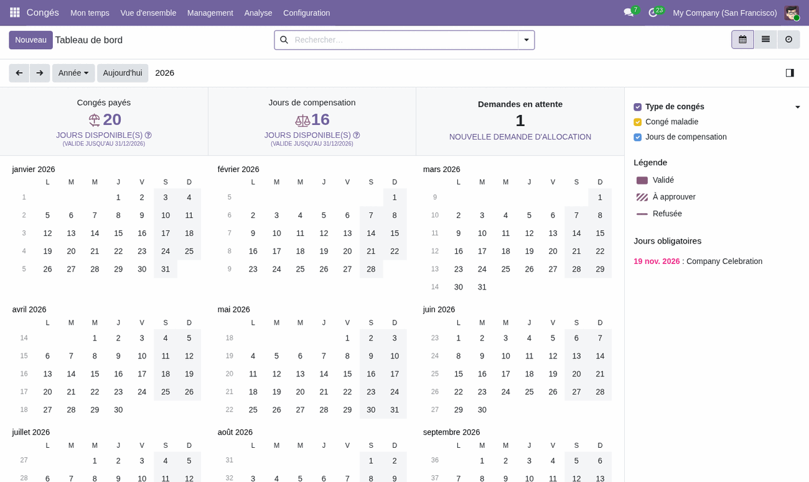

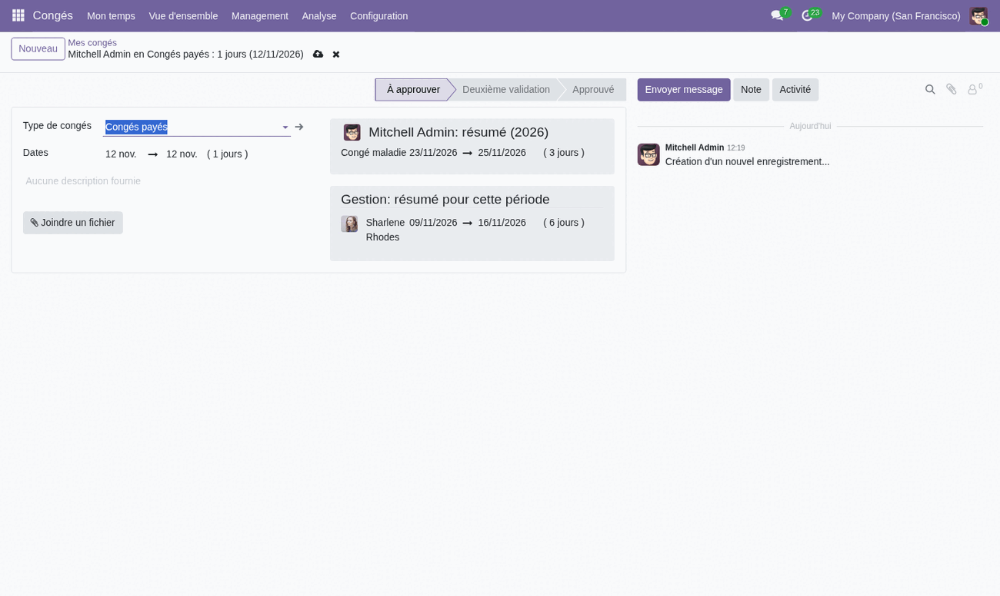

Le manager voit les demandes à approuver dans **Congés → Management → Congés**, et l'équipe entière dans la **Vue d'ensemble** :

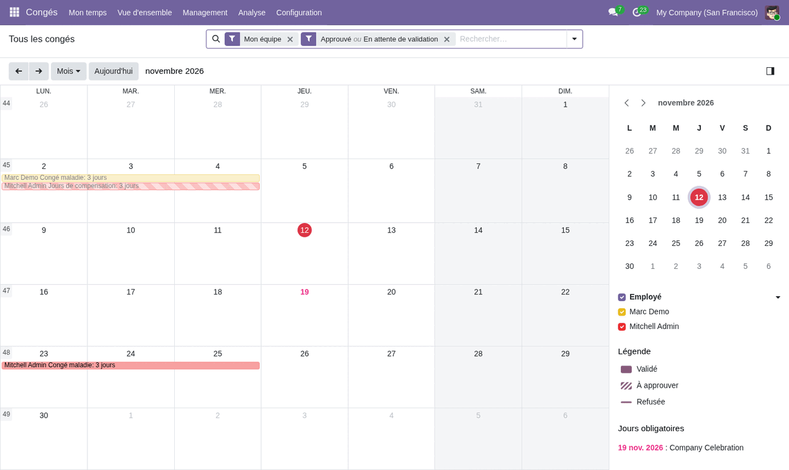

### ✍️ À vous — Exercice 8.2

**Les congés de l'équipe.**

1. Donnez **20 jours de congés payés** pour l'année à tous les employés, en une seule fois.
2. Ajoutez deux jours fériés : le **21 juillet** (Fête nationale) et le **15 août**.
3. Connecté en tant que **Lucas**, demandez 4 jours de congés payés du lundi au jeudi de la semaine du 15 août.
4. Connecté en tant que **Sophie**, approuvez la demande.

**Pour vérifier :**
- [ ] La demande ne compte que **3 jours** (le 15 août est férié).
- [ ] Le solde de Lucas passe à 17 jours.
- [ ] Le congé apparaît dans la vue d'ensemble.

👉 [Réponse commentée](reponses/08-rh.md#exercice-82)

---

## 3. Le recrutement

**Recrutement** s'ouvre sur les **postes** ouverts :

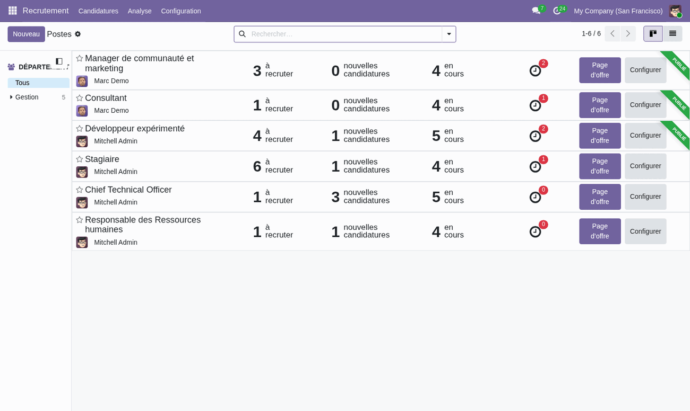

Chaque candidature avance dans un **pipeline** d'étapes : *Nouveau → Qualification → Premier entretien → Second entretien →
Proposition de contrat → Contrat signé*.

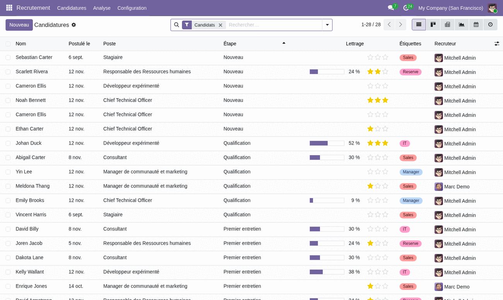

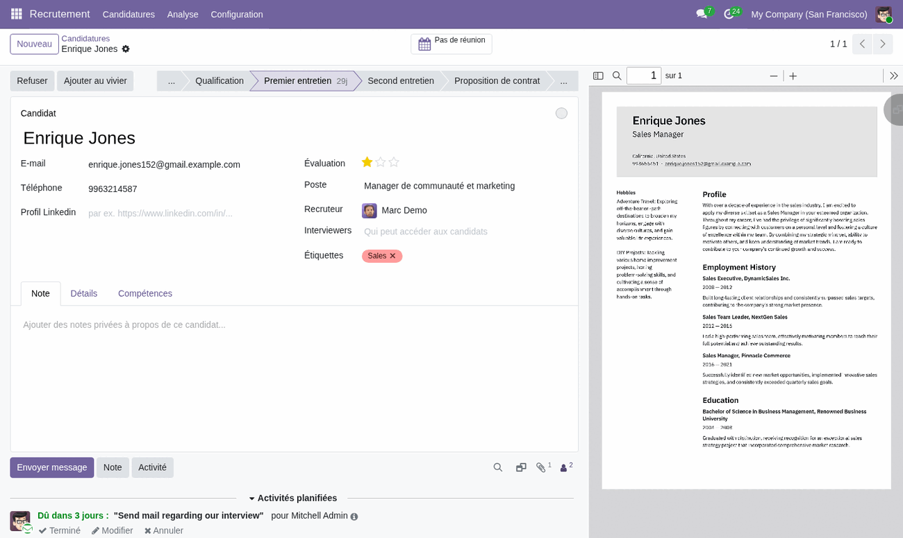

Le poste peut être publié sur le **site web** (bouton **Page d'offre**) : les candidats postulent en ligne, et leur candidature
arrive directement dans le pipeline, avec leur CV en pièce jointe. Quand le contrat est signé, **Créer un employé** transforme
le candidat en employé, sans ressaisie.

### ✍️ À vous — Exercice 8.3

**Recruter un vendeur.** La boutique a besoin d'un **vendeur à mi-temps**.

1. Créez le poste **Vendeur en boutique** (département Vente, 1 personne à recruter) et publiez-le sur le site.
2. En navigation privée, postulez comme un candidat, avec un CV (n'importe quel PDF).
3. Faites avancer la candidature jusqu'à **Contrat signé**, puis créez l'employé.
4. Refusez un autre candidat avec un motif.

**Pour vérifier :**
- [ ] L'offre est visible sur le site, page `/jobs`.
- [ ] Le nouvel employé est dans le département Vente, avec le bon poste.

👉 [Réponse commentée](reponses/08-rh.md#exercice-83)

---

## 4. Les dépenses

Un employé avance de l'argent pour l'entreprise (repas client, train, matériel) : il enregistre une **dépense**,
qui suit ce chemin :

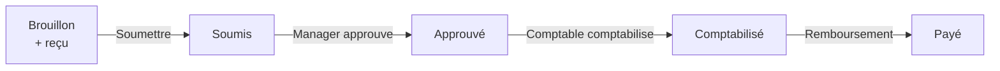

**Dépenses → Mes dépenses**

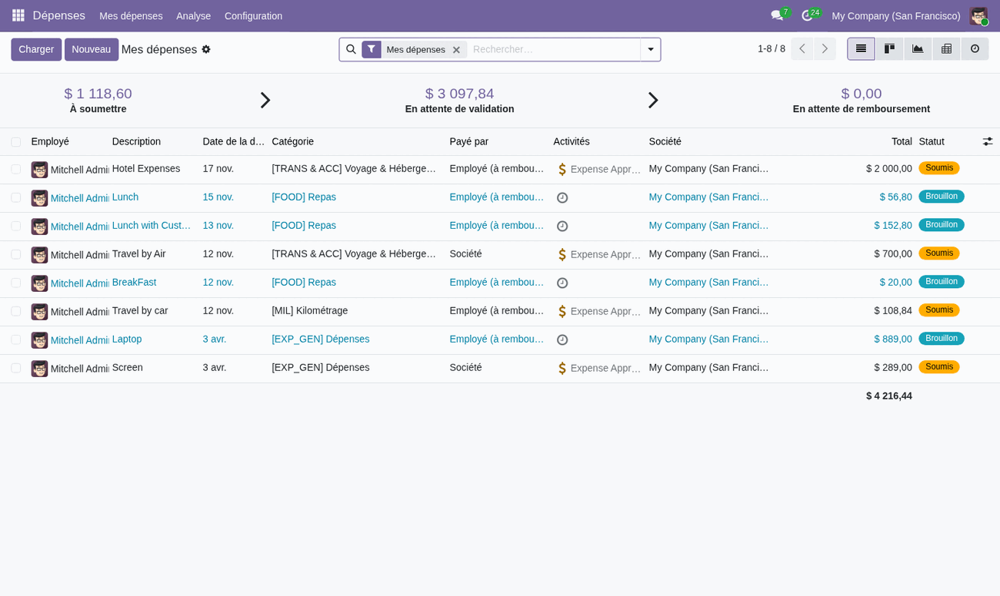

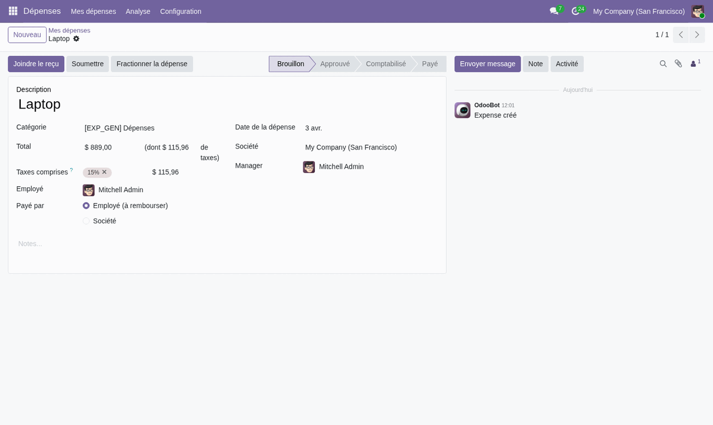

Le champ **Payé par** distingue une dépense payée par l'**employé** (à lui rembourser) d'une dépense payée avec une carte
de la **société** (rien à rembourser, mais à justifier).

### ✍️ À vous — Exercice 8.4

**Un déjeuner client.** Karim a invité le gérant d'un nouveau restaurant à déjeuner : **54 €**, payés avec sa carte personnelle.

1. En tant que Karim, encodez la dépense avec une photo du ticket, et soumettez-la.
2. Qui doit l'approuver ? Faites-le.
3. En tant qu'Inès (comptable), comptabilisez-la et remboursez Karim.

👉 [Réponse commentée](reponses/08-rh.md#exercice-84)

---

## 5. Les présences

**Présences** enregistre les heures d'arrivée et de départ. Les employés pointent :
- depuis Odoo (icône de présence en haut de l'écran) ;
- ou sur une tablette en **mode kiosque**, à l'entrée de l'atelier, avec leur badge ou un code PIN.

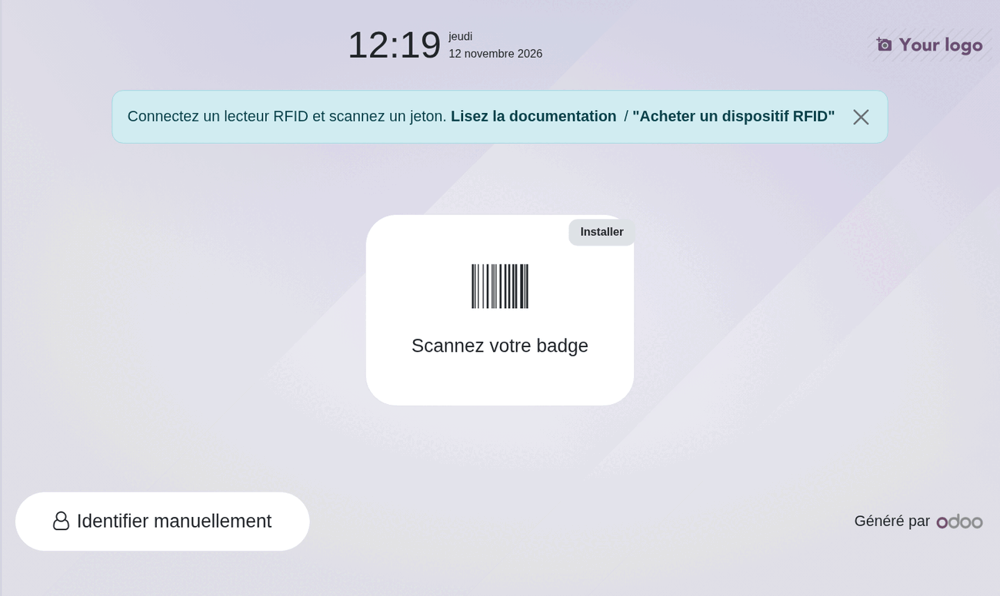

**Présences → Gestion** : les heures travaillées par employé, et les heures supplémentaires.

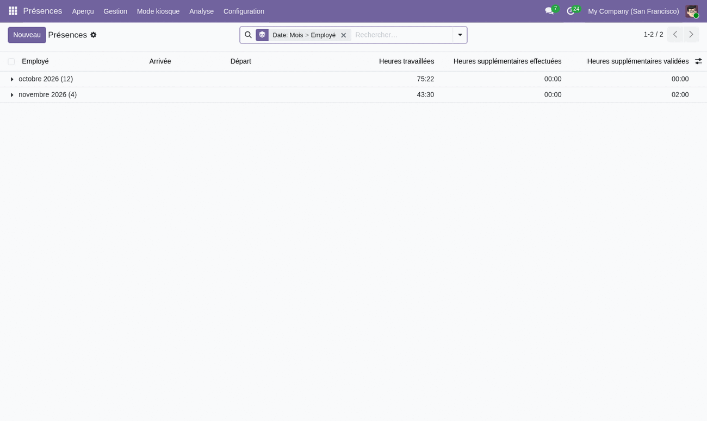

### ✍️ À vous — Exercice 8.5

1. Ouvrez le **mode kiosque** et faites pointer deux employés (arrivée, puis départ).
2. Retrouvez leurs heures travaillées dans **Présences → Gestion**.

👉 [Réponse commentée](reponses/08-rh.md#exercice-85)

---

## 🔍 Enquête

**« Je n'ai droit à rien ! »** Le nouveau vendeur recruté à l'exercice 8.3 veut poser un jour de congé payé.
Il ouvre **Congés** et voit **0 jour disponible**. Il ne comprend pas : tout le monde a 20 jours.
Quelles sont les causes possibles ?

👉 [Explication](reponses/08-rh.md#enquête)

---

## 🏁 Défi du chapitre — Exercice 8.6

**L'arrivée d'un nouveau torréfacteur.** Organisez toute l'arrivée d'un nouvel employé, de façon à ce que, le premier jour :
- il existe comme employé, dans le bon département, avec son manager ;
- il peut pointer au kiosque ;
- il a droit à ses congés (au prorata : il arrive le 1er juillet) ;
- il peut encoder une dépense qui sera approuvée par la bonne personne.

Listez les étapes **dans l'ordre**, et indiquez pour chacune l'application utilisée.

👉 [Réponse commentée](reponses/08-rh.md#exercice-86)

---

## 📁 Dans votre projet

1. Combien d'employés a votre client, dans quels départements ? Qui approuve quoi ?
2. Quels types de congés utilise-t-il ? Lesquels nécessitent une allocation ?
3. A-t-il besoin du recrutement, des dépenses, des présences ?
4. A-t-il besoin de la paie (🔒 Enterprise) ? Sinon, comment est-elle gérée aujourd'hui (secrétariat social) ?

---

## Questions de compréhension

1. Quelle est la différence entre un employé et un utilisateur ?
2. Quel rôle joue le manager d'un département dans les congés et les dépenses ?
3. Qu'est-ce qu'une allocation de congés ? Quand est-elle nécessaire ?
4. Pourquoi un jour férié n'est-il pas déduit d'une demande de congé ?
5. Que se passe-t-il quand on clique sur **Créer un employé** depuis une candidature ?
6. Quelle est la différence entre une dépense « payée par l'employé » et « payée par la société » ?

---

[⬅ Chapitre 7](07-point-de-vente.md) · [Sommaire](README.md) · [Chapitre 9 ➡](09-tableaux-de-bord.md)
