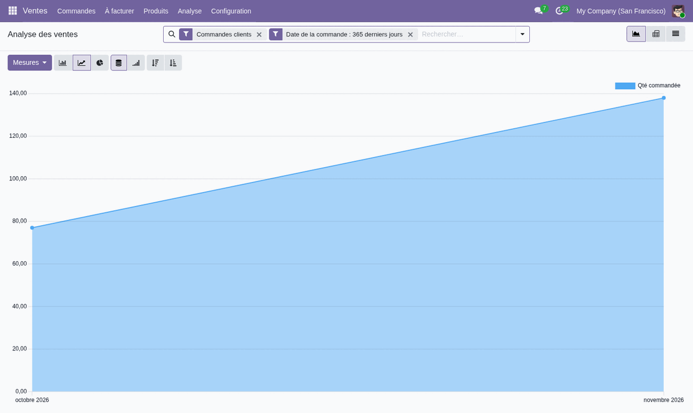
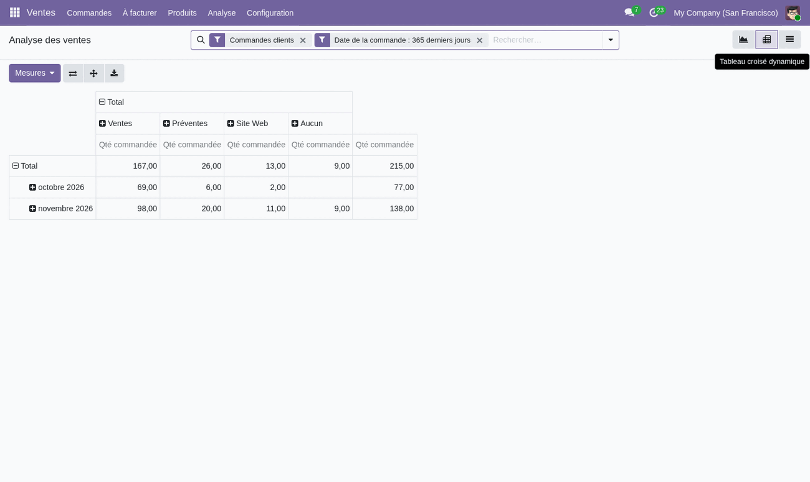
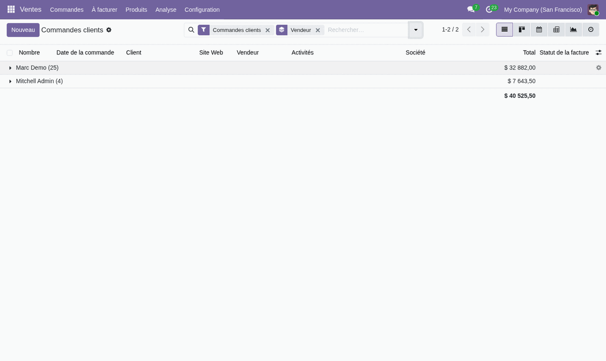
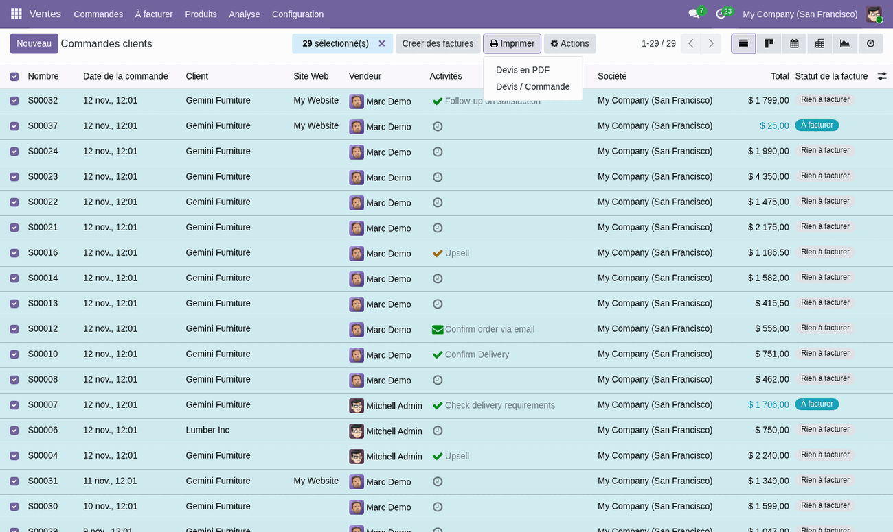
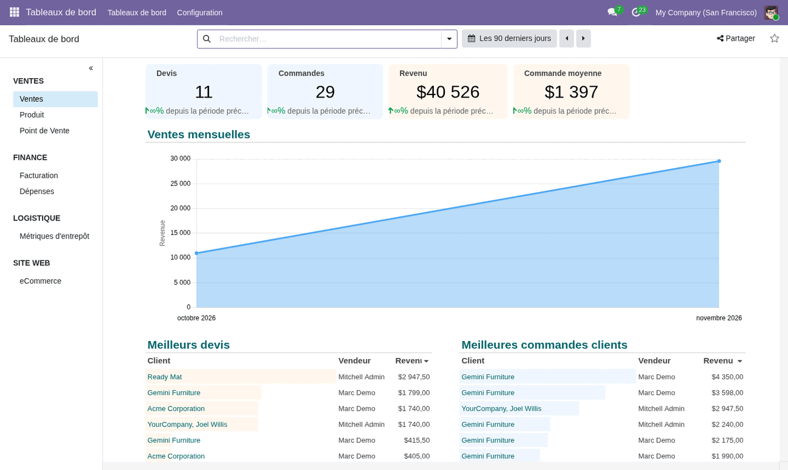
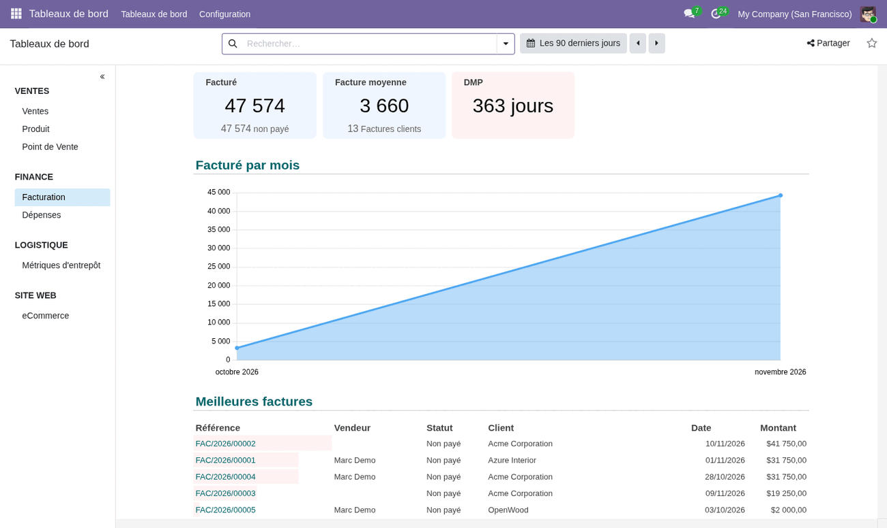
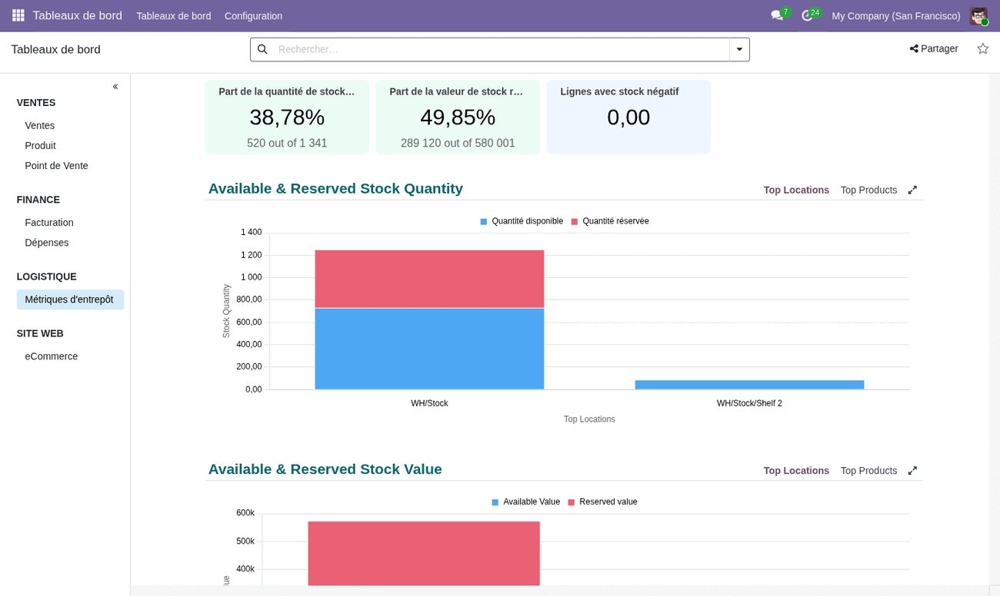

# Chapitre 9 — Tableaux de bord et analyses

[⬅ Chapitre 8](08-rh.md) · [Sommaire](README.md)

## Objectifs

À la fin de ce chapitre, vous savez :
- utiliser les menus **Analyse** de chaque application ;
- construire un graphique et un tableau croisé (pivot) ;
- filtrer, regrouper, enregistrer et partager une analyse ;
- exporter des données vers Excel ;
- lire les tableaux de bord de l'application **Tableaux de bord** ;
- choisir les bons indicateurs (KPI) pour un dirigeant.

> Application : **Tableaux de bord** (installée automatiquement avec les applications métier).
> 🔒 La création et la modification de tableaux de bord sous forme de feuilles de calcul (Odoo Spreadsheet) sont en Enterprise.
> En Community, on **consulte** les tableaux de bord fournis, et on construit ses analyses avec les vues graphique et pivot.

---

## 1. Toute donnée est analysable

Un ERP enregistre chaque vente, chaque mouvement de stock, chaque facture. C'est une mine d'or pour piloter l'entreprise,
à condition de savoir l'interroger.

Chaque application a un menu **Analyse** :

| Application | Menu | Question typique |
|---|---|---|
| CRM | Analyse → Pipeline | Combien de ventes en préparation ? Quel taux de transformation ? |
| Ventes | Analyse → Ventes | Quel chiffre d'affaires par mois, par vendeur, par produit ? |
| Facturation | Analyse → Gestion → Analyse des factures | Combien a-t-on réellement facturé ? À qui ? |
| Inventaire | Analyse → Stock / Analyse des mouvements | Quelle valeur de stock ? Quels produits bougent le plus ? |
| Point de Vente | Analyse → Commandes | Quel chiffre en boutique, par jour, par vendeur ? |
| Site Web | Analyse → Ventes en ligne | Que vend-on sur le site ? |

---

## 2. La vue graphique

**Ventes → Analyse → Ventes** s'ouvre en graphique :

| Réglage | Où |
|---|---|
| **Mesure** : ce qu'on compte (montant HT, quantité, nombre de commandes…) | Bouton **Mesures** |
| **Type** : barres, lignes, secteurs | Icônes à côté de Mesures |
| **Regroupement** : l'axe (par mois, par vendeur…) | Recherche → **Regrouper par** |
| **Empilé** | Icône dans la barre du graphique, quand il y a deux regroupements |
| **Période** | Recherche → filtre de date |

### ✍️ À vous — Exercice 9.1

Dans la base de démo, avec **Ventes → Analyse → Ventes** :

1. Affichez le **montant HT** vendu **par mois**, en **barres**, sur l'année en cours.
2. Ajoutez un second regroupement **par vendeur**, en barres **empilées**.
3. Quel vendeur a vendu le plus le mois dernier ?

👉 [Réponse commentée](reponses/09-tableaux-de-bord.md#exercice-91)

---

## 3. Le tableau croisé (pivot)

Le **pivot** croise deux dimensions dans un tableau, comme un tableau croisé dynamique d'Excel :

- Cliquez sur un en-tête de **ligne** ou de **colonne** (`⊕ Total`) pour le **déplier** selon un critère.
- **Mesures** : choisir une ou plusieurs valeurs à afficher.
- Boutons de la barre : **inverser** lignes et colonnes, **tout déplier**, **télécharger en Excel** (`.xlsx`).
- Cliquez sur une **cellule** : Odoo ouvre la liste des enregistrements qui la composent.

### ✍️ À vous — Exercice 9.2

Construisez un pivot : **clients** en lignes, **catégories de produit** en colonnes, mesures **Montant HT** et
**Quantité commandée**. Téléchargez-le en Excel.

Cliquez ensuite sur la cellule la plus élevée : quelles commandes la composent ?

👉 [Réponse commentée](reponses/09-tableaux-de-bord.md#exercice-92)

---

## 4. Regrouper, enregistrer, exporter

### La liste regroupée

La vue **liste** permet aussi d'analyser : **Regrouper par** affiche des sous-totaux par groupe.

### Les favoris

Une analyse utile se garde : recherche → **Favoris → Enregistrer la recherche actuelle**. Elle garde les filtres,
les regroupements, la vue et les mesures. Avec **Partager avec tous les utilisateurs**, toute l'équipe en profite.

### L'export

Sélectionnez des lignes (ou toutes, avec la case de l'en-tête) → **Actions → Exporter** :
on choisit les colonnes, et Odoo génère un fichier Excel.

> 💡 L'export est pratique pour un calcul ponctuel. Mais si on exporte la même chose chaque semaine,
> c'est qu'il manque un **favori** ou un tableau de bord. L'objectif d'un ERP est que les chiffres soient dans l'ERP.

### ✍️ À vous — Exercice 9.3

1. Dans **Facturation → Clients → Factures**, affichez les factures **non payées**, regroupées par **client**,
   et enregistrez-les en favori partagé « Encours clients ».
2. Exportez cette liste avec les colonnes : client, numéro, date d'échéance, montant dû.

👉 [Réponse commentée](reponses/09-tableaux-de-bord.md#exercice-93)

---

## 5. L'application Tableaux de bord

L'application **Tableaux de bord** regroupe des tableaux tout faits, par domaine : Ventes, Produits, Point de Vente,
Facturation, Dépenses, Métriques d'entrepôt, eCommerce…

En haut, des **indicateurs clés** (KPI) comparés à la période précédente. En dessous, des graphiques et des classements.
Le filtre de **période** en haut s'applique à tout le tableau.

| Facturation | Métriques d'entrepôt |
|---|---|
|  |  |

Un clic sur une valeur ou un graphique ouvre les enregistrements correspondants.

### ✍️ À vous — Exercice 9.4

Dans le tableau de bord **Ventes** :
1. Quel est le panier moyen (commande moyenne) sur les 90 derniers jours ? Est-il en hausse ou en baisse ?
2. Qui sont les trois meilleurs clients ?

Dans le tableau de bord **Facturation** :
3. Que signifie l'indicateur **DMP** ? Pourquoi un dirigeant le surveille-t-il ?

👉 [Réponse commentée](reponses/09-tableaux-de-bord.md#exercice-94)

---

## 6. Choisir les bons indicateurs

Un tableau de bord n'a de valeur que s'il aide à **décider**. Quelques indicateurs classiques :

| Domaine | Indicateur | Question à laquelle il répond |
|---|---|---|
| Ventes | Chiffre d'affaires, panier moyen | Vend-on plus ? Mieux ? |
| Ventes | Taux de transformation des devis | Nos devis sont-ils acceptés ? |
| Facturation | Encours clients, délai moyen de paiement (DMP) | Nos clients paient-ils à temps ? |
| Stock | Valeur du stock, ruptures | A-t-on trop, ou pas assez ? |
| Point de vente | Chiffre par jour, par vendeur | Quels jours et quels vendeurs performent ? |
| RH | Absentéisme, postes ouverts | L'équipe est-elle au complet ? |

> Un bon KPI est **mesurable dans Odoo**, **compris** par celui qui le lit, et **lié à une action**
> (« si le DMP dépasse 45 jours, on relance »).

---

## 🔍 Enquête

**« Les chiffres ne correspondent pas ! »** La gérante compare le chiffre d'affaires d'octobre dans
**Ventes → Analyse** (42 000 €) et dans **Facturation → Analyse des factures** (38 500 €).
Elle pense qu'il y a une erreur dans Odoo. Quelles sont les explications possibles ?

👉 [Explication](reponses/09-tableaux-de-bord.md#enquête)

---

## 🏁 Défi du chapitre — Exercice 9.5

**Le tableau de bord du lundi.** Chaque lundi, la gérante de Torréfaction Sablon veut voir en 5 minutes :
1. les ventes de la semaine passée, par canal (site web, boutique, restaurants) ;
2. les factures clients en retard de paiement ;
3. les produits sous leur stock minimum ;
4. l'évolution du chiffre d'affaires mois par mois cette année.

Préparez-lui ces quatre analyses en **favoris partagés**, et expliquez en une phrase à quoi sert chacune.

👉 [Réponse commentée](reponses/09-tableaux-de-bord.md#exercice-95)

---

## 📁 Dans votre projet

1. Quels sont les 5 indicateurs que votre client regarde (ou devrait regarder) chaque semaine ?
2. Pour chacun : dans quelle application, quelle vue, quels filtres ?
3. Lesquels sont déjà dans l'application Tableaux de bord ? Lesquels faut-il construire en favoris ?

---

## Questions de compréhension

1. Quelle est la différence entre la vue graphique et la vue pivot ?
2. Que se passe-t-il quand on clique sur une cellule d'un pivot ?
3. Pourquoi le chiffre d'affaires des ventes et celui des factures peuvent-ils différer ?
4. Qu'est-ce qu'un favori partagé, et pourquoi est-ce mieux qu'un export Excel hebdomadaire ?
5. Que peut-on faire et ne pas faire avec l'application Tableaux de bord en Community ?
6. Qu'est-ce qu'un bon KPI ?

---

[⬅ Chapitre 8](08-rh.md) · [Sommaire](README.md)
