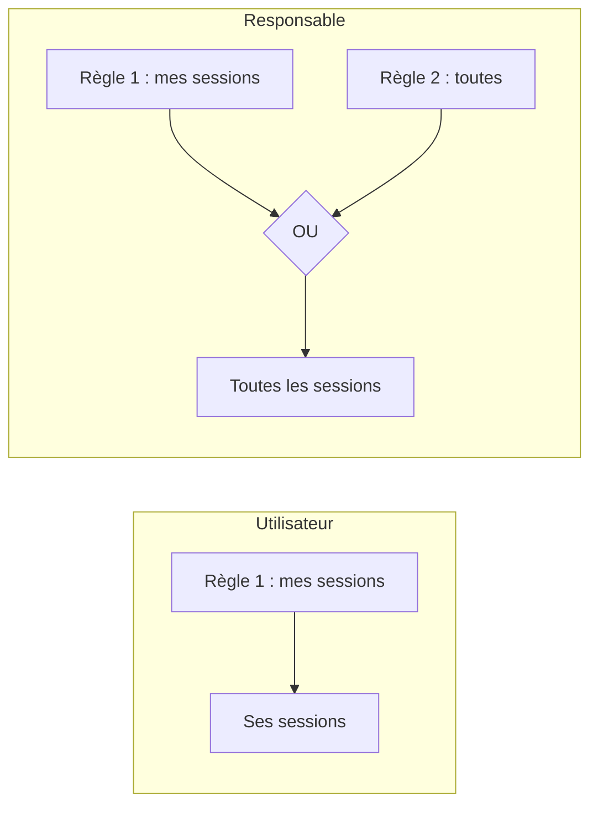

# Réponses — Chapitre 9

[⬅ Retour au chapitre](../chapitres/09-securite.md)

---

## Exercice 9.1

**Groupes et droits d'accès.**

### `security/security.xml`

```xml
<?xml version="1.0" encoding="utf-8"?>
<odoo>
    <!--
        La catégorie : elle regroupe les groupes de notre application.
        Dans le formulaire utilisateur, Odoo affiche une ligne "Open Academy"
        avec une liste déroulante : (vide) / Utilisateur / Responsable.
    -->
    <record id="module_category_openacademy" model="ir.module.category">
        <field name="name">Open Academy</field>
        <field name="sequence">50</field>
    </record>

    <record id="group_openacademy_user" model="res.groups">
        <field name="name">Utilisateur</field>
        <field name="category_id" ref="module_category_openacademy"/>
        <!-- Un utilisateur Open Academy est forcément un utilisateur interne -->
        <field name="implied_ids" eval="[(4, ref('base.group_user'))]"/>
    </record>

    <record id="group_openacademy_manager" model="res.groups">
        <field name="name">Responsable</field>
        <field name="category_id" ref="module_category_openacademy"/>
        <!--
            implied_ids : les groupes donnés automatiquement avec celui-ci.
            (4, id) est une COMMANDE Many2many : "ajouter le lien vers id".
            ref('...') : convertit un XML ID en id numérique.
            → Un responsable est aussi utilisateur : il cumule les deux jeux de droits.
        -->
        <field name="implied_ids" eval="[(4, ref('group_openacademy_user'))]"/>
        <!-- Bonus : l'administrateur devient responsable à l'installation -->
        <field name="users" eval="[(4, ref('base.user_admin'))]"/>
    </record>
</odoo>
```

### `security/ir.model.access.csv`

```csv
id,name,model_id:id,group_id:id,perm_read,perm_write,perm_create,perm_unlink
access_session_user,session user,model_openacademy_session,group_openacademy_user,1,1,1,1
access_course_user,course user,model_openacademy_course,group_openacademy_user,1,0,0,0
access_course_manager,course manager,model_openacademy_course,group_openacademy_manager,1,1,1,1
```

Lecture ligne par ligne :
1. Les **utilisateurs** peuvent tout faire sur les **sessions**.
2. Les **utilisateurs** peuvent seulement **lire** les **cours**.
3. Les **responsables** peuvent tout faire sur les **cours**.

**Pas besoin** de ligne « responsable / session » : le responsable est aussi utilisateur (`implied_ids`),
il a donc déjà la ligne 1. Les droits sont **cumulatifs**.

Les anciennes lignes avec `base.group_user` (chapitre 4) doivent être **supprimées** :
sinon tous les utilisateurs internes garderaient un accès complet aux cours.

### `__manifest__.py`

```python
'data': [
    'security/security.xml',          # 1. les groupes
    'security/ir.model.access.csv',   # 2. les droits, qui utilisent les groupes
    # ... vues, menus ...
],
```

L'ordre est obligatoire : le CSV référence `group_openacademy_user`, qui doit déjà exister.

### Et le menu ?

Optionnel mais propre : réserver le menu racine aux membres du groupe.

```xml
<menuitem id="menu_root" name="Open Academy"
          groups="openacademy.group_openacademy_user"/>
```

---

## Exercice 9.2

**Règles d'enregistrement.**

### `security/security.xml` (ajouts)

```xml
<!-- Règle 1 : un utilisateur ne voit que les sessions dont il est le professeur -->
<record id="rule_session_user_own" model="ir.rule">
    <field name="name">Session : mes sessions (professeur)</field>
    <field name="model_id" ref="model_openacademy_session"/>
    <!-- groups : la règle ne s'applique qu'aux membres de ce groupe (règle "de groupe") -->
    <field name="groups" eval="[(4, ref('group_openacademy_user'))]"/>
    <!--
        domain_force : la condition que chaque session doit remplir pour être accessible.
        instructor_id pointe vers res.partner ; user est un res.users.
        user.partner_id.id = l'id du CONTACT de l'utilisateur connecté.
    -->
    <field name="domain_force">[('instructor_id', '=', user.partner_id.id)]</field>
</record>

<!-- Règle 2 : un responsable voit tout -->
<record id="rule_session_manager_all" model="ir.rule">
    <field name="name">Session : toutes (responsable)</field>
    <field name="model_id" ref="model_openacademy_session"/>
    <field name="groups" eval="[(4, ref('group_openacademy_manager'))]"/>
    <!-- (1, '=', 1) : une condition toujours vraie = "aucun filtre" -->
    <field name="domain_force">[(1, '=', 1)]</field>
</record>
```

### Pourquoi la règle 2 est nécessaire

Le responsable est **aussi** utilisateur (via `implied_ids`). Sans la règle 2, seule la règle 1 s'appliquerait
à lui : il ne verrait que ses propres sessions.

Les règles **de groupe** s'**unissent** (OU) : pour un responsable, Odoo combine
« mes sessions » **OU** « toutes » = toutes. Pour un simple utilisateur, seule la règle 1 s'applique.



### Même logique pour les cours

```xml
<record id="rule_course_user_own" model="ir.rule">
    <field name="name">Cours : mes cours (responsable du cours)</field>
    <field name="model_id" ref="model_openacademy_course"/>
    <field name="groups" eval="[(4, ref('group_openacademy_user'))]"/>
    <!-- responsible_id pointe vers res.users : on compare directement à user.id -->
    <field name="domain_force">[('responsible_id', '=', user.id)]</field>
</record>

<record id="rule_course_manager_all" model="ir.rule">
    <field name="name">Cours : tous (responsable)</field>
    <field name="model_id" ref="model_openacademy_course"/>
    <field name="groups" eval="[(4, ref('group_openacademy_manager'))]"/>
    <field name="domain_force">[(1, '=', 1)]</field>
</record>
```

> ⚠️ Effet de bord à tester : un professeur voit ses sessions, mais si le **cours** de la session
> ne lui appartient pas, il ne peut plus l'ouvrir. Il verra le nom du cours, mais un clic dessus
> donnera « Accès refusé ». C'est le genre de cas que le client doit valider.

> 💡 Les règles d'enregistrement **ne s'appliquent pas** à l'administrateur en mode superutilisateur.
> Testez toujours avec vos utilisateurs de test.

---

## Exercice 9.3

**Champ protégé.**

```python
    # groups sur le champ PYTHON : pour un non-responsable, le champ n'existe pas.
    # Il n'apparaît dans aucune vue, aucun export, aucun appel API.
    # Tenter de le lire ou de l'écrire lève une AccessError.
    password = fields.Char(
        string='Mot de passe',
        groups='openacademy.group_openacademy_manager',
    )
```

```xml
<!-- Dans le formulaire, rien de spécial : Odoo retire automatiquement
     le champ de la vue pour les utilisateurs qui n'y ont pas accès. -->
<field name="password" password="True"/>   <!-- password="True" : affiché avec des points -->
```

**Pourquoi pas seulement `groups` dans la vue ?** `<field name="password" groups="..."/>` masque le champ
à l'écran, mais un utilisateur peut toujours le lire via **Exporter**, via l'API ou dans un rapport.
Sur le champ Python, il est réellement protégé.

---

## Exercice 9.4

**Validation par un responsable.**

### `models/session.py`

```python
from odoo import fields, models
from odoo.exceptions import AccessError


class Session(models.Model):
    # ...

    state = fields.Selection(
        selection=[
            ('draft', 'Brouillon'),
            ('confirm', 'Confirmé'),
            ('review', 'À valider'),      # nouvel état
            ('done', 'Terminé'),
            ('cancel', 'Annulé'),
        ],
        default='draft', required=True, readonly=True, copy=False, tracking=True,
    )

    def action_submit(self):
        """L'utilisateur termine sa session : elle part en validation."""
        self.write({'state': 'review'})

    def action_done(self):
        """Seul un responsable valide définitivement."""
        # Vérification CÔTÉ SERVEUR : c'est elle qui protège réellement l'action.
        # has_group renvoie True si l'utilisateur appartient au groupe (directement ou via implied_ids).
        if not self.env.user.has_group('openacademy.group_openacademy_manager'):
            raise AccessError("Seul un responsable peut valider une session.")
        self.write({'state': 'done'})
```

### Formulaire

```xml
<header>
    <button name="action_confirm" type="object" string="Confirmer"
            class="btn-primary" invisible="state != 'draft'"/>

    <!-- Tout utilisateur peut soumettre -->
    <button name="action_submit" type="object" string="Terminer"
            class="btn-primary" invisible="state != 'confirm'"/>

    <!--
        groups : le bouton n'est même pas envoyé au navigateur des non-responsables.
        C'est du CONFORT (ne pas montrer un bouton inutilisable).
        La SÉCURITÉ est dans la méthode Python ci-dessus.
    -->
    <button name="action_done" type="object" string="Valider"
            class="btn-primary" invisible="state != 'review'"
            groups="openacademy.group_openacademy_manager"/>

    <field name="state" widget="statusbar" statusbar_visible="draft,confirm,review,done"/>
</header>
```

### Test depuis le shell

```python
>>> user = env['res.users'].search([('login', '=', 'user_test')])
>>> session = env['openacademy.session'].search([('state', '=', 'review')], limit=1)
>>> session.with_user(user).action_done()
AccessError: Seul un responsable peut valider une session.
```

Sans la vérification Python, cet appel aurait réussi, même si le bouton était caché : voilà pourquoi
**visibilité ≠ sécurité**.

---

[⬅ Retour au chapitre](../chapitres/09-securite.md)
